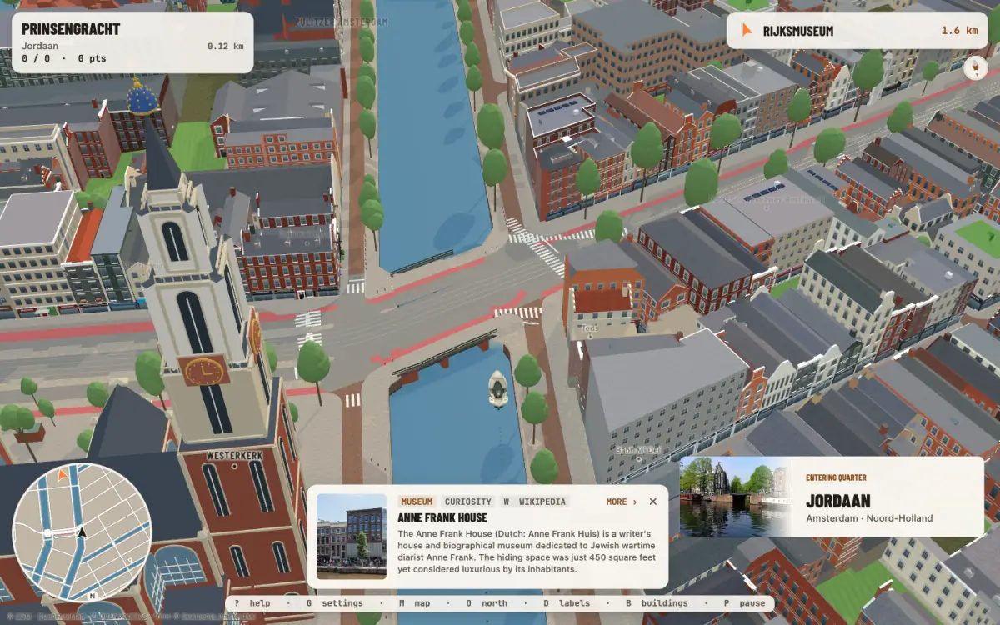
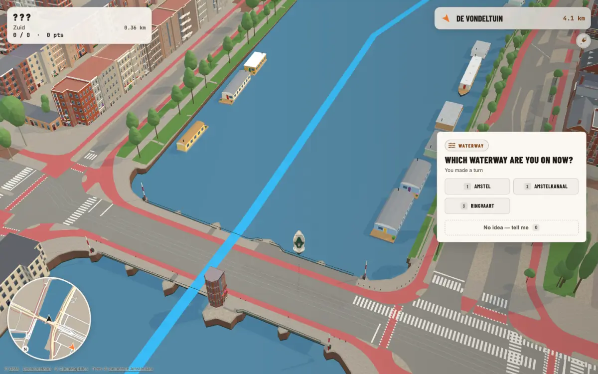

# Ride Amsterdam

**Learn Amsterdam by name.** Ride a bike or steer a boat through a 3D
Amsterdam built from open city data. Every street and canal you pass is a
question, and the map keeps the name to itself until you answer.

Play it at **[rideamsterdam.nl](https://rideamsterdam.nl)**. It's free, runs
in the browser on desktop or phone, and needs no account.



## What's in it

- **The ride** (`/ride`): cycle the streets or boat the canals to a
  destination. Street and canal names come up as questions along the way,
  with spaced review, so names you miss come back.
- **A city you can recognise:** 300+ hand-modelled landmarks (churches,
  museums, theatres, stations) and kit-built streets of canal houses and
  1890s blocks, all on real BAG footprints and 3DBAG heights.
- **Something to learn at every stop:** landmark and neighbourhood cards with
  sourced encyclopedia text, street-name origins from the city register,
  named bridges, themed tours and collectible destination stamps.
- **Map Quest** (`/quiz/`): a 2D map quiz with spaced repetition, for
  learning streets, neighbourhoods and places without riding.
- **Buildings explorer** (`/explore`): browse the modelled buildings.
- **Progress** (`/progress`): what you know, synced across devices if you
  sign in.



## Built from open data only

| Source | Used for |
| --- | --- |
| [OpenStreetMap](https://www.openstreetmap.org/copyright) | streets, canals, bridges, routing, POIs |
| [BAG](https://www.kadaster.nl/zakelijk/registraties/basisregistraties/bag) (CC0) | building footprints, addresses, street-name explanations |
| [3DBAG](https://3dbag.nl) (CC BY 4.0) | building heights and roof shapes |
| BGT, AHN (PDOK) | ground, roads, water, relief |
| Amsterdam panoramas (CC BY 4.0), Stadsarchief Beeldbank, RCE monument register | reference photos and descriptions for modelling |
| Wikipedia / Wikidata / Wikimedia Commons | encyclopedia text and images |
| OpenFreeMap / OpenMapTiles, Gemeente Amsterdam trees | basemap and street trees |

No Google or Apple imagery, and no third-party meshes. Every model is
original geometry in a flat-colour house style. The Amsterdam extracts are
cached and versioned in `public/data/extracts/`, so the game doesn't depend on
third-party APIs at runtime.

## Quick start

```sh
git clone --filter=blob:none https://github.com/blackmad/map-recall2.git   # current files only; full history is large
cd map-recall2
npm ci
npm run dev
```

One dev server (`tsx server.ts`, Express plus Vite middleware) serves
everything, on `PORT` (default 3000):

- Ride Amsterdam: <http://localhost:3000/canal-drive/>
- Landing page: <http://localhost:3000/canal-drive/landing.html>
- Map Quest: <http://localhost:3000/>

Everything works in guest mode, with progress kept in the browser.
[`FIREBASE_SETUP.md`](FIREBASE_SETUP.md) covers accounts and cross-device
sync.

## Repository map

| Path | What |
| --- | --- |
| `public/canal-drive/` | the ride: legacy canvas runtime (`game.js`, `js/`), pages (`index.html` = /ride, `landing.html`, `explore.html`, galleries), models, `TODO.md`, `HISTORY.md` |
| `src/canalRecall/` | typed modules for the ride (routing, physics, HUD, buildings, look, landmarks), bundled into `public/canal-drive/js/*.bundle.js` by the `build:canal-*` scripts |
| `src/` (rest) | Map Quest, the React + Vite quiz app, and the shared progress page |
| `scripts/` | data pipelines, building builders and recipes (`landmarks/`, `building-recipes/`, `block-face/`), checks |
| `public/data/extracts/` | versioned city extracts (Amsterdam, plus Utrecht, Rotterdam and Den Haag in progress) |
| `tests/e2e/` | Playwright specs (desktop and iPhone projects) |
| `docs/` | living docs, plans and dated research ([index](docs/README.md)) |

Architecture: [`docs/ARCHITECTURE.md`](docs/ARCHITECTURE.md). Art direction:
[`docs/LOOK.md`](docs/LOOK.md). Building pipeline:
[`docs/buildings-pipeline.md`](docs/buildings-pipeline.md).

## Checks

| Command | What it checks |
| --- | --- |
| `npm run lint` | TypeScript (`tsc --noEmit`) |
| `npm run check:canal` | the gate before integrating: typed checks, named driving and reachability regressions, Storybook build |
| `npm run test:canal-car` | named driving regressions at pinned OSM junctions and bridges |
| `npm run test:reachability` | road reachability audit |
| `npm run test:e2e:smoke` | one boot-and-ride Playwright spec |
| `npm run check:map-recall` | Map Quest unit, trivia and text checks |
| `npm run storybook` | HUD and card states workbench (port 6006) |

Playwright reuses any server already running on its port, so give your
checkout its own port: `PW_PORT=4388 npx playwright test tests/e2e/canal-recall.spec.ts`.
There are 500+ npm scripts. Most `build:canal-*` scripts bundle one
`src/canalRecall` module for the browser.

## Contributing

- **Buildings** are the most welcome contribution: landmarks, modern blocks,
  and kits for repeated canal houses and street fronts. Start with
  **[docs/START-HERE-buildings.md](docs/START-HERE-buildings.md)**. It covers
  setup, the three kinds of building work, the acceptance bar (likeness to the
  photo, open data only) and how to hand work back.
- **Agents:** point your agent at [`AGENTS.md`](AGENTS.md) and
  [`CLAUDE.md`](CLAUDE.md). Both apply to any coding agent.
- **Open work** is on the board in
  [`public/canal-drive/TODO.md`](public/canal-drive/TODO.md), ordered P0–P3.
  The reasons behind past decisions are in
  [`public/canal-drive/HISTORY.md`](public/canal-drive/HISTORY.md).
- Geographic bugs (a wrong turn, an unreachable street) become named
  regression locations in `scripts/check-canal-car.ts` or the reachability
  audit, not just fixes.

## Deploy

Pushing to `main` runs `.github/workflows/deploy-firebase.yml`. It builds the
site once, runs a smoke test, and publishes it to:

- **Cloudflare Pages** (project `rideamsterdam`), which serves
  `rideamsterdam.nl` and `www`. `scripts/hosting/build-pages-site.mjs`
  translates `firebase.json`'s routing into Pages `_redirects`/`_headers`.
- **Firebase Hosting** (`canalrecall-blackmad`), the fallback, plus the
  `edumap-blackmad` site, which redirects to `/quiz/`.

Details, domains and DNS: [`DEPLOY.md`](DEPLOY.md).

## Licence and attribution

- The ride's runtime is adapted from the open-source game *Smokeys and the
  Bandit*, under GPL-3.0 ([`public/canal-drive/LICENSE`](public/canal-drive/LICENSE)),
  credited in the game.
- The repository has no root `LICENSE` file, and `package.json` declares no
  licence. Treat other directories and dependencies as carrying their own
  terms.
- Data keeps its source licence (see the table above). The game's credits
  page lists the attributions: `public/canal-drive/credits.html`.
