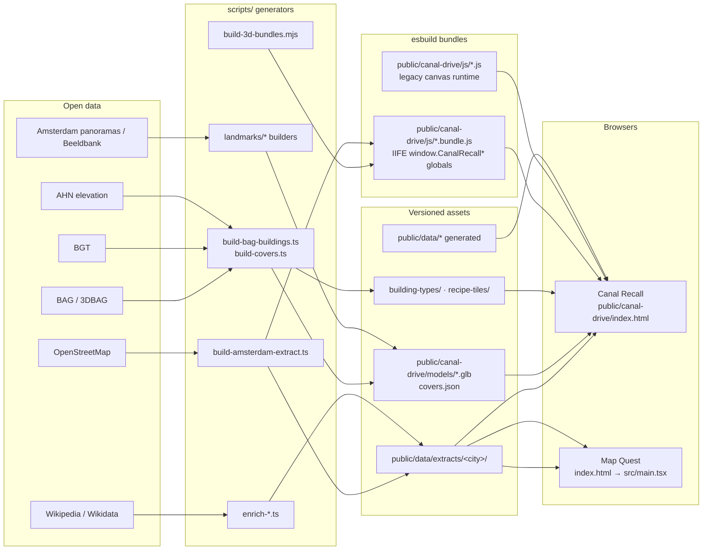

# Architecture overview

This is a code map for newcomers. It is a living document — see `CLAUDE.md` for the working agreement and `docs/README.md` for the docs index.

## Directory map

| Path | What it holds |
| --- | --- |
| `src/` | Typed TypeScript source: the React app + the `canalRecall` modules |
| `src/main.tsx` | Map Quest (React/Vite) entry point |
| `src/components/`, `src/mapRecall/` | Map Quest UI + 2D quiz logic |
| `src/canalRecall/` | Typed modules for Canal Recall (bundled into browser globals) |
| `public/canal-drive/` | Canal Recall runtime: `index.html`, `js/`, `models/`, labs |
| `public/canal-drive/js/` | Legacy vanilla JS + esbuild `.bundle.js` outputs (browser globals) |
| `public/canal-drive/models/` | Landmark GLBs (+ `.lod1.glb`), `covers.json` |
| `public/canal-drive/building-types/`, `recipe-tiles/` | Ordinary-building kits and recipe tiles |
| `public/data/extracts/<city>/` | Versioned city extracts (`amsterdam`, `utrecht`, `rotterdam`, `den-haag`) |
| `public/data/` | Other generated data (facades, wall colour, point clouds, …) |
| `scripts/` | Data generators, checks, and one-off tools (see below) |
| `tests/e2e/` | Playwright end-to-end specs |
| `stories/`, `.storybook/` | Storybook workbench (HUD/card visual states) |
| `docs/` | Plans, handoffs, living documents, research |
| `server.ts` | Dev server (Express + Vite middleware) |
| `.github/workflows/` | CI (`ci.yml`), deploys, nightly driving, hosting prune |

## Two runtimes: typed `src/canalRecall` vs legacy `public/canal-drive/js`

The Canal Recall page is served from `public/canal-drive/index.html`. It loads a mix of two kinds of scripts:

1. **Legacy vanilla JS** (`public/canal-drive/js/*.js`) — the original canvas game: `game.js`, `game-route.js`, `renderer.js`, `hud.js`, `road-network.js`, `osm-loader.js`, `map-picker.js`, etc. These are plain scripts that share state through `window` and `Game.prototype`.

2. **Typed modules bundled to browser globals** (`public/canal-drive/js/*.bundle.js`) — new logic is written in TypeScript under `src/canalRecall/`, then `esbuild --bundle --format=iife --global-name=<Name>` compiles each module into a self-executing bundle that exposes a `window.<Name>` global. The legacy runtime calls those globals (`window.CanalRecallRoute`, `window.CanalRecallPreferences`, …). This is why code search must grep for the **global name**, not just the import — the two sides are wired by convention, not by `import`.

Each bundle has its own `build:canal-*` npm script. Representative bundles (all `--format=iife --global-name=… --outfile=public/canal-drive/js/…`):

| npm script | Source module | Output bundle | Global |
| --- | --- | --- | --- |
| `build:canal-route-selection` | `src/canalRecall/game/routeSelection.ts` | `route-selection.bundle.js` | `CanalRecallRoute` |
| `build:canal-road-graph` | `src/canalRecall/routing/roadGraph.ts` | `road-graph.bundle.js` | `CanalRecallRoadGraph` |
| `build:canal-road-surface` | `src/canalRecall/routing/roadSurface.ts` | `road-surface.bundle.js` | `CanalRecallRoadSurface` |
| `build:canal-road-projection` | `src/canalRecall/osm/roadProjection.ts` | `road-projection.bundle.js` | `CanalRecallRoadProjection` |
| `build:canal-three` | `public/canal-drive/js/three-runtime-source.js` | `three.bundle.js` | `CanalRecallThree` |
| `build:canal-vehicles` / `build:canal-3d` | `scripts/build-3d-bundles.mjs` | `player-vehicles`, `detailed-buildings`, `pyramidal-roofs`, `signature-landmarks`, `facade-recipe`, `inventory-trees`, `google-tiles` | `CanalRecall…` |
| `build:canal-preferences` | `src/canalRecall/game/preferences.ts` | `preferences.bundle.js` | `CanalRecallPreferences` |
| `build:canal-overlay` | `src/canalRecall/overlay/mount.tsx` | `overlay.bundle.js` | `CanalRecallOverlay` |
| `build:canal-ui` | `src/canalRecall/gameUi.ts` | `game-ui.bundle.js` | `CanalRecallUi` |
| `build:canal-transit` | `src/canalRecall/transit/browser.ts` | `transit.bundle.js` | `CanalRecallTransit` |
| `build:canal-ferry` | `src/canalRecall/ferry/index.ts` | `ferry-network.bundle.js` | `CanalRecallFerry` |
| `build:canal-game-landmarks` | `src/canalRecall/game/landmarkRuntime.ts` | `game-landmarks.bundle.js` | — |
| `build:canal-game-recall` | `src/canalRecall/game/recallRuntime.ts` | `game-recall.bundle.js` | — |
| `build:canal-game-presentation` | `src/canalRecall/game/presentationRuntime.ts` | `game-presentation.bundle.js` | — |
| `build:canal-recall-store` | `src/canalRecall/recallStoreBrowser.ts` | `js/recall-store/` (ESM splitting) | — |
| `build:canal-feedback` | `scripts/feedback/build.mjs` | `js/feedback/browser.js` | `CanalFeedback` |

A few bundles are ESM rather than IIFE (e.g. `build:appearance-viewer`, `build:facade-opening-layout`, `build:ordinary-buildings-gallery`) and are loaded by lab/review pages, not the main game.

## Game loop and the main legacy files

The game is a `requestAnimationFrame` loop in **`js/game.js`** (a `Game` class with a state machine: menu → map select → loading → riding → finished). Subsystem methods are installed on `Game.prototype` by **`js/game-route.js`** (route setup, preferences, live reroute, POI selection), keeping ownership boundaries explicit.

The classic canvas files still describe the structure:

| File | Role |
| --- | --- |
| `js/constants.js` | Tunable parameters (physics, camera, HUD) |
| `js/utils.js` | Math helpers (clamp, lerp, angle) |
| `js/input.js` | Keyboard input manager |
| `js/camera.js` | Camera follow + zoom |
| `js/particles.js` | Particle system |
| `js/sound.js` | Web Audio engine + effects |
| `js/car.js` | Base vehicle physics (steering, drift, surface grip) |
| `js/player.js` | Player vehicle |
| `js/renderer.js` | Canvas rendering (track, cars, skids) |
| `js/hud.js` | Speedometer, minimap, warnings, prompts |
| `js/osm-loader.js` | Fetch/simplify OSM roads; lat/lng → world pixels |
| `js/road-network.js` | Spatial grid; nearest-road, surface and street-name queries |
| `js/map-picker.js` | Leaflet picker for route origin/destination |
| `js/loading-screen.js` | Loading progress |
| `js/vector-map.js` | Vector basemap rendering |
| `js/ferry-travel.js` | Ferry crossings (companion to the typed `ferry-network` bundle) |

Typed logic that replaces or augments these lives in `src/canalRecall/`: **routing** (`routing/roadGraph.ts`, `routing/roadSurface.ts`, `routing/cycleTrack.ts`, `routing/bikeAccess.ts`, `osm/roadProjection.ts`, `osm/roadSnapIndex.ts`), **game state** (`game/` — recall rules, route knowledge, preferences, teaching pacer, landmark runtime), and the **React overlay** (`overlay/` — route form, settings, HUD cards, mounted by `CanalRecallOverlay.install`).

## Building the city: landmarks, ordinary buildings, chunks, kits, covers

- **Landmarks** — one GLB per surveyed landmark under `public/canal-drive/models/` (e.g. `afrikahuis.glb`, `afrikahuis.lod1.glb`), authored with `scripts/landmarks/*` builders and verified with per-landmark `check-*-geometry.ts` scripts. Placement and signature-suppression logic is typed in `src/canalRecall/landmarks/` (`signatureModels.ts`, `signaturePlacement.ts`, `placedModels.ts`, `ordinaryModels.ts`, `manualModels.ts`). `models/covers.json` records footprint covers so replaced identities are suppressed after the GLB loads.
- **Ordinary buildings** — generated from BAG/3DBAG, not hand-authored. `scripts/build-bag-buildings.ts --tiles` + `scripts/build-covers.ts` (`build:bag-tiles`) produce building tiles; `src/canalRecall/tileBuildings/` and `js/tile-buildings.bundle.js` render them at runtime.
- **Chunks** — `src/canalRecall/streetChunks/` compiles street-row geometry (`compileChunk.ts`, `gltf.ts`, `manifest.ts`); related recipes live in `src/canalRecall/buildingRecipe/`.
- **Recipe tiles** — `public/canal-drive/recipe-tiles/` (`index.json`, `units/`, `building-mesh/`), compiled by `scripts/building-tiles/compile-recipes.ts` (`build:recipe-tiles`).
- **Kits** — reusable component/material libraries: `src/canalRecall/buildingTypes/`, `src/canalRecall/galleryKits.ts`, `landmarkKits.ts`, `worshipKits.ts`, `museumKits.ts`, and the GLB kits under `public/canal-drive/building-types/`.

## Extracts and their generators

Versioned city data lives in `public/data/extracts/<city>/` (`amsterdam`, `utrecht`, `rotterdam`, `den-haag`). The Amsterdam pipeline:

- `scripts/build-amsterdam-extract.ts` (`build:amsterdam`) — assemble routing/POI/street extracts from OSM + BAG.
- `scripts/enrich-amsterdam-wikimedia.ts` (`enrich:amsterdam`) and `scripts/enrich-amsterdam-wikipedia-extracts.ts` — attach Wikimedia/Wikipedia content.
- `scripts/translate-extracts-to-english.ts` (`enrich:english`) — English text.
- `scripts/enrich-amsterdam-neighborhoods.ts` (`enrich:neighborhoods`), `scripts/build-neighborhood-stories.ts`.
- `scripts/refresh-amsterdam-extract.sh` / `scripts/refresh-city-extract.sh` — full refresh for other cities.

## Firebase: auth, progress sync, and the feedback queue

- **Map Quest** uses `src/firebase.ts`, `src/firebaseConfig.ts`, and `src/progressRepository.ts` for auth and Firestore-backed progress (guest progress stays in the browser; signing in merges and uploads).
- **Canal Recall** keeps its progress in `src/canalRecall/game/progressStore.ts` and syncs through the same Firebase project.
- **Feedback queue** — `src/canalRecall/feedback/browser.ts` + `cloud.ts` (browser side) and `scripts/feedback/queue.mjs` (`npm run feedback:queue`) (operator side). Notes are immutable, keyed by client UUID; access is governed by `firestore.rules`. See **[docs/feedback-work-queue.md](feedback-work-queue.md)** and the `canal-feedback` skill (`.agents/skills/canal-feedback/SKILL.md`).
- Config is written into the Canal Recall page by `scripts/write-canal-firebase-config.ts` (`canal:firebase-config`); the Web API key is not secret — enforcement is `firestore.rules`.

## Testing layers

1. **Typed checks** — `scripts/check-*.ts` run via `tsx` (and Node's `node --import tsx --test` for `*.test.ts`). Aggregate gates: `check:canal`, `check:map-recall`, `check:transit`, `check:facade-rebuild`.
2. **Playwright e2e** — `tests/e2e/*.spec.ts` drive the real pages and pin visual regressions. Pin a private port per worktree (`PW_PORT=…`).
3. **Storybook** — `stories/` + `.storybook/` render deterministic HUD/card states (`storybook`, `build-storybook`).

## Worktree / lane workflow

From `CLAUDE.md`: one worktree + feature branch per parallel agent, each with an exclusive **lane** (presentation, routing, content/data, domain logic) and a unique dev-server port. The **integrating agent** alone owns `game.js`, `index.html`, `package.json`, lockfiles, generated bundles/data, `TODO.md`, and `HISTORY.md`, and performs merges/pushes. Leaf agents return a commit SHA + verification results instead of editing those shared hotspots. Commit a typed source module and its generated bundle atomically; publish generated data into versioned extracts only after review.

## Data flow

