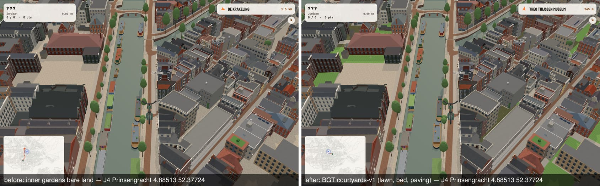

# Courtyards from BGT (ride review J4), 2026-10-14

**Problem (ride review row J4, 4.88513 52.37724 bearing 209):** inner-block gardens in the Jordaan and the canal belt
drew as the bare `land` colour (sand), so every closed block read as a public square from the street.

**Fix:** the `courtyards-v1` extract (`public/data/extracts/amsterdam/courtyards-v1/`). Each cell holds the BGT terrain
polygons inside a building block's interior, with the park surface each one draws as. The extract is kept apart from
the OSM cells (`own-ground-osm-v1`) so it cannot collide with other lanes that patch those cells (roads-v1 is starting
on the same cell pattern). The store loads it (`GroundStore` option `courtyards`, on by default). `groundCell` draws it
into the existing park surface layers (lawn, bed, shrub, bark, sand, parkGravel, paving) with holes kept, and culls the
land quads under it. The colours are the ground look's tones (`groundPalette(...).tones`), so the courtyards follow a
brighter look without further change.

## Sources and licences

| Source | Use | Licence |
|---|---|---|
| BGT (Kadaster / gemeente Amsterdam) via the PDOK OGC API `https://api.pdok.nl/lv/bgt/ogc/v1`, `datetime=2026-10-14`: `begroeidterreindeel`, `onbegroeidterreindeel`, `ondersteunendwegdeel` | the candidate polygons and their classes | CC0 1.0 |
| BGT `pand`, `waterdeel` (same API, cell padded 130 m) | the block-interior ray test (buildings close a ray, water opens it) | CC0 1.0 |
| PDOK Luchtfoto CIR WMS `https://service.pdok.nl/hwh/luchtfotocir/wms/v1_0`, layer `2025_ortho25IR`, read at 0.5 m | the vegetated share of each `erf` (yard) | CC BY 4.0 (Beeldmateriaal Nederland) |
| OSM (the published own-ground cells) | street centrelines that open a ray, and areas already painted (left to OSM) | ODbL |

The provenance is recorded in `courtyards-v1/cells.json` (`provenance`).

City download: 2,045 requests, 2.6 GB (BGT JSON pages plus 0.5 m CIR tiles). The cache stays in the scratchpad and is
not committed. Published extract: 226 cells with courtyards (of the 294 game cells), 3.5 MB gzipped. Per cell, the
median is 8 KB and the maximum is 86 KB (-1_4; the Jordaan cells -2_0 and -1_0 are 73 and 54 KB).

## Why the aerial

BGT types back gardens as **`erf`**, which only means ground belonging to a building's parcel. It says nothing about
cover. In the Jordaan test box, 23,040 of the 23,345 m² of `onbegroeidterreindeel` is `erf`, and `begroeidterreindeel`
covers 258 m². BGT alone would have left the courtyards bare. The colour-infrared ortho tells green from paving per
pixel: NDVI = (NIR − red) / (NIR + red) from the delivered bands (R = NIR, G = red, B = green). A pixel is vegetated
when NDVI ≥ 0.12. A pixel whose band sum is under 150 is in shadow and counts as unknown. A yard's share is taken over
its sunlit pixels, and needs at least 8 of them and at least 20 % of the yard lit.

## Mapping (`src/canalRecall/ownGround/courtyards.ts` `courtyardSurface`)

| BGT collection | `fysiek_voorkomen` (plus type) | drawn as |
|---|---|---|
| begroeidterreindeel | groenvoorziening (gras-/kruidachtigen or untyped), grasland | lawn |
| begroeidterreindeel | heesters, bosplantsoen, struiken, houtwal, bos | shrub |
| begroeidterreindeel | planten, rozen, bodembedekkers, heide, riet, moeras | bed |
| begroeidterreindeel | (plus) …schors | bark |
| onbegroeid / ondersteunendwegdeel | zand | sand |
| onbegroeid / ondersteunendwegdeel | half verhard, onverhard | gravel |
| onbegroeid / ondersteunendwegdeel | open verharding, gesloten verharding | paving |
| ondersteunendwegdeel | groenvoorziening | as begroeidterreindeel |
| onbegroeid / ondersteunendwegdeel | **erf**, vegetated share ≥ 0.5 | lawn |
| onbegroeid / ondersteunendwegdeel | **erf**, share ≥ 0.25 | bed (mixed planting and paving) |
| onbegroeid / ondersteunendwegdeel | **erf**, share < 0.25 | paving |
| onbegroeid / ondersteunendwegdeel | **erf**, share unknown (shadow) | not drawn: the land stays |
| any | other (transitie, kering, …) or `relatieve_hoogteligging` ≠ 0 | not drawn |

## Block interior

From the polygon's interior point (the centroid of its largest earcut triangle), 16 rays of 120 m. A ray is **closed**
when the first thing it meets is a BGT `pand` edge. It is open when it first meets an OSM street centreline (motorway
… residential, living_street, pedestrian, cycleway, road, links; not footway, path or service, which run into hofjes
and yards) or a BGT water edge, or when it meets nothing. At least 13 of 16 rays must be closed. One gate or gap in a
block wall is allowed, but a front garden, a verge or a park is not. A polygon whose interior point lies inside an OSM
area of the 3×3 neighbourhood is left to OSM (28,621 such polygons). A polygon belongs to the cell of its interior
point. Rings are simplified with Douglas–Peucker at 0.15 m and stored as delta-encoded decimetres in the local frame.

## Coverage (city, 294 cells)

438,508 candidates, 75,522 inside a block interior, 1,711 yards left unknown (shadow), 73,810 areas drawn:

| class | ha |
|---|---|
| paving | 300.0 |
| lawn | 258.7 |
| bed | 104.2 |
| gravel | 7.3 |
| shrub | 6.5 |
| sand | 2.3 |
| total | 679.0 (54 % vegetated) |

Densest cells (ha, vegetated share): -3_-1 12.1 (81 %), -2_-2 12.0 (79 %), -9_-3 11.9 (58 %), -1_-1 11.7 (80 %), -2_-1
11.3 (76 %), -4_-7 10.6 (88 %), -2_0 8.9 (68 %), -1_0 6.2 (69 %). `artifacts/own-ground/staging/courtyards-v1/report.json`
has the full table per cell and class. Diff against the published extract: 73,810 added, 0 removed, 0 kept (first
publish).

## Regression

`check:own-ground-cells`, `courtyardRegressions`: 2,497 probes (`scripts/own-ground/j4-courtyard-probes.json`), a 4 m
grid from Bloemgracht to Tuinstraat and from Lijnbaansgracht to Keizersgracht, kept on open BGT terrain inside a block
by the same ray test.

- With courtyards-v1: **64 % vegetated**, 28 % paving, 6 % bare land.
- Without it: **2 % vegetated**, 95 % bare land.

The thresholds are > 40 % and < 5 %. Unit tests in `ownGround.test.ts` cover the mapping table, the pixel and share
tests, the ray test on a synthetic block (closed, gated, front garden, open square), and a drawn courtyard lawn culling
the land under it.

Regenerate: `npx tsx scripts/own-ground/add-bgt-courtyards.ts --raw <empty dir>`. Review the staging report, then run
`--publish`. To redo the fixture, run `--probes 4.8770,52.3740,4.8880,52.3775`.

## What BGT (and this extract) does not say

- **What a yard is covered with.** That comes from one aerial flight (2025). It is a camera's view from above: tree
  canopy over a paved yard reads as lawn, and a pergola or a parasol reads as paving.
- **Yards in deep shadow** (the 1,711 unknown) stay bare land. Narrow north-facing Jordaan yards are the most affected.
- **Individual trees, sheds, fences and garden walls.** `pand` sheds show as holes, which the buildings layer covers.
  Fences (`scheiding`) and BGT `vegetatieobject` are not drawn here.
- **Roof gardens and decks** (`relatieve_hoogteligging` ≠ 0) are excluded.
- **Blocks with a wide opening** (more than about 3 of 16 directions open), such as courts of modern estates open to a
  street, are not interiors by this test and keep the land colour.
- **The far ring** (farRing.ts) does not draw courtyards. They appear only in streamed cells (LOD 0 and 1).
- **The 0.5 m pixel** cannot resolve yards narrower than about 2 m. They go unknown or follow their neighbours' share.
