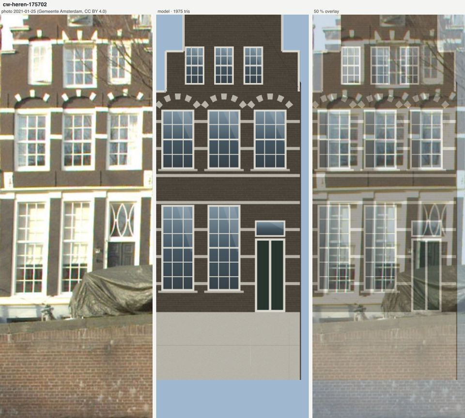
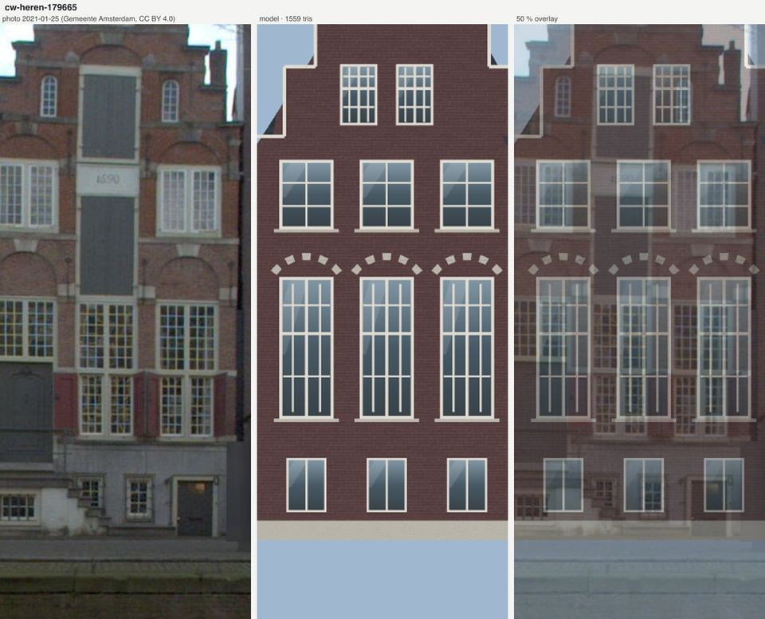
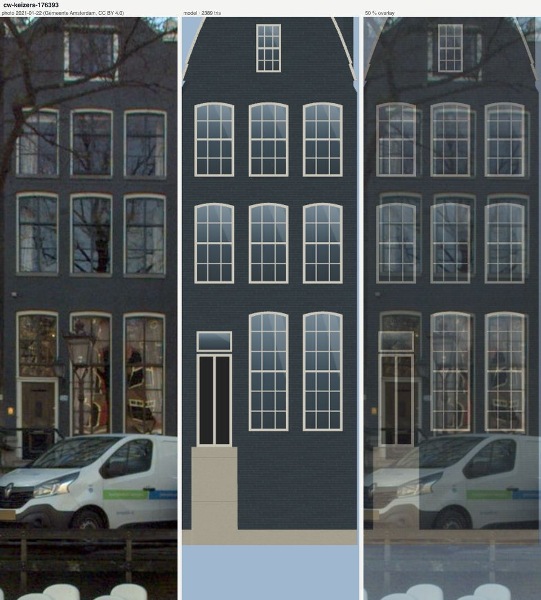
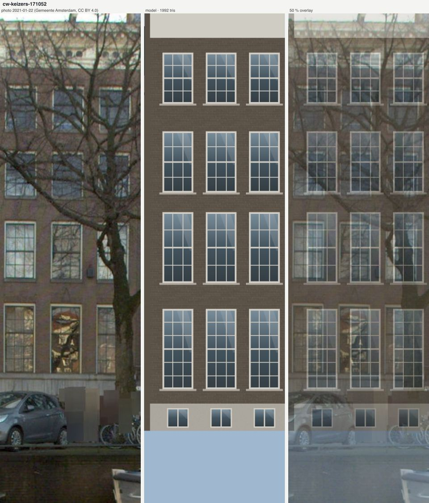
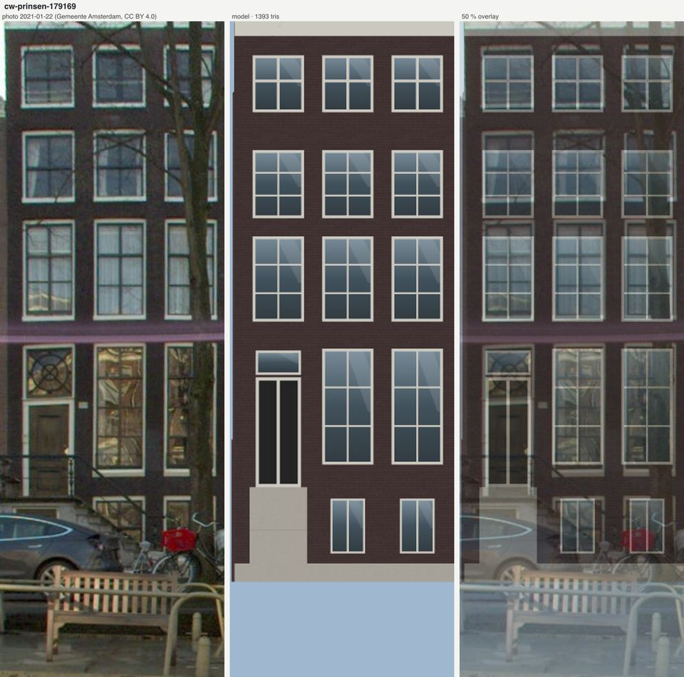
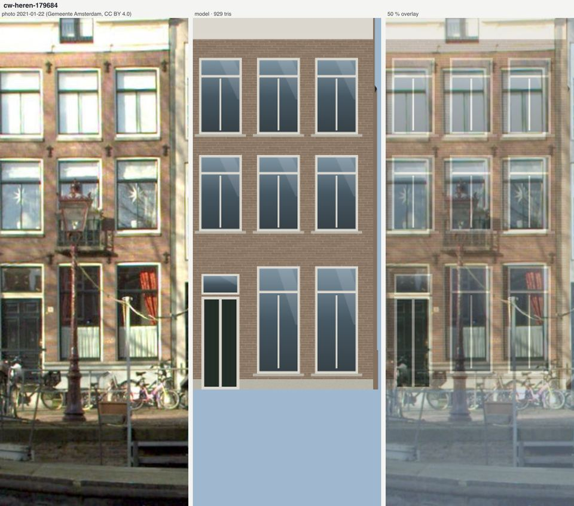
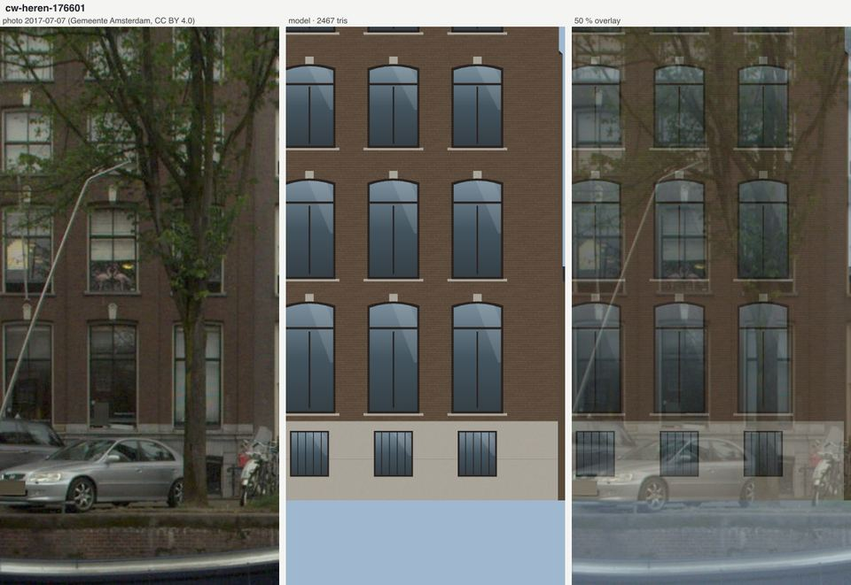
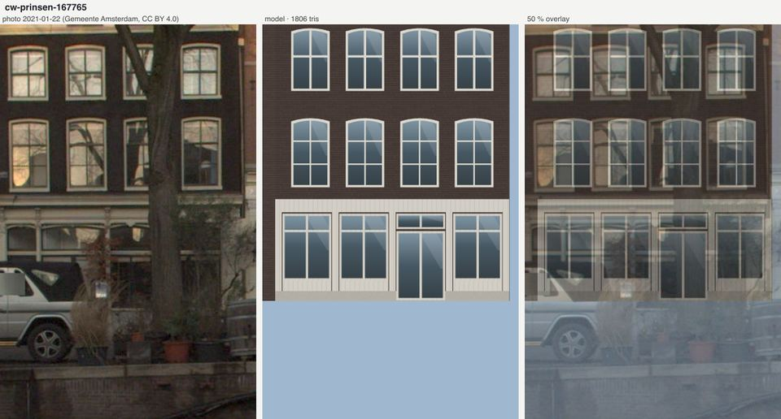

# Canal-house windows and white accents (survey 2026-10-14)

The user (2026-10-14): "window shape on canal houses is important to me, as are white-brick accents in facades."

This survey measured windows and white or sandstone accents on rectified crops of canal-belt fronts on the Herengracht,
Keizersgracht and Prinsengracht. It covers 35 pands, built from the 1610s to 1905, of which 29 could be measured.
The kit gained the vocabulary those fronts need, and eight houses were re-fitted with it as `scripts/building-recipes/houses/cw-*`.
They are not installed.

## Method

- **Source data** (open data only):
  - Gemeente Amsterdam street panoramas, CC BY 4.0. The crops are rectified by `scripts/pand-reference/run.ts --ids=…`
    at 50 px/m and stored in `staging/pand-reference-walls/<pand>/front.jpg` (or `front-alt.jpg`).
  - BAG for build years and pand outlines.
  - 3DBAG for heights.
- **Choosing pands:** `scripts/research/canal-windows/list-pands.ts` selected canal pands within 22 m of the canal street lines.
  That gave 1,816 pands with BAG year and monument status. From those, I sampled across eras by hand.
- **Measuring:**
  - `scripts/research/canal-windows/grid.ts` draws a metric grid over each crop. Every opening was read off that grid by eye
    (sill, head, width, glazing pattern).
  - `--sample` gives the median hex of a box.
  - `--profile` finds light runs (speklagen) in a pier column by chroma, because a luminance threshold fails on sunlit orange brick.
  - Automatic window detection was tried and dropped as unreliable.
- **Unusable crops:** 177174, 171721, 180184, 179151, 182939, 169249, 176402 and 180189 were skipped (wrong wall, foliage,
  obstruction or a bad scale). 168394, 177213 and 176022 are qualitative only.
- **Sheets:** `scripts/research/canal-windows/sheets.sh` compiles the eight refits and renders photo | model | 50 % overlay.
  - The model is rendered orthographically along the crop's wall normal.
  - The street level on each crop is a per-house `--ground` offset read off the overlay, because the crop's own ground
    estimate sits 1–4 m low.

"Share" below means window height divided by storey pitch (sill to sill, or sill to cornice for the top storey).
Measurements are in metres, as width x height.

## Catalogue

| Pand (BAG year) | Canal | Front era | Window kind by storey | Head | Measured (w x h), share | Frames | White / stone accents |
|---|---|---|---|---|---|---|---|
| 175702 (1615) | Heren | 17c step gable | ground: tall small-pane; s1: 6-over-6 | flat, under 5-block white relieving arches | ground 1.2x3.25; s1 1.2x2.2 | white | **black-painted brick**; white speklagen at 8.15 / 9.15 / 10.45 / 11.45 (~1.1 m apart, 0.10–0.12 deep); block arches; door transom with ogee tracery |
| 179665 (1626) | Heren | 17c step gable, date stone | ground: cross-transom (transom .6), small panes; s1: two-light kloosterkozijn | flat, relieving arches with white springers and keystone | ground 1.35x3.1; s1 1.35x1.6 | white | white stone frame round the central loading axis, date stone; red shutters |
| 169072 (1620) | Keizers | 17c step gable | single-pane, modern glazing in 17c openings | relieving arches, white springer and keystone blocks | 1.25x2.25 | white | speklagen 0.12–0.16 deep every 0.45–0.6 m; stone in sun #fbf9ee against brick #f6ba85, stone in shade #c7c9bc; white jamb blocks |
| 176590 (1655) | Heren | 17c step gable | small panes | relieving arches with brick tympana | s1 1.1x2.05 | white | white bands at mid-window (9.1–9.25) and springing (10.1–10.25) |
| 177213 (Huis met de Hoofden) | Keizers | 1622 | stone cross windows (transom ~.61) | relieving block arches | qualitative | — | sandstone speklagen at transom and head level, pilasters, heads |
| 179672 (1666) | Heren | 17c neck | s1: 9-pane (3x3), w:h .8 | flat | s1 1.4x1.75 | white | two-storey white timber pui; lugged architrave and hood on the neck light; oval cartouches |
| 177541 (1660) | Keizers | 17c / 18c | ground small panes; s1, s2: 6-over-6 | flat | ground 1.25x2.75; s1 1.25x2.0 (.80); s2 1.25x2.15 (.75) | white | sandstone scrolls on the neck gable; white sills; red shutters |
| 171052 (1672) | Keizers | 18c | bel-etage: small panes 3x6; s1–s3: 6-over-6 | flat | bel 1.2x2.75 (.73); s1 2.15 (.80); s2 2.1 (.78); s3 1.6 | white | white attic frieze with round oculi |
| 178125 (1690) | Keizers | neck gable | T-windows (transom .88) | flat | bel 1.05x2.45 (.67); s1 2.35 (.77); s2 2.2 (.71) | white | white-rendered souterrain base, white sills, oval cartouche |
| 177405 (1701) | Prinsen | three neck gables | 2-over-2, alternating 1.3 / 0.85 wide | flat | s1 2.15 (.72); s2 1.55 (.48) | white | sandstone claw pieces and balls; white sills |
| 167765 (1650) | Prinsen | 18c frames | s1: 2 wide x 3 high; s2: 2x2 | **segmental frame head**, rise ~.12 on 1.2, no ring | s1 1.2x2.1 (.74); s2 1.2x1.5 | white | dark-painted brick #2d2826; white timber pui |
| 168393 (1665) | Heren | 18c Louis remodel | large-pane sash 2x3 | flat | 1.6x2.8 on all three storeys (.64 / .74 / .81) | white | white sandstone door surround with pediment; carved cornice with consoles |
| 169197 (1730) | Heren | 18c | 12-over-12 (bel), 9-over-9, 6-over-6 | flat | bel 2.0x3.95; s1 1.7x2.9; s2 1.7x1.65 | white | white Corinthian door surround |
| 176393 (1770) | Keizers | 18c bell gable | ground: small panes; s1, s2: 6-over-6 | **segmental frame head**, rise ~.08 on 1.15, no ring | ground 1.15x3.5 (.75); s1 2.3 (.81); s2 1.85 (.65) | cream | dark grey painted brick #303639 |
| 174411 (1790) | Prinsen | 18c, three storeys | 8-over-8, then 8-over-8, then 4-over-4 | flat | 1.8x1.8 / 1.55 / 1.1 (.67 / .62 / .67), a textbook diminishing front | white | dark grey painted brick; oval and X door transoms |
| 176022 (1795) | Keizers | 18c | 2-over-2 with dark rails | flat | 1.4 wide | white | — |
| 179169 (1800) | Prinsen | c.1800 | six-pane (2x3), then four-pane at the top | flat | ground 1.25x3.0 (.72); s1 2.2 (.90); s2 1.75 (.73); s3 1.45 (.80) | white, no stone sills | black-brown painted brick; purple-red string course #7a6175; basement half-lights |
| 168394 (1800) | Heren | c.1800 | 2-over-2 | flat | qualitative | white | double stoop with a basement door under the landing; barred lights; sandstone door surround with consoles |
| 176353 (1800) | Heren | 19c stucco | T-windows | flat | qualitative | **dark** | whole front grey-white stucco with pilasters; radial fanlight |
| 170878 (1820) | Prinsen | 19c | six-pane, six-pane, four-pane | flat | 1.15x2.25 (.78) / 2.15 (.78) / 1.45 (.64) | white | black brick; white sills |
| 167740 (1837) | Keizers | church front | giant round-arched window | **round, white ring ~0.12, keystone 0.25x0.45** | 3.0x6.3 | white | **white stucco quoins** (blocks ~0.33 tall at a 0.56 pitch, alternating 0.45 and 0.3 out); impost string course; balustrade |
| 179684 (1615) | Heren | 19c | T-windows (transom .76, mullion below only) | flat | ground 1.2x2.75; s1 1.25x2.05 (.72); s2 1.9 | white | white stone sills #f4f4dd; iron wall anchors; brick #9c8068–#ad927c |
| 179751 (1632) | Heren | 19c | 2-over-2 (rail .65 / .52) | flat | bel 1.25x3.6 (.84); 2.2 (.86); 1.95 (.80); 2.15 (.84) | white | white sills and cornice; 1 m plinth |
| 165076 (1700) | Keizers | 19c | 2-over-2 | flat | s1 1.2x2.3 (.79); s2 1.9 | white | black-painted brick; white stucco ground storey with pilasters; white attic with dentils |
| 171666 (1725) | Heren | 19c | T-windows (transom .78), w:h .82 | flat | 1.55x1.9 / 1.8 / 1.75 (.75 / .71 / .70) | white | white projecting stone sills 0.08 tall; dentilled cornice |
| 176665 (1650) | Heren | c.1880 | T-windows (transom ~.8) | flat | 1.0x2.3 / 2.1 / 1.9 | white | **blokband**: a white head-line band of alternating blocks, with impost blocks at the jambs |
| 177154 (1655) | Prinsen | 19c | T-windows (transom .83) | flat | 0.95x1.45 | white | two-storey white timber pui; iron wall anchors |
| 176601 (1727) | Heren | late 19c | T-windows (transom .75) | **shallow segmental head with a carved white keystone** | s1 1.35x3.85; s2 2.6 | **dark brown-black**, in deep reveals | white stone souterrain base with barred basement lights; white sills |
| 177332 (1890) | Prinsen | 1890 | T-windows (transom ~.85) | flat, **small white keystone blocks** 0.1x0.25 | 1.15x1.8 (.60) / 1.9 | white | wide white frieze |
| 177141 (1905) | Prinsen | c.1900 twin point gables | big lower pane, small-pane upper sash 3x2 | flat, under **band-brick relieving arches** | 1.2x2.4 | white | radial fan window in the gable |
| 176427 (1904) | Keizers | c.1900 | sash with top light | round on the ground storey; band-brick rings | 1.3x2.4 / 2.35 / 2.2 | white | white plaster flat-arch caps |
| 177281 (1905) | Keizers | 18c / 19c look | six-pane plus top light | flat | 1.25x2.1 / 2.0 / 1.95 / 1.5 (.65 / .78 / .68 / .81) | white | white sills |
| 167657 (1905) | Heren | 18c-style bell gable | 6-over-6 | faint segmental (rise ~.04) | 1.45x2.0 (.73) / 1.9 (.73) | white | white timber pui |

### Era medians (window height / storey pitch)

| Front era | Ground / bel-etage | First floor | Second floor | Fronts |
|---|---|---|---|---|
| 17th c. | .70 | .79 | .73 | 177541, 171052, 178125, 177405 |
| 18th c. | .67 | .74 | .67 | 168393, 176393, 174411, 167765 |
| 19th c. | .78 | .78 | .72 | 179751, 179169, 171666, 170878, 179684, 165076, 177332 |
| c.1900 | .69 | .76 | .68 | 177281, 167657 |
| **all** | **.73** | **.76** | **.72** | |

- **Before the survey:** the kit default was .58–.62 of the storey and about .51 of the front width in windows.
- **Window share of the front width:** the median is .66, from .55 (176601) to .74 (167765).
  - Widths cluster at 1.1–1.25 m on 17th and 18th-century fronts and 1.25–1.55 m on 19th-century fronts.
  - Louis XIV / XV remodels (168393, 174411, 169197) reach 1.6–2.0 m.
- **Heights diminish upward:** absolute window heights fall storey by storey. The share stays about .7–.8 because the
  storey pitch falls with them.
  - 179169: 3.0 / 2.2 / 1.75 / 1.45 m.
  - 174411: 1.8 / 1.55 / 1.1 m.
  - 171052: 2.75 / 2.15 / 2.1 / 1.6 m.
- **Storey pitch medians,** relative to the first floor: bel-etage 1.45, first 1, second .97, top .85. The bel-etage
  over a souterrain is the tallest storey on almost every 18th and 19th-century front.
- **Pane layout by era:**
  - 17th c.: cross windows and small leaded panes.
  - 18th c.: 6-over-6, 8-over-8 and 9-over-9 sashes, with a heavier meeting rail.
  - 19th c.: six-pane, 2-over-2 and T-windows.
  - c.1900: small-paned upper sash over a large pane.
- **Frame colour:** white or cream on 27 of 29. Dark frames appear on late 19th-century fronts (176601, 176353).
- **White accents:**
  - Speklagen are 2 courses (0.10–0.16 m) every 0.45–1.1 m.
  - Arch rings are 3–4 courses, either solid or 5 radiating blocks.
  - Keystones are 0.1–0.25 wide.
  - Stone sills are 0.08 tall.
  - Quoins are 0.33 tall at a 0.56 pitch.
  - Painted brick is near-black or dark grey (#2d2826, #303639, #3f3a33) on about a third of the fronts.

## New intent keys (all optional; absent means byte-identical)

These are defined in `src/canalRecall/buildingRecipe/intent.ts` and fitted in `fit.ts`. Tests are in `streetComponents.test.ts`.

- **`windows` / `storeyWindows`** (per storey: index or `last`) take seven new pane layouts. Bars are fractions of
  the opening, and every thin bar is clamped 1.5 cm inside the pane.

  | Layout | Bars |
  |---|---|
  | `sash-6-over-6` | 2 glazing bars across, rails at ¼ ½ ¾, 6 cm meeting rail |
  | `sash-8-over-8` | 3 glazing bars across, same rails as 6-over-6 |
  | `sash-9-over-9` | 2 glazing bars across, 5 rails |
  | `six-pane` | 2 wide x 3 high, 4.5 cm mullion |
  | `t-window` | 7 cm transom at .76, mullion below it only |
  | `small-over-one` | big lower pane, upper sash 3 wide x 2 high |
  | `cross-transom` | mullion and 7 cm transom at .6, small panes in each light |

- **`windowHead`** `{kind, storeys?, archRing?}`:
  - `segmental`: frame head with a rise of 0.08 x the width (the survey median).
  - `round`: a semicircle.
  - `relieving`: a square window under a brick arch spanning w + 0.12 with a rise of ¼ span.
  - `archRing` `{colour: stone|band|frame, style: solid|blocks|none, keystone?, widthCourses 1–6}`:
    - The ring is extruded around the head.
    - `blocks` is 5 radiating voussoirs of 9.
    - `keystone` is a block 0.16–0.26 wide, ring depth + 8 cm tall, 6 cm proud.
    - `none` plus `keystone` gives the late-19th-century keystone-only head.
- **`windowShare`** (0.3–0.8): the windows' total width as a share of the front, replacing the default .51.
- **`windowHeights`** (`'diminishing'` or one 0.3–0.9 share per storey): window height / storey height, with the head on a
  common line at .86 of the storey. `'diminishing'` uses the survey medians [.73, .76, .72, .72, .70, .68].
- **`storeyHeights`** (one weight per storey, or one more with a souterrain first): measured relative storey heights
  instead of the 1.1 / 1.32 ground plus a 4 %-per-storey rule.
- **`bands: 'speklagen'` + `speklagen {spacing 4–30 courses, courses 1–5}`:** white courses, 2 cm proud, every
  `spacing` x 0.055 m from the plinth to the cornice. They take the band colour when the palette has one, else stone.
- **`windowSurround: 'sill'`:** a stone sill only, with no lintel.
- **`plinth: 'low'`:** a 0.45 m stone plinth with brick above it, instead of stone over the whole basement or souterrain.
- **`basementBars`:** four vertical iron bars in each basement light.
- **`cornice: 'frieze'`:** a tall (1.6 m) plain attic frieze with its cornice, 0.25 m deep.

## The eight refits

All eight compile and pass every gate (929–2,467 triangles). Sheets are in `artifacts/canal-windows/<id>/sheet.png`,
with copies under 300 KB in `docs/images/canal-windows/<id>.jpg`.

| House | What it exercises | Verdict at gallery size |
|---|---|---|
|  cw-heren-175702 | black brick, white speklagen, 5-block relieving arches, 6-over-6 / 9-over-9, sills | **Reads right.** It is the archetype, and the arches and speklagen land on the photo's courses. The white reads slightly greyer than the photo. The door tracery transom is missing, and the souterrain is hidden behind the quay wall in the photo. |
|  cw-heren-179665 | cross-transom ground windows, block arches with springers, low plinth | **Good on windows and arches.** The central white loading axis with its date stone and the red shutters are drawn as a third window bay, because the kit cannot say either. |
|  cw-keizers-176393 | shallow segmental frame heads, cream frames, dark paint, bell gable, measured storeys | **Reads right after the fixes:** rise 0.08w, `storeyHeights`, and a bell gable instead of a raised cornice. The door sits under the left window, where the photo has it beside the windows. |
|  cw-keizers-171052 | 9-over-9 bel-etage, 6-over-6 above, frieze cornice | **Good.** The windows overlay window for window. The frieze has no oculi, and the tree hides most of the photo. |
|  cw-prinsen-179169 | six-pane windows diminishing upward (3.0 / 2.2 / 1.75 / 1.45), stoop with basement lights | **Good.** Heights diminish as in the photo. The purple string course and the round door fanlight are missing. |
|  cw-heren-179684 | T-windows, white sills, frieze | **Good.** The T-window mullion and transom read clearly. The iron wall anchors and the attic light are missing, and the dormer was dropped because it failed the open-edges gate. |
|  cw-heren-176601 | dark frames, segmental heads with white keystones, barred souterrain lights, measured souterrain | **Reads right in structure.** The keystones are plain blocks; the photo's are carved lanterns. |
|  cw-prinsen-167765 | white segmental frame heads on dark paint over a timber pui | **Good.** The heads match. The pui is approximate. |

## What the kit still cannot say

1. **Loading axis on a canal-house front:** the white stone frame, stacked loading doors and date stone of 179665 and
   177541. These are drawn as ordinary window bays.
2. **Shutters:** the `shutters` field is ignored by the fit. Red shutters appear on 179665 and 177541.
3. **Door transoms and fanlights:** ogee tracery (175702), radial fanlights (176353), round ornamental transoms (179169),
   oval and X lights (174411).
4. **Carved keystones:** lantern and mask keystones are drawn as plain blocks.
5. **Blokband:** a head-line band of alternating white blocks with impost blocks (176665).
6. **Speklagen tied to the openings:** the kit draws them at a regular spacing. On 169072 and 176590 the bands sit at
   mid-window and at the springing line.
7. **A single string course** at one height, coloured (179169's purple band) or white (167740's impost).
8. **Quoins with measured block size and pitch:** quoins exist in the kit but their size and pitch cannot be set
   (167740: 0.33 / 0.56).
9. **Lugged architraves, cornice hoods over windows, and stone door surrounds** with pilasters, pediments or consoles
   (179672, 168393, 169197, 168394).
10. **Oculi in an attic frieze** (171052) and **oval cartouches** (178125, 179672).
11. **Gable ornament:** claw pieces, scrolls, balls and the decorated gable top (177405, 177541).
12. **Iron wall anchors** (179684, 177154).
13. **A basement door under the stoop landing, and double stoops** (168394).
14. **Frame width:** the frame width is fixed at 0.07 m. Deep reveals (176601) and thin 19th-century frames are not distinguished.
15. **Painted or stucco whole fronts with pilasters** (176353, 165076's ground storey).
16. **Dormers** still fail the open-edges gate on some fronts (179684's dormer was dropped).
