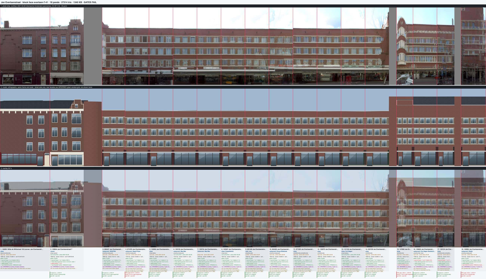
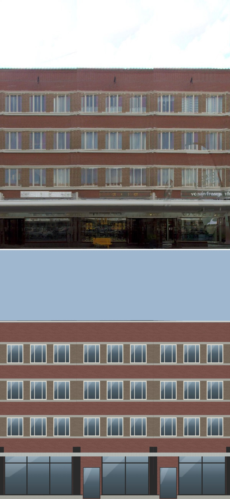

# De Baarsjes house types (Jan Evertsenstraat library, 2026-10-14)

Plan Part 2 step 7, the type half: a type library for the Amsterdam School rows of Jan Evertsenstraat, written from the
survey's sketch (`docs/jan-evertsenstraat-survey-20261014.md`) and measured on the exemplar strips (Gemeente Amsterdam
panoramas, CC BY 4.0; 2021-03-26 for 7-41 and 4-44, 2024-12-06 for the rest; open data only). It is proved on one face,
`evertsen-7-41`, which was compiled but not installed.

## Method

1. **Rows and colours.** `scripts/research/strip-row-profile.ts` (new) prints, per 5 cm row of a pand span, the shares
   of glass, white and wall pixels (the `classifyPixel` of `stripPalette.ts`), with the runs of white rows (bands) and
   window rows. Ruler crops (0.5 m grid) of the exemplars were read by eye for the lines the classes miss: on the dull
   2024-12-06 strips the white frames are grey and read as wall.
2. **Palettes.** `palette-from-strip.ts --street=jan-evertsenstraat` gives per-pand palettes. A survey eaves under 6 m
   reads a low annex or the courtyard, so the script now falls back to the facts (`dak70pM`). Before this, 61, 70, 81
   and the other corner pands measured nothing. `scripts/research/de-baarsjes-palettes.ts` (new) takes the per-type
   medians and samples the zones the generic palette does not: the piers, the spandrels and the glass-block rows.
3. **Detection.** `detect-house-types.ts --face=evertsen-7-41 --module=6` finds type A: 10 modules from 13 to 31,
   body NCC 0.63-0.92. These are the lintel-band pands.
4. **Measured heights are counted, not written in metres.** The intent contract refuses any key that ends in M. The
   parapet and the canopy wall band are therefore counted in brick courses (0.055 m), and the glass-block band in rows
   of 0.2 m blocks.

## Types

| Type | Pands (survey) | Exemplars | Measured |
|---|---|---|---|
| `evertsen-1926-lintel-band` | 18-20: 9-33 odd, 24-38 even, and the corner group 35-41 | 13, 23 and 19-21 (071876, 081449, 136734, 125587); 32 is washed out | storey pitch 2.88 m; three 1.30 m triple casements per 6 m (share 0.65); sill band 0.15 m, head band 0.15-0.20 m; storeys end 1.21 m (22 courses) under the 14.0 m coping; 23 courses of wall over the canopy; spandrel #6e4b44, pier #6f6356, bands #a5a59e (painted), frames #a4a39d, coping #827a7b |
| `evertsen-1926-hood-lisene` | 40: 93-129 odd, 96-140 even | 101 (147193), 118 (081416), 126 (118917) | glass block 3.1-4.65 m (8 rows), 8 courses of wall to the sills; box windows 5.15-6.95, 8.0-9.85 and 10.95-12.85 m (pitch 2.93 m); top light 0.2 of the window; 3.0 m parapet (55 courses); lisene 0.4 m, stopping at 13.6 m; wall #54432e, frames #acab93, glass block #4f503f, hood #3d3827 |
| `evertsen-1926-balcony-slot` | 14: 59-87 odd | 61 (107408); 69 and 81 by eye | glass block 3.1-4.5 m (7 rows), 16 courses; pitch 2.9 m; 3.3 m parapet (60 courses); balconette slabs about 0.15 m; top hood about 0.2 m at 13.35-13.6 m; wall #54402a, hood #7e7a5f, glass block #535442 |
| `evertsen-1926-ladder-plain` | 19: 45-53 odd, 52-64 even, 68-90 even | 49 (127935), 60 (124819), 70 (079120) | glass block 6 rows, 16 courses; pitch 3.0 m; three 1.35 m windows (share 0.68); 3.1 m parapet (56 courses); wall #614e37, glass block #4f5140 |
| `evertsen-1927-white-attic-tile-roof` | 12: 139-149 odd, 146-156 even | 141 (151275), 148 (093776), 154 (130972) | storeys 3.2 / 3.1 / 3.2 / 3.0 m; a white band storey at 9.6-12.6 m with 5 lights between white piers; tiles to 15.0 m; wall #5a4c39, white #b2b39c |

Crowns. The default is the tall plain parapet (`parapet: {courses, coping: true}`, `cornice: "none"`). Other crowns:
- `corner-tower`: a raised flat-topped corner mass, either `tower.corner` on two-front corner pands or `tower.bays` on
  35. It is never a pyramid.
- `raised-end`: a raised stair-tower end, `tower.bays` with `cap: "flat"`.
- `corner-group-parapet`: the 2.8 m parapet of 35-41.
- `tile-roof`: the white-attic rows.

Every type keeps the measured strip colours. The 2024-12-06 strips are overcast and dark, so the whites measure as
greys (#a5-#b2).

## Kit added

Every key is optional, and a house without them builds byte-identical. Results on this branch:
- `test:fit-golden`: all 156 recipes identical.
- `test:block-kit-installed`: identical.
- `large-mesh-hashes.ts`: all 115 identical.
- The other faces' chunk hashes: all 32 compiled faces hash the same (sha256 of `chunk.glb`) with this lane's kit files as with origin/main's.

Validation is in `buildingRecipe/deBaarsjesIntent.ts`, layout in `fit.ts` (`DE_BAARSJES`), and meshes in
`amsterdamSchool.ts`. Tests: `blockFace/deBaarsjes.test.ts`.

| Key | What it draws |
|---|---|
| `windows: "casement-toplight"` | two side-hung casements under a fixed top light (transom at 0.8), with the mullion through both |
| `windows: "casement-gridded-toplight"` | the same, with two bars in the top light (small panes) |
| `windows: "casement-triple"` | a fixed centre light between two narrow casements (bars at 0.27 and 0.73) |
| `parapet: {courses, coping}` (crown key) | the full storeys end N courses under the eaves, and the wall above them is plain; a 0.1 m coping 4 cm proud in the cornice colour |
| `bandPiers: true` (with `bands: "painted"`) | the window zone between each storey's sill band and head band is faced in `palette.band`, 2 cm proud, with the bands in front of it: white bands over two-tone piers |
| `bayWindows: {bays, storeys, hood: true}` | a shallow box frame per storey around the window of the spanned axes: 0.25 m deep, square returns, no stallriser, painted white, with a hood slab (0.15 m, 0.1 m overhang, `palette.band`) on every box |
| `balconies.style: "slab-hood"` | a stacked balconette per storey (0.15 m slab, 0.45 m deep, iron rail), and a 0.2 m hood slab, 0.6 m deep, over the top door |
| `awning.glassBlocks: {rows}` | a glass-block band of N rows over the rigid canopy |
| `awning.wallCourses` | the canopy and the shop-glass head drop so that N courses of wall (and the glass-block rows) end at the first-storey sills |
| `palette.glassBlock` | the glass-block band's measured colour, exported as its own measured-tint glass material |

The lisenes of a type with glass-block rows start on the band and stop 0.3 m into a tall parapet.

## Proof face: evertsen-7-41 (odd side, 18 pands)

Placements:
- 9-33 (13 pands): `evertsen-1926-lintel-band` with the parapet crown, in one canopy group and one coping line.
- 35: the `corner-tower` crown.
- 37-41: the `corner-group-parapet` crown, with measured eaves at strip row 164 (15.3 m).
- The 1912 pands 158391 (Witte de Withstraat 153) and 7 (159654): own designs in the Oud-West vocabulary, with
  measured storey heights and the eaves of 7 at row 202.

Shops come from the 2021 strip and OSM. The face compiles to 27,314 tris and all gates pass. The party-line FAILs are
the strip's gaps between buildings. In the review, every upper row count matches the photo, and the wall colour is in
tolerance on 16 of the 18 pands.

Verdict per pand at gallery size:
- **9-33.** The storey lines land within about 0.1 m. The three windows per house land, and so do the white sill and
  head bands, the yellow-brown piers between the windows under red spandrels, and the 14.0 m coping line. What does
  not land:
  - The canopy is a thin pale line where the photo shows a deep white slab. The photo also has its shop-glass head
    lower (about 2.6 m) and a dark transom zone under the slab.
  - The signs on the wall band over the canopy are not drawn.
  - The dentil blocks under the head bands are not drawn.
  - The curved corner of 9-11 is drawn square.
- **35.** The flat raised mass stands over the corner-group parapet. The half-round white oriel stack and its pointed
  top are not drawn, and the wall colour fails (the oriels' white mixes into the photo median).
- **37, 39.** The window bands land: 37 has 4 per storey and 39 has 3. The diamond-brick frieze, the cast-iron
  balustrade over the canopy and the ground glazing fail. The 3DBAG roof mass (16.6-17.4 m) shows above the measured
  15.3 m parapet, while the photo shows sky. That roof is recorded here, not fitted; the generic fix belongs to the
  kit-rules lane.
- **41.** The strip is ghosted (two panoramas blended), so its lines are only about ±0.3 m. The wall colour fails as too
  saturated.
- **158391, 7.** The cornice line and the storey rows land after the measured storey heights. The 3DBAG roof shows
  dark above the cornice, while the photo shows a low roof. The step gable of 7 is low, and the photo comparison counts
  0 peaks against the photo's 1.
- **The gap between 7 and 9.** The model draws a tall plain brick mass in the grey gap of the strip. It is not a front
  of this face. It comes from a neighbour's side or rear mass and is unexplained.

The other four types are measured on their exemplar strips and build in the tests on a 6 m pand of this face. They are
not yet authored on a face. Hood-lisene, for example, has no pand on 7-41; its rows are 93-140.

## What the kit still cannot say

- signs mounted on the glass-block band, and signs on the wall band over a canopy (without a wall-mounted shop sign)
- the box frame and its flat two-light neighbour touching: the kit keeps a pier between axes
- a window that straddles a party wall (hood-lisene pairs)
- the corner group's diamond-brick frieze, cast-iron balustrade and half-round or pointed stacked oriels (35, 40, 144)
- curved corners (9-11, 20-24)
- dentil blocks under painted bands
- the white attic band as painted timber (it is drawn as painted bands and piers over brick), and the brick balcony
  band over the ground storey
- all-over small panes (43-53)
- the projecting brick pier between two balcony slots
- canopy depth: the kit's 1.2 m is not measured, because a rectified strip lifts the slab nose by parallax
- setting a 3DBAG roof mass back behind a measured parapet or cornice (35-41, 7, 158391); handed to the kit-rules lane
