# Kinkerstraat even-side faces (2026-10-14)

Plan Part 2 step 4, even side: twelve block faces written as full intents on the Oud-West type library
(`docs/kinkerstraat-types-20261014.md`), 103 pands. `kinker-32-54` belongs to another lane and `kinker-2-30` was
already done. The three single-pand faces (`kinker-140-142`, `kinker-382-382`, `kinker-392-392`) are **blocked**: see
below.

Sources: each face's strip (Gemeente Amsterdam panoramas, 2024-11-29 or 2024-12-11, CC BY 4.0) and the zoom crops in
`pand-reference-kinkerstraat` (2018-2025, same publisher). Where the dates differ, the strip date wins. OSM and BAG uses
come from each face's `uses.json`. Each face was compiled with `compile.ts --face=<id>` and none was installed.

All faces were recompiled on the accents kit (origin/main at 1c8005b86, merged as d4ab97f8a). That gives them the
springer rows, painted stone and per-storey head lines.

| face | pands | tris | strip | types placed | sheet |
|---|---|---|---|---|---|
| kinker-56-84 | 5 | 22,817 | 2024-11-29 | neo-renaissance 4, 1985-infill 1 | 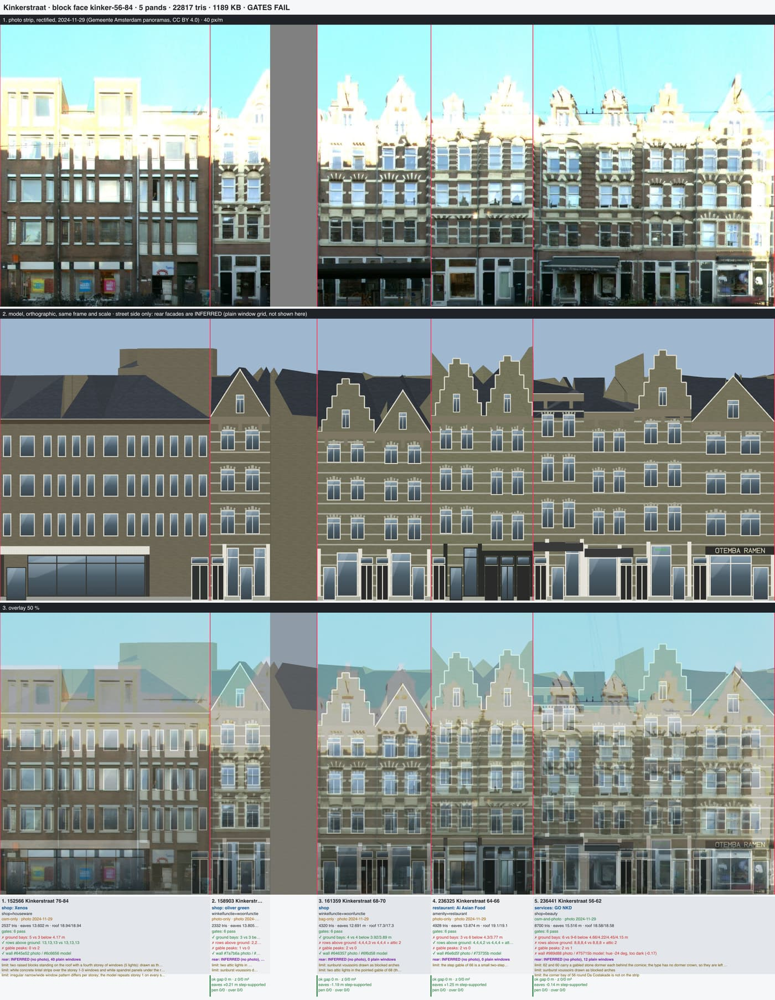 |
| kinker-86-110 | 10 | 16,444 | 2024-11-29 | plain-brick 10 | 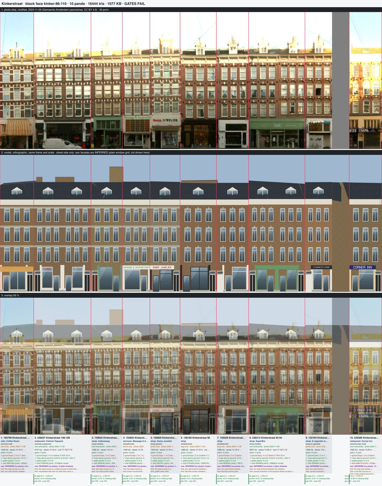 |
| kinker-112-116 | 2 | 3,908 | 2024-12-11 | plain-brick 2 (relieving heads) | 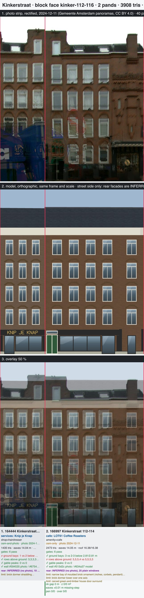 |
| kinker-120-138 | 3 | 10,136 | 2024-12-11 | plain-brick 3 (126-138 as 7 modules) | 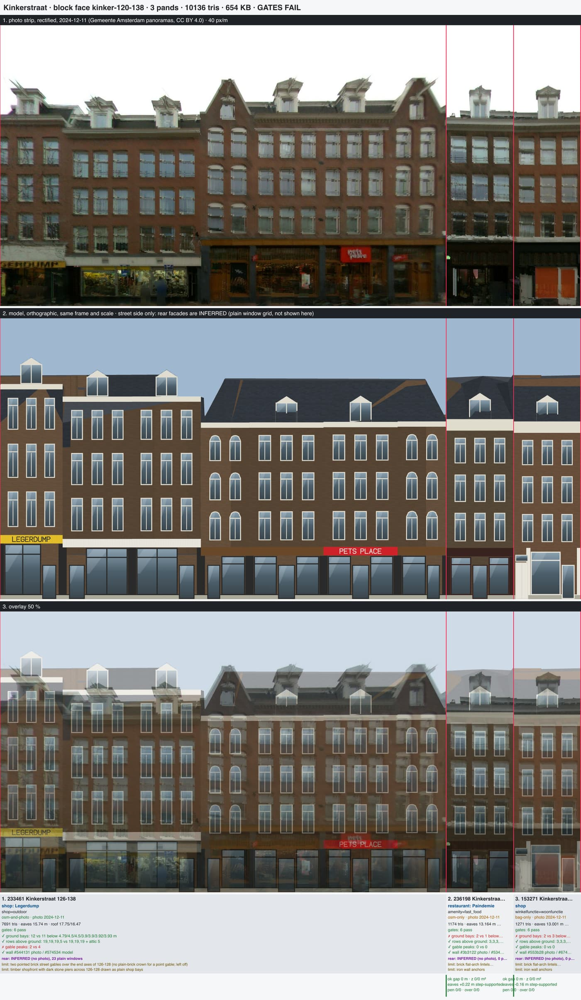 |
| kinker-142-178 | 11 | 23,988 | 2024-12-11 | 1985-infill 4, brick-arched 3, plain-brick 3, neo-renaissance 1 | 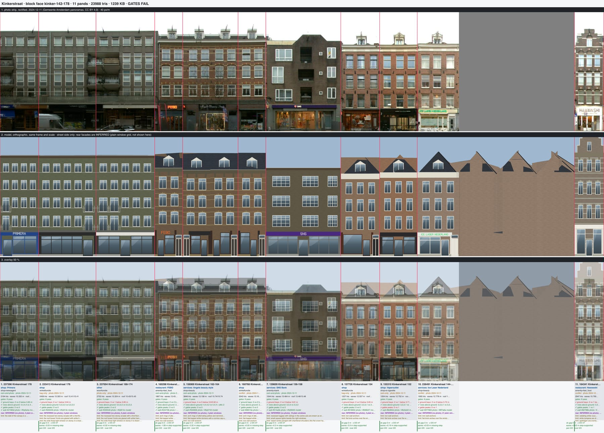 |
| kinker-182-184 | 2 | 2,286 | 2024-12-11 | 1985-infill 2 | 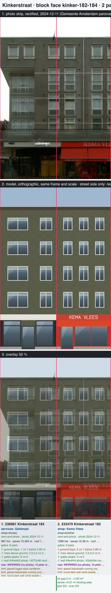 |
| kinker-186-202 | 6 | 16,696 | 2024-12-11 | brick-arched 5, plain-brick 1 | 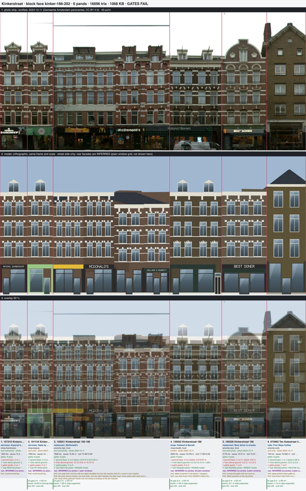 |
| kinker-206-242 | 15 | 25,795 | 2024-12-11 | painted-band 5, plain-brick 8, brick-arched 2 | 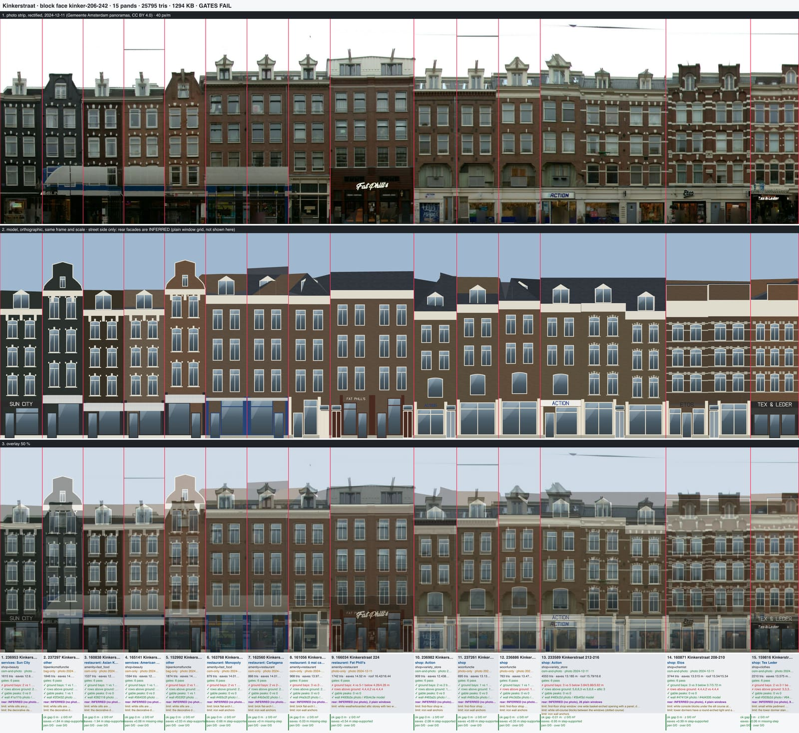 |
| kinker-244-332 | 26 | 62,479 | 2024-12-11 | brick-arched 10, plain-brick 10, painted-band 1, stucco 3, 1985-infill 2 | 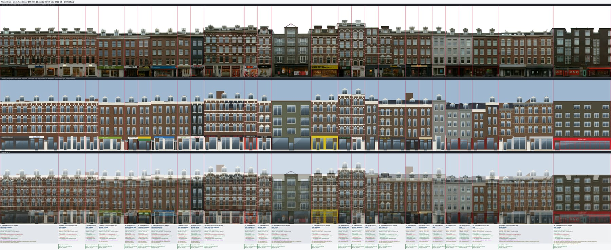 |
| kinker-334-374 | 18 | 45,076 | 2024-12-11 | plain-brick 6, balcony-axis 10, brick-arched 2 | 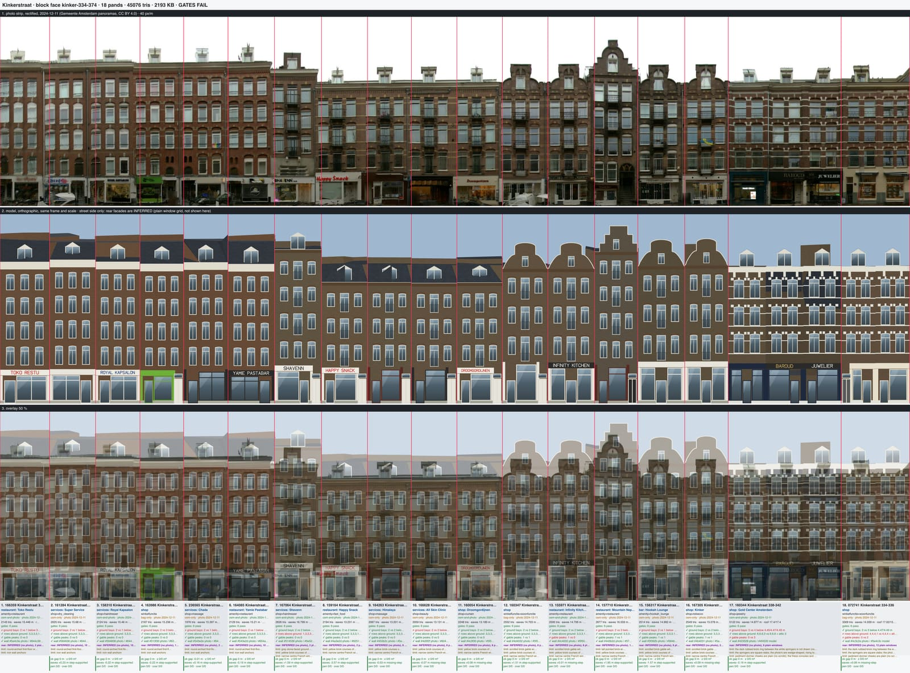 |
| kinker-376-380 | 3 | 6,484 | 2024-12-11 | plain-brick 3 | 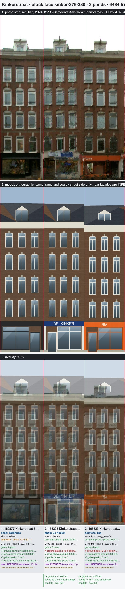 |
| kinker-386-390 | 2 | 4,128 | 2024-12-11 | balcony-axis 1, plain-brick 1 | 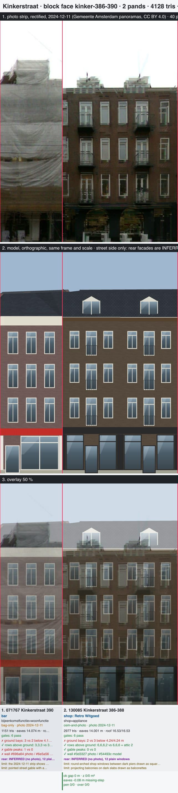 |
| **total** | **103** | **240,237** | | | |

No inline types were needed: every pand fits a library type or the 1985-infill grid. Every face passes the
compile gates and the interference check. Each sheet header still reads "GATES FAIL", from the same GLB-audit
z-fight in the INFERRED rear facades that the odd-side doc describes. `kinker-2-30` on main fails it too. It is not an
intent problem.

`kinker-244-332` stays one intent (26 pands, 3.2 MB GLB, 837 KB gzip). The face is straight, it compiles in about 9 s
and every per-front budget passes, so nothing called for a split at a party line. It is about twice the size of the
other chunks, so the integrator should know.

## Method

- **Types** come from the cluster table. Where the photo disagrees with an `auto` assignment, the intent says so: 16
  house citations, plus the face notes of 334-374, 376-380, 120-138 and 112-116. The overrules cover:
  - plain-brick rows tagged balcony-axis that have no balcony stack: 374-364, 380-376, 138-120
  - balcony stacks tagged brick-arched: 362, 352-344
  - brick-arched tagged plain-brick that do have white blocks: 252-258, 166-160
  - post-war fronts on BAG pre-war pands: 244-248
- **Shops** are read from the strip first, then the zoom crop. The OSM name is used when the strip is illegible, and
  every house records its `agreement`: osm-and-photo, osm-only, photo-only, bag-only or conflict. Lettering is drawn only
  when it is legible on the photo.
- **Walls**: a `measuredPalette` brick is set per pand, from palette-from-strip, and is new in the kit this lane
  (absent means byte-identical). palette-from-strip classes black and near-black paint as glass, so 242, 240, 238,
  244-248, 326-332, 296 and 188 take the review sampler's median or hand-sampled piers instead, with evidence.
- **Second pass** after every first sheet:
  - frieze cornices that drew a 1.6 m cream slab became `bracketed`
  - cornice rows that were off on the overlay became `measuredEaves`
  - storey pitch was taken from the photo where 3DBAG's eaves read the roof
- **Gallery-size look** at about 900 px wide per face.
- **Scaffolding**: 382-384 and 390 are under sheeting on the 2024-12-11 strip. 390 is read from the 2020-02-07 crop,
  and its review wall and row checks read the sheeting.

## Per-face tables

The wall columns are the review sampler's photo and model medians (tolerance hue 12°, sat 0.09, light 0.1).
### kinker-56-84 (5 pands, 22,817 triangles)

| pand | address | type | crown | shop (agreement) | wall photo | wall model | wall check | verdict |
|---|---|---|---|---|---|---|---|---|
| 152566 | Kinkerstraat 76-84 | infill | flat | Xenos (osm-only) | #645e52 | #6c6656 | ok | partial: storeys, 13 axes and shop span right; hipped 3DBAG roof vs flat parapet + 2 raised blocks, white lintel strips missing |
| 158903 | Kinkerstraat 72-74 | neo-ren | point-gable | oliver green (photo-only) | #7a7b6a | #6b6754 | ok | good: 2 axes, speklagen, pointed gable; 1 attic light vs 2 |
| 161359 | Kinkerstraat 68-70 | neo-ren x2 | point-gable/step-gable | shop (bag-only) | #646357 | #6f6d58 | ok | good |
| 236325 | Kinkerstraat 64-66 | neo-ren x2 | step-gable | Ai Asian Food (photo-only) | #6e6d5f | #73735b | ok | good; small gable of 66 drawn full height |
| 236441 | Kinkerstraat 56-62 | neo-ren x4 | none/point-gable/step-gable | GO NKD (osm-and-photo) | #989d88 | #75715b | hue -24 deg, too dark (-0.17) | partial: two gabled dormers (62, 60) missing; wall check fails (glare on the right half, photo #989d88) |

### kinker-86-110 (10 pands, 16,444 triangles)

| pand | address | type | crown | shop (agreement) | wall photo | wall model | wall check | verdict |
|---|---|---|---|---|---|---|---|---|
| 165799 | Kinkerstraat 110 | plain-brick | pediment-dormer | Coffee Room (osm-only) | #987d5b | #856a4b | ok | good: 3 axes, head course, dormer; striped Dutch awnings drawn |
| 236027 | Kinkerstraat 106-108 | plain-brick x2 | pediment-dormer | Camino Taqueria (osm-and-photo) | #796248 | #7e664c | ok | good |
| 159635 | Kinkerstraat 104 | plain-brick | pediment-dormer | Indianaweg (osm-and-photo) | #6f5d42 | #857251 | ok | good; 3DBAG hip roof hides the dormer |
| 152925 | Kinkerstraat 102 | plain-brick | pediment-dormer | Massage & Acupunctuur (photo-only) | #82694b | #847359 | ok | good; louvred transom panel missing |
| 160809 | Kinkerstraat 100 | plain-brick | pediment-dormer | Swiss Juwelier (photo-only) | #957f61 | #8b7a60 | ok | good |
| 158180 | Kinkerstraat 98 | plain-brick | pediment-dormer | shop (bag-only) | #7b5d43 | #83674b | ok | good |
| 156028 | Kinkerstraat 96 | plain-brick | pediment-dormer | shop (bag-only) | #836044 | #816448 | ok | good |
| 236213 | Kinkerstraat 92-94 | plain-brick x2 | pediment-dormer | SuperBra (osm-and-photo) | #846849 | #886b4c | ok | good |
| 155794 | Kinkerstraat 90 | plain-brick | pediment-dormer | E-cigarette store (photo-only) | #956945 | #936f4e | ok | good |
| 233580 | Kinkerstraat 86-88 | plain-brick | none | Corner Inn (osm-and-photo) | #d9a15f | #7d6a4d | too grey (-0.38), too dark (-0.22) | partial: wall check fails (strip is direct low sun), roof box and cream ground storey missing |

### kinker-112-116 (2 pands, 3,908 triangles)

| pand | address | type | crown | shop (agreement) | wall photo | wall model | wall check | verdict |
|---|---|---|---|---|---|---|---|---|
| 164444 | Kinkerstraat 116 | plain-brick | none | Knip je Knap (osm-and-photo) | #594535 | #675443 | ok | good |
| 166997 | Kinkerstraat 112-114 | plain-brick x2 | none | LOT61 Coffee Roasters (osm-only) | #513d2c | #634a37 | ok | partial: relieving arches drawn but faint at gallery size (band #453524 on wall #543f2f), moulded brick ornament bay and one-axis dormer tower left off |

### kinker-120-138 (3 pands, 10,136 triangles)

| pand | address | type | crown | shop (agreement) | wall photo | wall model | wall check | verdict |
|---|---|---|---|---|---|---|---|---|
| 233461 | Kinkerstraat 126-138 | plain-brick x7 | none/pediment-dormer | Legerdump (osm-and-photo) | #544131 | #574534 | ok | partial: two pointed street gables of 126-128 left off; timber shopfront piers plain |
| 236198 | Kinkerstraat 122 | plain-brick | pediment-dormer | Paindemie (osm-only) | #3b3122 | #534636 | ok | good |
| 153271 | Kinkerstraat 120 | plain-brick | pediment-dormer | shop (bag-only) | #553b28 | #674e3b | ok | good |

### kinker-142-178 (11 pands, 23,988 triangles)

| pand | address | type | crown | shop (agreement) | wall photo | wall model | wall check | verdict |
|---|---|---|---|---|---|---|---|---|
| 237396 | Kinkerstraat 178 | infill | flat | Primera (osm-and-photo) | #47483d | #5a5e4a | ok | partial: axes/storeys right, wall reads olive vs grey-brown, balconies thin, glazed canopy parapet as glass-block band |
| 233413 | Kinkerstraat 176 | infill | flat | shop (bag-only) | #505246 | #5c614c | ok | partial (same) |
| 237004 | Kinkerstraat 168-174 | infill | flat | other (photo-only) | #535549 | #5d614c | ok | partial (same) |
| 160298 | Kinkerstraat 166 | brick-arched | pediment-dormer | FEBO (osm-and-photo) | #534738 | #685644 | ok | good |
| 156969 | Kinkerstraat 162-164 | brick-arched x2 | pediment-dormer | Angels beauty style (osm-and-photo) | #594836 | #6a5743 | ok | good |
| 160768 | Kinkerstraat 160 | brick-arched | pediment-dormer | shop (conflict) | #68513e | #745c46 | ok | good |
| 139609 | Kinkerstraat 156-158 | infill | flat | SNS Bank (osm-and-photo) | #514a3b | #5d5645 | ok | partial: loggias, square lights, raised parapet missing |
| 157726 | Kinkerstraat 154 | plain-brick | pediment-dormer | shop (bag-only) | #816652 | #846b57 | ok | good |
| 155310 | Kinkerstraat 152 | plain-brick | pediment-dormer | Vaperoutlet (osm-only) | #8c664d | #8c6a52 | ok | good |
| 236491 | Kinkerstraat 144-150 | plain-brick | pediment-dormer | Ice Laser Nederland (conflict) | #977963 | #8f7a6a | ok | good |
| 164341 | Kinkerstraat 142 | neo-ren | step-gable | Hawawshi (conflict) | #82796b | #807567 | ok | good; lettering dropped for the triangle budget |

### kinker-182-184 (2 pands, 2,286 triangles)

| pand | address | type | crown | shop (agreement) | wall photo | wall model | wall check | verdict |
|---|---|---|---|---|---|---|---|---|
| 236981 | Kinkerstraat 184 | infill | flat | Geldmaat (osm-and-photo) | #4b4d43 | #575c48 | ok | partial: cantilevered glazed loggia stack flush; wall reads olive against the grey photo (within tolerance) |
| 233470 | Kinkerstraat 182 | infill | flat | Kema Vlees (osm-and-photo) | #4e4f44 | #5a5d4a | ok | good; glazed first-floor balustrade missing |

### kinker-186-202 (6 pands, 16,696 triangles)

| pand | address | type | crown | shop (agreement) | wall photo | wall model | wall check | verdict |
|---|---|---|---|---|---|---|---|---|
| 157310 | Kinkerstraat 202 | brick-arched | pediment-dormer | Imperial barbershop (osm-and-photo) | #504134 | #5e4e3d | ok | good; arched dormer light plain |
| 161134 | Kinkerstraat 200 | brick-arched | pediment-dormer | Nails by Bianca (osm-only) | #514234 | #61503f | ok | good |
| 159351 | Kinkerstraat 192-198 | brick-arched x4 | none | McDonald's (osm-and-photo) | #524135 | #5f4d40 | ok | partial: shared brick roof box and two one-axis dormer towers left off; stone mezzanine band over the left modules reads as a tall ground storey |
| 129253 | Kinkerstraat 188 | brick-arched x2 | pediment-dormer | Holland & Barrett (conflict) | #3d3a2d | #4f4635 | ok | good; very dark brick lifted by the brick slot (wall from pier samples) |
| 160226 | Kinkerstraat 186 | brick-arched | none | Best doner & snacks (osm-and-photo) | #52493b | #5f5647 | ok | partial: bell gable with oculi left off |
| 073962 | Ten Katestraat 42 (corner) | plain-brick | none | Five Ways Coffee (osm-only) | #4b432d | #5c5136 | ok | partial: steep street gable with oculus left off; olive brick |

### kinker-206-242 (15 pands, 25,795 triangles)

| pand | address | type | crown | shop (agreement) | wall photo | wall model | wall check | verdict |
|---|---|---|---|---|---|---|---|---|
| 236953 | Kinkerstraat 242 | painted-band | pediment-dormer | Sun City (osm-and-photo) | #1a1f1b | #2a302b | ok | good (wall from review sampler) |
| 237297 | Kinkerstraat 240 | painted-band | neck-gable | other (bag-only) | #2f3432 | #2a302d | ok | good |
| 160838 | Kinkerstraat 238 | painted-band | pediment-dormer | Asian King (osm-only) | #282118 | #362f24 | ok | good |
| 165141 | Kinkerstraat 236 | painted-band | pediment-dormer | American Nails (osm-only) | #564535 | #655749 | ok | good |
| 152992 | Kinkerstraat 234 | painted-band | neck-gable | other (bag-only) | #553f2f | #654e3c | ok | good; curved shared canopy drawn as per-house Dutch awnings |
| 163768 | Kinkerstraat 232 | plain-brick | pediment-dormer | Monopoly (osm-only) | #493c2f | #5a4c3e | ok | good |
| 162560 | Kinkerstraat 230 | plain-brick | pediment-dormer | Cartagena (osm-only) | #4b3e32 | #5a4c3f | ok | good |
| 161056 | Kinkerstraat 228 | plain-brick | pediment-dormer | ô mai café (osm-only) | #4a3c2f | #5b4b3d | ok | good |
| 166034 | Kinkerstraat 224 | plain-brick x2 | none | Fat Phill's (photo-only) | #493b2e | #5b4c3e | ok | partial: white weatherboarded attic storey missing |
| 236982 | Kinkerstraat 222 | plain-brick | pediment-dormer | Action (osm-and-photo) | #463a2c | #574b3a | ok | good |
| 237261 | Kinkerstraat 220 | plain-brick | pediment-dormer | shop (photo-only) | #483c2e | #584c3c | ok | good |
| 236886 | Kinkerstraat 218 | plain-brick | pediment-dormer | shop (photo-only) | #4c3d2e | #5e4c3b | ok | good; dormer lost to the 3DBAG roof |
| 233589 | Kinkerstraat 212-216 | plain-brick x3 | pediment-dormer | Action (osm-and-photo) | #483c2d | #5b4f3d | ok | partial: dotted sill blocks; 3DBAG roof partition fails the library check |
| 160871 | Kinkerstraat 208-210 | brick-arched x2 | tower | Etos (osm-and-photo) | #474134 | #4d4335 | ok | good; tower lights not arched |
| 159816 | Kinkerstraat 206 | brick-arched | tower | Tex Leder (osm-and-photo) | #503b2d | #644c38 | ok | partial: pediment hoods, tower over one axis |

### kinker-244-332 (26 pands, 62,479 triangles)

| pand | address | type | crown | shop (agreement) | wall photo | wall model | wall check | verdict |
|---|---|---|---|---|---|---|---|---|
| 159927 | Kinkerstraat 326-332 | brick-arched x4 | pediment-dormer | Coffee Company (osm-and-photo) | #4b3628 | #624533 | ok | good; balconettes not placed; wall from sampler |
| 236616 | Kinkerstraat 322-324 | brick-arched x2 | pediment-dormer | Gekaapt (photo-only) | #5a3e2c | #6b4b37 | ok | good |
| 153405 | Kinkerstraat 320 | brick-arched | pediment-dormer | Gekaapt (osm-and-photo) | #583e2d | #6b4e3c | ok | good |
| 236512 | Kinkerstraat 316-318 | plain-brick x2 | pediment-dormer | The Spa (osm-and-photo) | #56402e | #664a36 | ok | good |
| 157584 | Kinkerstraat 314 | plain-brick | pediment-dormer | Project 86 Men (osm-and-photo) | #574231 | #664e3a | ok | good |
| 235902 | Kinkerstraat 312 | plain-brick | pediment-dormer | Dönerland Eethuis (osm-and-photo) | #574436 | #645040 | ok | good |
| 236531 | Kinkerstraat 308-310 | plain-brick x2 | pediment-dormer | Moneytrans (osm-and-photo) | #4f4030 | #5f4c39 | ok | good |
| 236250 | Kinkerstraat 306 | plain-brick | pediment-dormer | Hazel Notenen & zuidvruchten (osm-and-photo) | #554433 | #634f3b | ok | good |
| 236258 | Kinkerstraat 304 | painted-band | pediment-dormer | Nicole (osm-and-photo) | #262d29 | #2d2f2b | ok | good |
| 235916 | Kinkerstraat 298-302 | brick-arched x3 | pediment-dormer | Hong Kong Superstore (osm-and-photo) | #4d3a2b | #5a4535 | ok | good |
| 235880 | Kinkerstraat 296 | brick-arched | pediment-dormer | U Break I Fix Amsterdam (osm-and-photo) | #4c4134 | #5d4737 | ok | good (wall from sampler) |
| 156795 | Kinkerstraat 294 | brick-arched | pediment-dormer | Ab-art (osm-and-photo) | #574233 | #655243 | ok | good; fan ornament plain, banded dormer |
| 061473 | Kinkerstraat 288-292 | infill | flat | Cycle (osm-and-photo) | #4d4e44 | #5b604c | ok | partial: raised centre bay and red frame missing; olive tone |
| 236631 | Kinkerstraat 284-286 | brick-arched x2 | pediment-dormer | Nusselein (osm-only) | #4e3d2e | #625342 | ok | good; banded dormers drawn as pediments |
| 167053 | Kinkerstraat 282 | brick-arched | pediment-dormer | De Indian Mart (osm-and-photo) | #4b4033 | #5a4c3d | ok | good; lattice tympana top storey missing |
| 236233 | Kinkerstraat 280 | brick-arched | pediment-dormer | Mydollishhair (osm-and-photo) | #504335 | #615142 | ok | good |
| 154164 | Kinkerstraat 278 | plain-brick | pediment-dormer | shop (photo-only) | #4d3f32 | #5c5144 | ok | good |
| 157025 | Kinkerstraat 274-276 | plain-brick x2 | pediment-dormer | Praxis City (osm-and-photo) | #483829 | #5a4a39 | ok | partial: two styles in one pand |
| 160192 | Kinkerstraat 272 | plain-brick | pediment-dormer | residential (photo-only) | #4e3d2f | #5e4c3c | ok | good |
| 159323 | Kinkerstraat 270 | plain-brick | pediment-dormer | Gustil (osm-only) | #4d3e30 | #5d4c3c | ok | good |
| 153531 | Kinkerstraat 268 | stucco | pediment-dormer | shop (photo-only) | #787b73 | #80837c | ok | good |
| 156893 | Kinkerstraat 266 | stucco | pediment-dormer | shop (photo-only) | #797c75 | #7c8079 | ok | good |
| 236219 | Kinkerstraat 264 | stucco | pediment-dormer | shop (bag-only) | #787d75 | #7a817a | ok | good |
| 237017 | Kinkerstraat 260 | plain-brick x2 | pediment-dormer | shop (bag-only) | #453425 | #594836 | ok | good |
| 156816 | Kinkerstraat 252-258 | brick-arched x4 | pediment-dormer | Zeeman (osm-only) | #54402f | #654f3d | ok | good |
| 233496 | Kinkerstraat 244-248 | infill | flat | Kruidvat (osm-and-photo) | #302d23 | #4c4838 | ok | partial: very dark brick lifted by the brick slot; set-back top storey |

### kinker-334-374 (18 pands, 45,076 triangles)

| pand | address | type | crown | shop (agreement) | wall photo | wall model | wall check | verdict |
|---|---|---|---|---|---|---|---|---|
| 166359 | Kinkerstraat 374 | plain-brick | pediment-dormer | Toko Restu (osm-and-photo) | #5a4c3e | #644c39 | ok | good; round-arched storey 1 and round stair lights missing; 372 cornice measured (3DBAG 17.3 m read the roof) |
| 161284 | Kinkerstraat 372 | plain-brick | pediment-dormer | Super Service (osm-only) | #584636 | #644b37 | ok | good; round-arched storey 1 and round stair lights missing; 372 cornice measured (3DBAG 17.3 m read the roof) |
| 158310 | Kinkerstraat 370 | plain-brick | pediment-dormer | Royal Kapsalon (osm-and-photo) | #594838 | #644c38 | ok | good; round-arched storey 1 and round stair lights missing; 372 cornice measured (3DBAG 17.3 m read the roof) |
| 163986 | Kinkerstraat 368 | plain-brick | pediment-dormer | shop (bag-only) | #513f30 | #634835 | ok | good; round-arched storey 1 and round stair lights missing; 372 cornice measured (3DBAG 17.3 m read the roof) |
| 236565 | Kinkerstraat 366 | plain-brick | pediment-dormer | Chada (osm-only) | #543e2e | #644936 | ok | good; round-arched storey 1 and round stair lights missing; 372 cornice measured (3DBAG 17.3 m read the roof) |
| 164085 | Kinkerstraat 364 | plain-brick | pediment-dormer | Yamie Pastabar (osm-and-photo) | #543e2d | #654a36 | ok | good; round-arched storey 1 and round stair lights missing; 372 cornice measured (3DBAG 17.3 m read the roof) |
| 167064 | Kinkerstraat 362 | balcony-axis | dormer | Shavenn (osm-and-photo) | #514536 | #5e5240 | ok | partial: stone ground + mezzanine band missing |
| 159164 | Kinkerstraat 360 | balcony-axis | dormer | Happy Snack (osm-and-photo) | #4a3e2d | #62513d | ok | good; yellow courses missing |
| 164263 | Kinkerstraat 358 | balcony-axis | dormer | Himalaya (osm-only) | #453b2c | #5e523f | ok | good; yellow courses missing |
| 166628 | Kinkerstraat 356 | balcony-axis | dormer | All Skin Clinic (osm-only) | #4d3f2f | #604f3e | ok | good; yellow courses missing |
| 160054 | Kinkerstraat 354 | balcony-axis | dormer | Droomgordijnen (osm-and-photo) | #4c3f30 | #5f513e | ok | good; yellow courses missing |
| 160347 | Kinkerstraat 352 | balcony-axis | neck-gable | shop (bag-only) | #4d4032 | #5f503e | ok | good; scrolled gable ornament plain |
| 155971 | Kinkerstraat 350 | balcony-axis | neck-gable | Infinity Kitchen (osm-and-photo) | #4c4032 | #5f503e | ok | good; scrolled gable ornament plain |
| 157710 | Kinkerstraat 348 | balcony-axis | step-gable | Mountain Nepal (osm-only) | #443b2d | #574f42 | ok | good; pointed brick entrance missing |
| 156317 | Kinkerstraat 346 | balcony-axis | neck-gable | Hookah Lounge (osm-only) | #3f392b | #564b3a | ok | good; scrolled gable ornament plain |
| 167305 | Kinkerstraat 344 | balcony-axis | neck-gable | Kinker (osm-only) | #4b4031 | #5a4e3c | ok | good; scrolled gable ornament plain |
| 160344 | Kinkerstraat 338-342 | brick-arched x3 | pediment-dormer | Gold Center Amsterdam (osm-and-photo) | #423528 | #4f4535 | ok | good |
| 072741 | Kinkerstraat 334-336 | brick-arched x2 | pediment-dormer | shop (bag-only) | #4c3c2e | #5e4c3c | ok | good |

### kinker-376-380 (3 pands, 6,484 triangles)

| pand | address | type | crown | shop (agreement) | wall photo | wall model | wall check | verdict |
|---|---|---|---|---|---|---|---|---|
| 160877 | Kinkerstraat 380 | plain-brick | pediment-dormer | Yarnhugs (osm-only) | #513e30 | #624a3a | ok | good; one round-arched storey-1 window each missing |
| 158308 | Kinkerstraat 378 | plain-brick | pediment-dormer | De Kinker (osm-and-photo) | #533e2e | #644b37 | ok | good; one round-arched storey-1 window each missing |
| 165323 | Kinkerstraat 376 | plain-brick | pediment-dormer | Ria (osm-and-photo) | #533e2e | #644935 | ok | good; one round-arched storey-1 window each missing |

### kinker-386-390 (2 pands, 4,128 triangles)

| pand | address | type | crown | shop (agreement) | wall photo | wall model | wall check | verdict |
|---|---|---|---|---|---|---|---|---|
| 071767 | Kinkerstraat 390 | plain-brick | none | bar (bag-only) | #696a64 | #6e5a56 | too saturated (+0.09) | partial: pointed gable with hexagonal light left off; review checks read scaffold sheeting |
| 130085 | Kinkerstraat 386-388 | balcony-axis x2 | dormer | Retro Witgoed (osm-and-photo) | #3d3327 | #54493c | ok | good; projecting balconies drawn as balconettes, arched shop windows square |

## Kit gaps: what the photos show that no type and no kit key can say

Each gap is counted in pands (159 limitation lines across the 12 intents). Nothing here was approximated with the
nearest option. Each one is left out and named in the face's `limitations`.

| gap | pands | where |
|---|---|---|
| iron wall anchors | 27 | 86-110, 142-178, 206-242, 244-332, 334-374 |
| tympanum ornament (sunburst voussoirs, fan, lattice, carved fills) | 13 | 56-84, 86-110, 186-202, 244-332 |
| dormer shapes (gabled stone, flat-capped, banded brick-and-white, one-axis brick towers, arched lights, a box straddling two modules) | 13 | 56-84, 112-116, 142-178, 186-202, 206-242, 244-332 |
| yellow brick courses of the 1902 balcony row | 10 | 334-374 |
| narrow centre French windows (the kit widens the balcony axis) | 10 | 334-374 |
| gables the crown set cannot say (scrolled, bell with oculi, point gable on a plain type, a small two-step gable, steep pitched street gable) | 9 | 56-84, 120-138, 186-202, 334-374, 386-390 |
| round-arched storey-1 windows mixed into a segmental row, round stair lights | 9 | 334-374, 376-380 |
| dotted white block courses (drawn continuous or left off) | 7 | 86-110, 206-242, 244-332 |
| flat brick arches (strekken) | 5 | 86-110, 142-178 |
| loggias, glazed balustrades, terrace edges | 5 | 142-178, 182-184 |
| yellow/red alternating arch blocks | 4 | 142-178, 244-332 |
| basket-arched first-floor shop window | 4 | 206-242 |
| 3DBAG roof mass wrong for the front (hip over a flat block, partition failure, weatherboarded attic) | 3 | 56-84, 206-242 |
| very dark brick below the brick slot's lightness floor (0.30) | 2 | 186-202, 244-332 |
| pediment hoods over single windows | 2 | 186-202, 206-242 |
| two styles in one BAG pand | 1 | 244-332 |
| smaller items: moulded brick ornament bay, raised centre bay with steel frame, louvred transom, stall-riser colour, pointed entrance, stone mezzanine, projecting balconies on slabs, round wall vents | 1 each | various |

Pipeline gaps found on the way:

- **palette-from-strip classes black and near-black paint as glass** (242, 240, 238, 244-248; 188 and 326-332 read too grey for the same reason). The review sampler is the workaround,
  with the evidence recorded.
- **Sign glyphs and the triangle budget**: Hawawshi on 142 went to 3,011 triangles and the lettering was dropped.
- **No `Ö` glyph**: Dönerland on 312 is left unlettered. The sign validator also strips non-ASCII letters before it
  matches the use name.
- **Infill walls read olive** against grey-brown photos (182-184, 142-178, 288-292), even inside the tolerance.

## Blocked: the single-pand faces

`kinker-140-142` (237340), `kinker-382-382` (067825) and `kinker-392-392` (197936) each hold one pand.
`validateBlockFace` rejects them: "a block face needs at least two houses", from `src/canalRecall/blockFace/intent.ts`.
Relaxing that rule to one house is a shared validator change. This lane's attempt was refused by the session's
permission policy, so it is left to the integrator. Two things are ready for it:

- The 382-384 draft is parked at `staging/look/kinker-382-382.intent.json` in this worktree. It is balcony-axis, read
  from the 2019-11-11 crop because the strip is scaffolded.
- The notes below describe the other two.

What each face shows:

- **140-142**: the strip span is about 3 m off. Its left part is 142 (164341, already in `kinker-142-178`). The pand
  itself is dark brown brick (#52463a), with 3 flat-headed axes, a white cornice, a pediment dormer and a white
  ground storey. OSM gives Takumi Ramen, de Volkskruidentuin and Meat the Balls.
- **392**: a one-storey building, 4 m to the eaves, behind a brick wall. BAG logiesfunctie, no OSM. It fits no type,
  so it would need a house `design` and not a type placement.

## The brick-arched window width (coordinator question)

The accents note said the 1890 brick-arched windows draw about 0.8 m wide, against 0.95 m in the photo
(`windowShare` 0.55). Measured on these strips:

| pand | photo window | model window | bay | photo share |
|---|---|---|---|---|
| 298-302 (235916) | 1.19 m | 1.12 m | 2.05 m | 0.58 |
| 202 (157310) | about 1.0 m | about 1.0 m | 2.05 m | about 0.50 |

These faces do not show a consistent under-width. 298-302 is about 7 cm narrow and 202 matches. The brick-arched
pands here are 2-axis modules about 4.1 m wide, not the narrower bays where the gap was seen.

## Verification

- `npm run lint`, `npm run test:block-face` (86 pass) and `npm run test:fit-golden` ("all 156 house recipes
  identical") pass on the merged branch.
- The kit changes in this lane are guarded, so they are byte-identical when absent:
  - `measuredPalette`
  - `limitations` (documentation only)
  - the interference side taken from the frontage, which reads the gate and not the GLB
- When the kit change landed, all 25 other faces' chunks hashed identically before and after. After the main merge
  the other 33 faces compile. The before/after hash on main's kit files could not be redone, because swapping those
  files in was refused by the permission policy.
