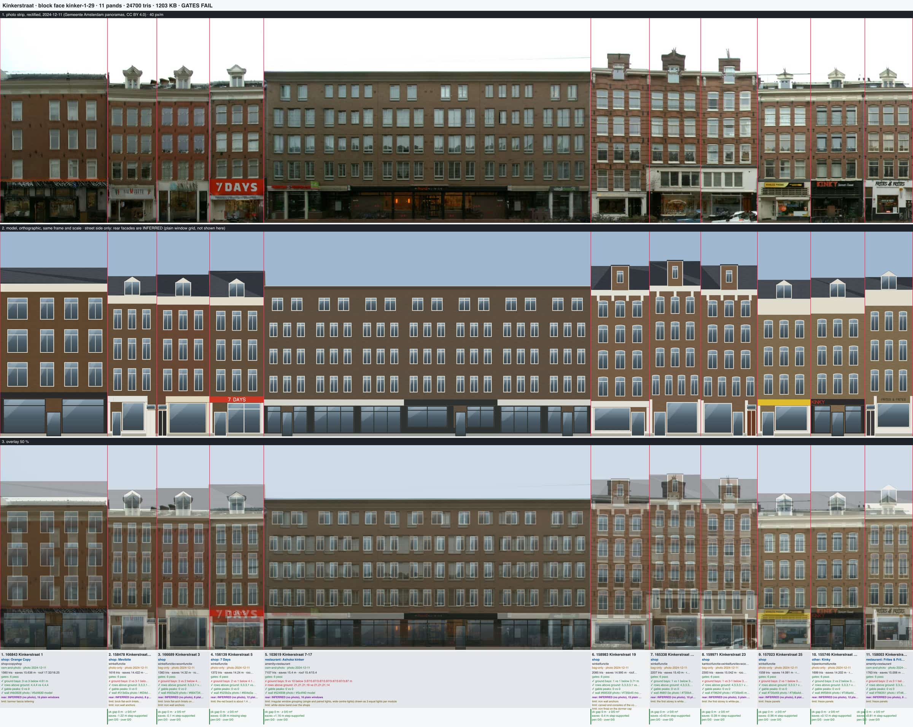
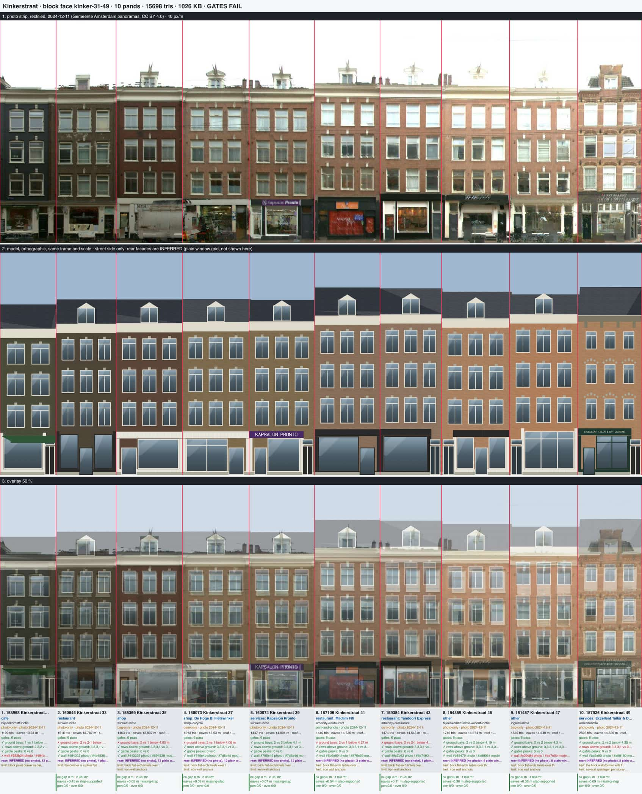
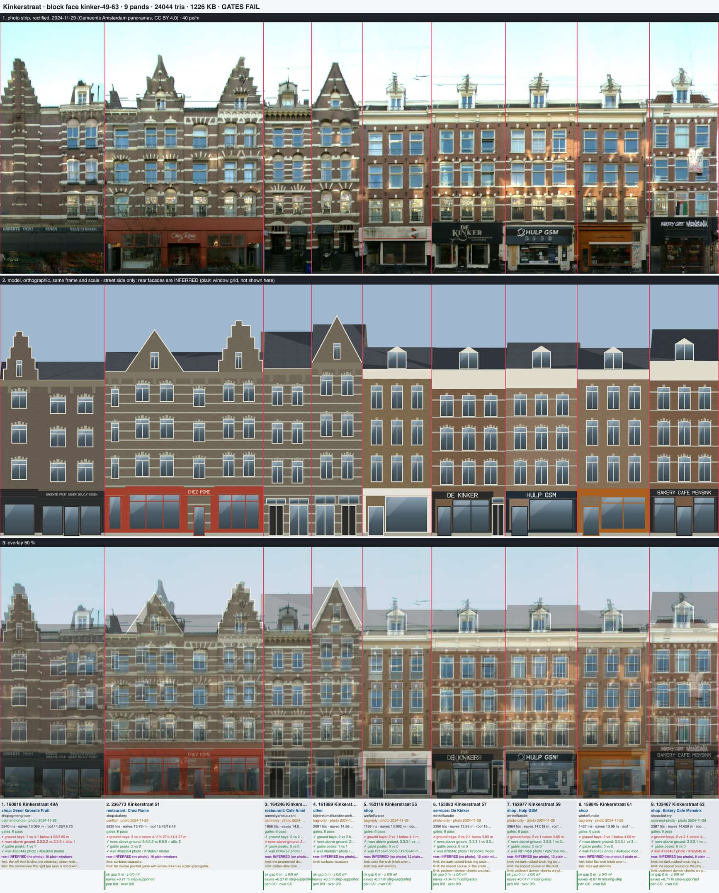
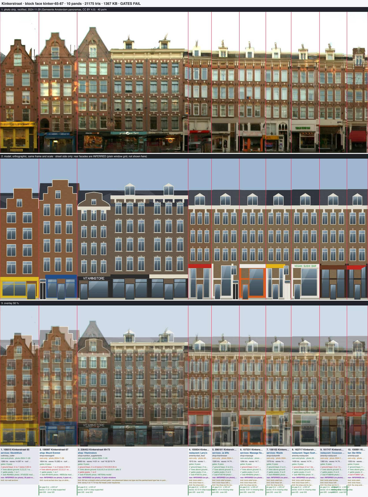
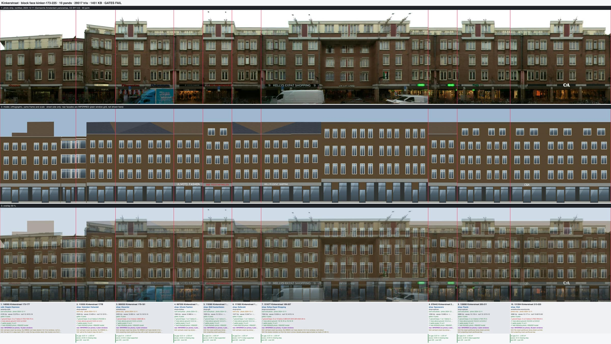
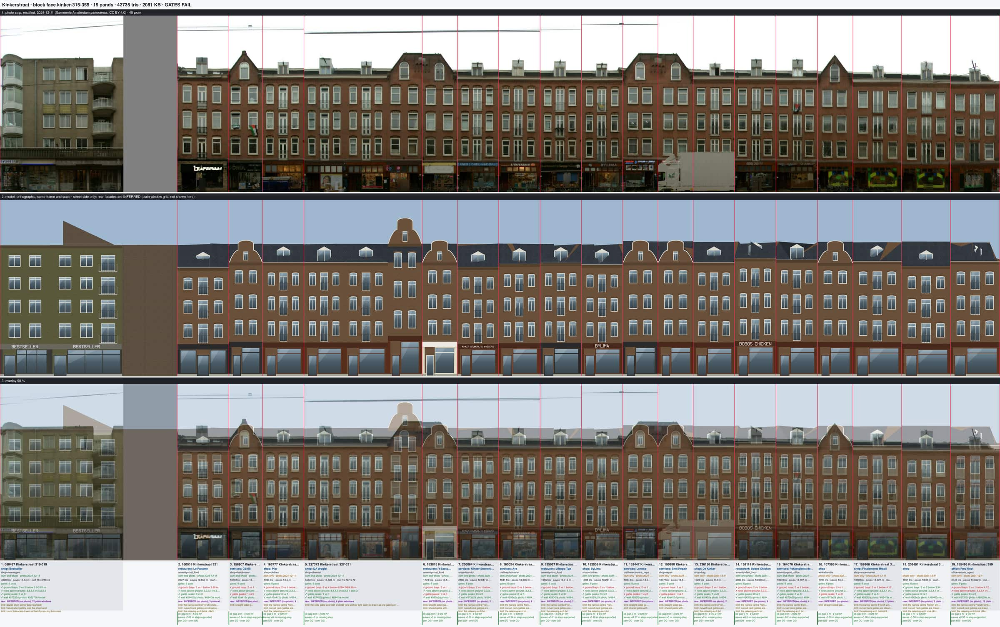
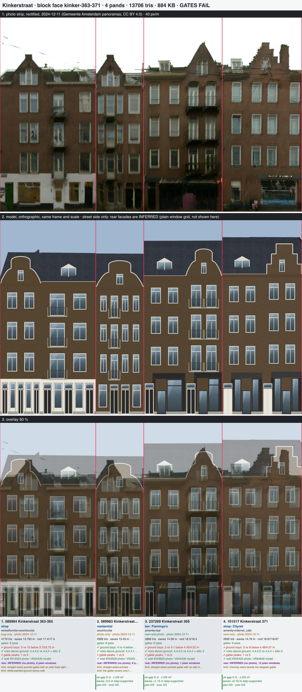
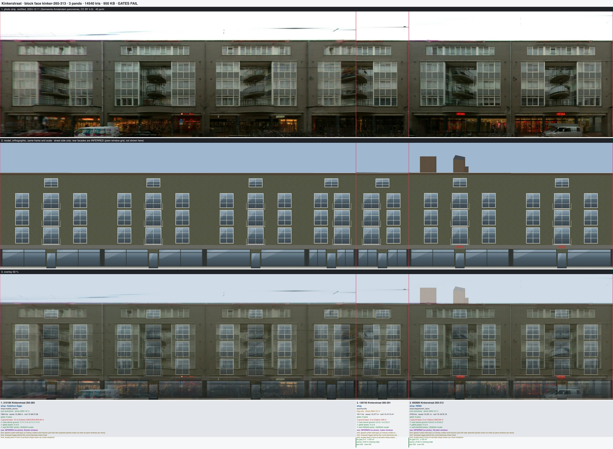

# Kinkerstraat odd-side faces (2026-10-14)

Plan Part 2 step 4, odd side: eight block faces authored as full intents on the Oud-West type library
(`docs/kinkerstraat-types-20261014.md`), 76 pands. `kinker-89-105` and `kinker-227-263` (large-tier singles) belong to
another lane. Sources are the face strips only (Gemeente Amsterdam panoramas 2024-11-29 and 2024-12-11, CC BY 4.0), with
OSM and BAG uses from each face's `uses.json`. Every face was compiled with `compile.ts --face=<id>` (not installed).

| face | pands | tris | strip | types placed | inline (face-local) types |
|---|---|---|---|---|---|
| kinker-1-29 | 11 | 24,700 | 2024-12-11 | plain-brick 7, 1985-infill 1 | `kinker-1885-wall-dormer` (19, 21, 23) |
| kinker-31-49 | 10 | 15,698 | 2024-12-11 | plain-brick 9, neo-renaissance 1 | - |
| kinker-49-63 | 9 | 23,312 | 2024-11-29 | neo-renaissance 4, plain-brick 2, brick-arched 3 | - |
| kinker-65-87 | 10 | 20,311 | 2024-11-29 | plain-brick 7, painted-band 1 | `kinker-1893-plain-step-gable` (65, 67) |
| kinker-173-225 | 10 | 29,517 | 2024-12-11 | 1985-infill 10 | - |
| kinker-315-359 | 19 | 42,735 | 2024-12-11 | 1902-balcony-axis 18, 1985-infill 1 | - |
| kinker-363-371 | 4 | 13,706 | 2024-12-11 | 1902-balcony-axis 4 (flat heads) | - |
| kinker-265-313 | 3 | 14,540 | 2024-12-11 | 1985-infill 3 (bay unit as overrides) | - |
| **total** | **76** | **184,519** | | | |

Gates and interference pass on all eight faces. The GLB audit's z-fight check fails on every Kinkerstraat face,
including the two proof faces at current main (2-30: 115 m², 109-161: 148 m² coplanar): the overlap is in the INFERRED
rear facades (glass and frame of the rear windows; with `--no-rears` 1-29 drops from 187 m² to 1.5 m²). That is a
shared-kit regression for the rear-facade lane, not something an intent can fix; the sheets' "GATES FAIL" header is
that audit line.

## Method

- **Types** from the cluster tables, checked against each strip zoom; where the photo disagrees with an `auto`
  assignment the intent says so in `groundFloor.note`/`rhythm.citation` (1A brick-arched → plain-brick: flat heads;
  55 brick-arched → plain-brick; 59 plain-brick → brick-arched; 61 painted-band → plain-brick; 7-17 brick-arched →
  infill: BAG says 1900, the front is a late-20th-century block; 363-367 had no type: 1902 balcony-axis with flat heads).
- **Two inline types**, each because no library type and no placement override can say the front: a centre-axis brick
  wall dormer through the cornice (19-23; brick-arched's `tower` crown spans axes 0-1 of a 2-axis module, plain-brick has
  only pediment dormers), and a plain brick front with a stepped gable (65, 67; the gabled types carry speklagen or
  painted courses that a placement cannot remove: `speklagen` needs `bands: speklagen`, `bandLines` needs `bands:
  painted`). Both are written as candidates for the library.
- **Modules** carry crowns that cover part of a front (51: none | point | none | step; 49A; 363-371) and follow
  footprint steps: a front whose chain has a vertex more than 0.5 m proud of its chord throws "Grouped frontage is not a
  straight surveyed wall", and a 0.85 m return alone has no roof profile, so 177-177B and 189-207 are cut at the step
  corners with the returns folded into the recessed module (an inset ≤ 1 m is allowed).
- **Wall colour**: `palette-from-strip.ts` per pand; where the type palette was more than 24 (sum of RGB) off, the
  measured brick goes in `overrides.palette.brick` (a 3 cm facing). The render lifts and saturates: where the first
  review missed, the input was compensated by the photo-minus-model difference (31, 33, 45, 47, 49, 173-225, 315-319,
  363-371). The facing roughly doubles a front's triangles (23: 2,300 → 4,048), so five pands keep the type palette to
  stay under the 3,000-per-front budget (23, 57, 59, 63, 69-73; 59 since the accents pass added white courses and springers to brick-arched).
- **Cornices** measured on the strip (`measuredEaves` with `frontRoof`) where 3DBAG eaves read a mansard or a rear roof
  (51, 69-73, 75-87, 323-357, 367-371); 1-29, 31-49, 49-63 and 65-87 use recipe roofs at 30° so 3DBAG pyramids and
  mansards do not stand over the cornice line; 173-225 keeps the 3DBAG roof as the set-back storey's mass.
- **Shops** from zoom crops: names when legible (`osm-and-photo` when OSM agrees, `photo-only` without an OSM node,
  `conflict` at 51: OSM Mano Bakery, sign Chez Rome), else OSM (`osm-only`), else BAG (`bag-only`). Signs carry lettering
  only where the photo's is legible.
- **Second pass** on every face after looking at the sheet at gallery size (each fix is in the face's commit message):
  1-29 recipe roofs and 21-23 as four-light storeys instead of glass two-storey shops; 49-63 the four-module 51 and one
  sign per pand; 65-87 the 75-87 row's cornice at row 295 with two-storey shops (it had stood 2.5 m high under a frieze
  slab) and 69-73's per-front eaves; 173-225 four storeys under the 3DBAG roof (five failed the storey-height gate);
  315-359 the corner block in two modules; 363-371 measured cornices; 265-313 window share instead of bay widths.
- Brick-arched window width (the type's `windowShare` 0.55): on the three 3-axis brick-arched fronts here the photo's
  windows measure 0.55 (57), 0.56 (59) and 0.59 (63) of the front, so the type share holds on this side; the 0.8 vs
  0.95 m issue seen on the 2-axis modules does not show.

## What the kit still cannot say (odd side, counts in pands)

| gap | pands | where |
|---|---|---|
| Arcade: piers in front of set-back shops under a canopy | 13 | 173-225 (10), 265-313 (3) |
| Frieze panels and consoles (the kit frieze/bracketed cornice is plain) | 13 | 25-29, 57, 59, 63, 75-87 |
| Iron wall anchors | 21 | 1-5, 19-29, 31-47, 65, 67 |
| Straight-sided pointed gables (drawn as the type's bell/neck gable) | 10 fronts | 69, 323, 331, 333, 343, 345, 353, 363-365, 367, 369 |
| Set-back top storey (and its cream material) | 10 | 173-225 |
| Brick-relief tympana (carved brick fans over segmental heads) | 7 | 75-87 |
| Shop with a mezzanine storey (drawn as one two-storey shop) | 7 | 75-87 |
| Projecting cream penthouse bays (red panel, grey ledge) | 5 | 179-181, 185, 189-207, 209-211, 213-225 |
| Centre brick wall dormer through the cornice (no library crown) | 5 | 19, 21, 23 (inline type), 49 corner, 87 |
| Brick look clamps colour: black paint lifts to olive, sunlit light brick darkens, light walls saturate | 4 | 31, 47, 63, 87 (wall check fails) |
| Per-front facing doubles triangles: measured brick dropped for the budget | 5 | 23, 57, 59, 63, 69-73 |
| Pair gable over two pands (one gable per front instead) | 4 | 331+333, 343+345 |
| Sunburst voussoirs | 3 | 51, 53, 53A |
| Dormers on the neo-renaissance type (no dormer crown) | 3 | 49A, 53, 49 corner side dormers |
| Glazed curtain-wall bays and recessed loggias; windows capped at ~1.5 m on wide bays | 3 | 265-313 |
| One-storey paint (a painted first storey or ground storey wall) | 3 | 21, 23, 363-365 |
| Footprint steps: no front over a > 0.5 m outset vertex, no front on a return | 3 | 177-177B, 189-207 (cut by modules) |
| Gable scrollwork and finials | 2 | 49A, 51 |
| Plain brick with a stepped gable (no library variant) | 2 | 65, 67 (inline type) |
| Stoops on a `groundFront: wall` ground | 2 | 53, 53A |
| Placement cannot set the wall material (painted brick) | 1 | 31 |
| One type per pand (gabled 69 and 6-axis 71-73 in one BAG pand) | 1 | 69-73 |
| Blind (windowless) part of a front | 1 | 49A |
| Gable over part of a module's axes | 1 | 367 |
| Glazed drum corner bay; balustraded gallery; round balconies | 1 | 315-319 |
| Pointed Gothic mezzanine lights | 1 | 81 |
| Plain flat-topped dormer on plain-brick | 1 | 33 |
| Corbel-table cornice | 1 | 53 |
| Chimney stack beside a gable | 1 | 371 |

## Files

- `scripts/block-face/faces/kinker-{1-29,31-49,49-63,65-87,173-225,315-359,363-371,265-313}/intent.json` (each with a
  `limitations` list).
- Sheets (photo | model | 50 % overlay | per-pand uses, gates, facade-compare, wall colour | party lines):
  `staging/block-face/<face>/review/strip-sheet.png`, copies in `docs/images/kinkerstraat/<face>-sheet.jpg`.

## Faces

### kinker-1-29 (11 pands, 24,700 tris, gates pass)

| pand | address | type (crown, modules) | shop (agreement) | wall photo / model | verdict |
|---|---|---|---|---|---|
| 166843 | Kinkerstraat 1 | kinker-1890-plain-brick (none) | Orange Copy (shop=copyshop), osm-and-photo | #4b3926 / #5d4630 | read: storey lines, cornice, axis grouping; wrong: model windows too wide (photo narrow ~0.9 m T-windows), banner fascia. |
| 158478 | Kinkerstraat 1A | kinker-1890-plain-brick (pediment-dormer) | Mevibite, photo-only | #513d2a / #634d37 | right. |
| 166689 | Kinkerstraat 3 | kinker-1890-plain-brick (pediment-dormer) | shop, bag-only | #563a29 / #664734 | right. |
| 156139 | Kinkerstraat 5 | kinker-1890-plain-brick (pediment-dormer) | 7 Days, photo-only | #523b2a / #604e3a | right; red board shorter than photo's 1.4 m. |
| 103619 | Kinkerstraat 7-17 | kinker-1985-infill (flat, 7 modules) | Ashoka kinker (amenity=restaurant), osm-and-photo | #524938 / #5c4f40 | storeys, flat top, colour right; irregular single/paired lights regularised; white stone band over shops drawn as fascias. |
| 158983 | Kinkerstraat 19 | kinker-1885-wall-dormer (wall-dormer) | shop, bag-only | #69533f / #735b45 | segmental heads, wall dormer through cornice right; end consoles, finial missing. |
| 165338 | Kinkerstraat 21 | kinker-1885-wall-dormer (wall-dormer) | shop, bag-only | #68513e / #735b45 | right except white-painted first storey drawn as brick. |
| 159971 | Kinkerstraat 23 | kinker-1885-wall-dormer (wall-dormer) | shop, bag-only | #79624f / #735b45 | as 165338; wall slightly darker than photo (within tolerance). |
| 157023 | Kinkerstraat 25 | kinker-1890-plain-brick (pediment-dormer) | shop, photo-only | #735d49 / #7d6a4d | right; frieze plain slab, no panels. |
| 155746 | Kinkerstraat 27 | kinker-1890-plain-brick (pediment-dormer) | Kinky, photo-only | #6f5844 / #7d6a4d | right. |
| 158003 | Kinkerstraat 29 | kinker-1890-plain-brick (pediment-dormer) | Frites & Frites (amenity=restaurant), osm-and-photo | #766351 / #7d6a4d | right. |

Limitations (in the intent): Iron wall anchors on every 1883-1885 front (no kit key); 7-17 (103619): irregular grouping of single and wide lights per module; drawn as 3 equal lights per module; 19-23: carved end consoles of the cornice and the iron finial on the wall dormer; 21-23: the first storey is white-painted over the whole width (one storey of paint over brick): the kit paints whole fronts (wallMaterial) or bands, not one storey; drawn as brick with its 4 lights; 25-29: frieze panels (the kit frieze is a plain slab).

### kinker-31-49 (10 pands, 15,698 tris, gates pass)

| pand | address | type (crown, modules) | shop (agreement) | wall photo / model | verdict |
|---|---|---|---|---|---|
| 158968 | Kinkerstraat 31 | kinker-1890-plain-brick (none) | cafe, photo-only | #282b24 / #494b3b ✗ hue -18 deg, too light (+0.11) | storeys/axes right; black paint renders as dark olive brick (#494b3b vs #282b24): FAIL wall, painted-brick not settable per placement. |
| 160646 | Kinkerstraat 33 | kinker-1890-plain-brick (pediment-dormer) | restaurant, photo-only | #454032 / #4c4538 | right; dormer is a plain box in the photo. |
| 155369 | Kinkerstraat 35 | kinker-1890-plain-brick (pediment-dormer) | shop, bag-only | #443225 / #594538 | right. |
| 160073 | Kinkerstraat 37 | kinker-1890-plain-brick (pediment-dormer) | De Hoge Bi Fietswinkel (shop=bicycle), osm-only | #745e4b / #7d6a4d | right. |
| 160074 | Kinkerstraat 39 | kinker-1890-plain-brick (pediment-dormer) | Kapsalon Pronto, photo-only | #795e49 / #7d6a4d | right. |
| 167106 | Kinkerstraat 41 | kinker-1890-plain-brick (pediment-dormer) | Madam Fifi (amenity=restaurant), osm-and-photo | #8b6e59 / #876e59 | right. |
| 159384 | Kinkerstraat 43 | kinker-1890-plain-brick (pediment-dormer) | Tandoori Express (amenity=restaurant), osm-only | #9c7b63 / #8e7460 | right. |
| 154359 | Kinkerstraat 45 | kinker-1890-plain-brick (pediment-dormer) | other, photo-only | #b89479 / #a88061 | right. |
| 161457 | Kinkerstraat 47 | kinker-1890-plain-brick (pediment-dormer) | other, bag-only | #c09d84 / #ae7e5b ✗ too dark (-0.12) | wall FAIL too dark: brick look caps sunlit light brick. |
| 157926 | Kinkerstraat 49 | kinker-1886-neo-renaissance (none) | Excellent Tailor & Dry Cleaning, photo-only | #ba9a80 / #a98160 | speklagen and relieving arches read; wall dormer + side dormers missing. |

Limitations (in the intent): Kinkerstraat 31: black paint (painted-band type has no crown without a dormer; a placement cannot change the wall material). Drawn as dark brick; Kinkerstraat 33: plain flat-topped box dormer with a white frame drawn as the type pediment dormer (plain-brick has no plain-dormer crown); Kinkerstraat 49: centre brick wall dormer with a flat cap between two small dormers; not drawn (neo-renaissance has no wall-dormer crown); Iron wall anchors; tall carved keystones drawn as plain keystone blocks.

### kinker-49-63 (9 pands, 23,312 tris, gates pass)

| pand | address | type (crown, modules) | shop (agreement) | wall photo / model | verdict |
|---|---|---|---|---|---|
| 160810 | Kinkerstraat 49A | kinker-1886-neo-renaissance (step-gable + none, 2 modules) | Sener Groente Fruit (shop=greengrocer), osm-and-photo | #5d544a / #665b50 | speklagen, step gable read; blind left third drawn with windows, dormer missing. |
| 236773 | Kinkerstraat 51 | kinker-1886-neo-renaissance (none + point-gable + none + step-gable, 4 modules) | Chez Rome (shop=bakery), conflict | #6e6354 / #706657 | two gables, 6 axes, speklagen read; sunburst voussoirs and gable scrollwork missing; point gable broad. |
| 164246 | Kinkerstraat 53 | kinker-1886-neo-renaissance (none) | Cafe Amoi (amenity=restaurant), osm-only | #746757 / #706658 | read; pediment dormer and corbel cornice missing. |
| 161889 | Kinkerstraat 53A | kinker-1886-neo-renaissance (point-gable) | other, bag-only | #6e6051 / #706658 | right. |
| 162119 | Kinkerstraat 55 | kinker-1890-plain-brick (pediment-dormer) | shop, bag-only | #715e4f / #7d6a4d | right. |
| 153083 | Kinkerstraat 57 | kinker-1890-brick-arched (pediment-dormer) | De Kinker, photo-only | #775e4b / #765b45 | right; frieze consoles missing. |
| 163977 | Kinkerstraat 59 | kinker-1890-brick-arched (pediment-dormer) | Hulp GSM, photo-only | #8f725a / #765b45 | right. |
| 159845 | Kinkerstraat 61 | kinker-1890-plain-brick (pediment-dormer) | shop, bag-only | #7e6752 / #846e56 | right. |
| 133467 | Kinkerstraat 63 | kinker-1890-brick-arched (pediment-dormer) | Bakery Cafe Mensink (shop=bakery), osm-and-photo | #786356 / #765b45 ✗ too saturated (+0.10) | read; wall slightly too saturated (FAIL +0.09 sat) - facing would break 3000-tri budget. |

Limitations (in the intent): Sunburst voussoirs (radiating white blocks) over the storey-1 windows of 51-53A: drawn as blocked arches; 49A: blind brick pier with its own stepped gable over the left third; drawn as a one-axis module; 51: gable scrollwork and finials on the pointed and stepped gables; 53: pedimented dormer and 49A dormer on the neo-renaissance type (no dormer crown variant); 53/53A: corbel-table cornice; stoops up to the house doors (groundFront has no stoop on a wall ground).

### kinker-65-87 (10 pands, 20,311 tris, gates pass)

| pand | address | type (crown, modules) | shop (agreement) | wall photo / model | verdict |
|---|---|---|---|---|---|
| 106015 | Kinkerstraat 65 | kinker-1893-plain-step-gable (step-2) | Sleutelkluis (craft=key_cutter), osm-and-photo | #6d482c / #7d5232 | read; gable rises lower than the photo's; anchors missing. |
| 156997 | Kinkerstraat 67 | kinker-1893-plain-step-gable (step-3) | Mount Everest (shop=newsagent), osm-only | #816043 / #805c3e | read; storey-1 arched door bay drawn as a window. |
| 236453 | Kinkerstraat 69-73 | kinker-1895-painted-band (neck-gable + pediment-dormer + pediment-dormer, 3 modules) | Vitaminstore (shop=nutrition_supplements), osm-and-photo | #735d45 / #67594a | 71-73 reads (blocked arches, cornice line, two dormers); 69's tall pointed gable drawn as a low neck gable (one type per pand). |
| 155934 | Kinkerstraat 75 | kinker-1890-plain-brick (pediment-dormer) | Larry's (amenity=fast_food), osm-only | #70573c / #765b40 | cornice line, dormers, axes read; brick fans and frieze panels plain. |
| 096181 | Kinkerstraat 77 | kinker-1890-plain-brick (pediment-dormer) | Ja &Ro (shop=hairdresser), osm-only | #7c6749 / #7d694d | as above. |
| 157331 | Kinkerstraat 79 | kinker-1890-plain-brick (pediment-dormer) | Massage Salon Oranje (shop=massage), osm-and-photo | #84694a / #7c694d | as above. |
| 156102 | Kinkerstraat 81 | kinker-1890-plain-brick (pediment-dormer) | Wesile (shop=locksmith), osm-only | #908063 / #7d6a4d | as above; Gothic mezzanine lights missing. |
| 162717 | Kinkerstraat 83 | kinker-1890-plain-brick (pediment-dormer) | Vegan Sushi Bar (amenity=restaurant), osm-and-photo | #86765a / #7d6a4d | as above. |
| 161747 | Kinkerstraat 85 | kinker-1890-plain-brick (pediment-dormer) | Couscous Bar (amenity=restaurant), osm-only | #7d6649 / #7d6a4d | as above. |
| 156991 | Kinkerstraat 87 | kinker-1890-plain-brick (pediment-dormer) | Bar Billie (amenity=pub), osm-only | #736851 / #786145 ✗ too saturated (+0.10) | wall FAIL slightly saturated (+0.10); brick wall dormer drawn as pediment dormer. |

Limitations (in the intent): 69-73 is one BAG pand with two fronts of different types (gabled 69, 6-axis 71-73); a placement takes one type, so 69 is the painted-band neck gable instead of its straight-sided pointed gable; 75-87: brick-relief tympana (carved brick fans over the segmental heads) drawn as plain band-brick fills; frieze panels and consoles; 81: pointed Gothic mezzanine lights. 67: round-arched door bay on storey 1. 87: a brick wall dormer; Iron wall anchors (65, 67).

### kinker-173-225 (10 pands, 29,517 tris, gates pass)

| pand | address | type (crown, modules) | shop (agreement) | wall photo / model | verdict |
|---|---|---|---|---|---|
| 148565 | Kinkerstraat 173-177 | kinker-1985-infill (flat, 3 modules) | Doppio Espresso (amenity=cafe), osm-and-photo | #433625 / #56452f | storeys, triples, bay-window stack read; set-back cream storey is a 3DBAG box; cream flush top storey on the left missing. |
| 115555 | Kinkerstraat 177B | kinker-1985-infill (flat, 2 modules) | Volendam Vishandel (shop=seafood), osm-only | #423423 / #56452f | read. |
| 085030 | Kinkerstraat 179-181 | kinker-1985-infill (flat, 2 modules) | Discenter, photo-only | #4b3b2a / #56452f | read; penthouse bay missing (cream, red panel). |
| 087255 | Kinkerstraat 183 | kinker-1985-infill (flat) | Ulivoto Fashion (shop=clothes), osm-and-photo | #4a3a29 / #56452f | right. |
| 119385 | Kinkerstraat 185 | kinker-1985-infill (flat) | B&B feestartikelen (shop=gift), osm-and-photo | #4e3e2c / #56452f | read; cream penthouse storey drawn as brick. |
| 111903 | Kinkerstraat 187 | kinker-1985-infill (flat) | Solleveld (shop=photo), osm-only | #463726 / #56452f | right. |
| 151677 | Kinkerstraat 189-207 | kinker-1985-infill (flat, 6 modules) | Kellys Expat Shopping (shop=convenience), osm-and-photo | #493b29 / #56452f | rows right; recessed middle reads flush and too tall; penthouse missing. |
| 078442 | Kinkerstraat 205 | kinker-1985-infill (flat) | Specsavers (shop=optician), osm-and-photo | #433423 / #56452f | right. |
| 130890 | Kinkerstraat 205-211 | kinker-1985-infill (flat, 2 modules) | Pearle (shop=optician), osm-and-photo | #4c3d2c / #56452f | read; penthouse storey as brick. |
| 131204 | Kinkerstraat 213-225 | kinker-1985-infill (flat, 3 modules) | C&A, photo-only | #4b3c2a / #56452f | read; mostly set-back top drawn as brick. |

Limitations (in the intent): Set-back cream top storey behind a balustrade (whole block): the fronts stop at the brick wall top (3DBAG eaves 12.3-12.9 m) and the 3DBAG roof mass stands in for the set-back storey; where the cream penthouse bays come forward (185, 209-211, 219-223: eaves 15.1 m) the cream storey is drawn as brick. The kit has no set-back storey or one-storey material change; Projecting cream penthouse bays with a dark red panel and a grey ledge (183-187, 195-199, 209-211, 219-223); Arcade: square piers in front of set-back shops under a grey canopy band; drawn as a flush shopfront with a grey fascia; 195-201: the middle 15 m of the front steps back about 1.5 m.

### kinker-315-359 (19 pands, 42,735 tris, gates pass)

| pand | address | type (crown, modules) | shop (agreement) | wall photo / model | verdict |
|---|---|---|---|---|---|
| 080487 | Kinkerstraat 315-319 | kinker-1985-infill (flat, 2 modules) | Bestseller (shop=newsagent), osm-and-photo | #57533d / #59573b | storeys, axes, balconies, colour read; drum corner bay and gallery missing; a 3DBAG rear roof peak shows over the left. |
| 160018 | Kinkerstraat 321 | kinker-1902-balcony-axis (dormer) | Le Paname (amenity=fast_food), osm-and-photo | #59402b / #694f3a | right. |
| 156907 | Kinkerstraat 323 | kinker-1902-balcony-axis (neck-gable) | Gőnűl (shop=hairdresser), osm-and-photo | #5a412c / #69503a | read; gable is straight-sided pointed in the photo, bell in the model. |
| 165777 | Kinkerstraat 325 | kinker-1902-balcony-axis (dormer) | Pior (shop=clothes), osm-only | #5a412c / #684f3a | right. |
| 237373 | Kinkerstraat 327-331 | kinker-1902-balcony-axis (dormer + dormer + neck-gable, 3 modules) | DA drogist (shop=chemist), osm-and-photo | #57402b / #694f3a | 3-axis modules right; 331's half of the shared gable drawn as its own narrow bell gable, too tall-looking. |
| 153818 | Kinkerstraat 333 | kinker-1902-balcony-axis (neck-gable) | 't Saotohuisje (amenity=fast_food), osm-and-photo | #563e2a / #69503a | read; shared gable split. |
| 236064 | Kinkerstraat 335 | kinker-1902-balcony-axis (dormer) | Kinker Stomerij & Wasserij (shop=laundry), osm-and-photo | #573d29 / #694f3a | right. |
| 160024 | Kinkerstraat 337 | kinker-1902-balcony-axis (dormer) | Ays (craft=upholsterer), osm-and-photo | #593e2a / #684f3a | right. |
| 235967 | Kinkerstraat 339 | kinker-1902-balcony-axis (dormer) | Aleppo Top (amenity=fast_food), osm-and-photo | #593f2a / #684f3a | right. |
| 152535 | Kinkerstraat 341 | kinker-1902-balcony-axis (dormer) | ByLima (shop=clothes), osm-and-photo | #563d29 / #684f3a | right. |
| 153447 | Kinkerstraat 343 | kinker-1902-balcony-axis (neck-gable) | Lenexo (craft=electronics_repair), osm-only | #593f2a / #69503a | read; shared gable split. |
| 159990 | Kinkerstraat 345 | kinker-1902-balcony-axis (neck-gable) | Snel Repair (shop=repair), osm-only | #5e422d / #69503a | read; shared gable split. |
| 236156 | Kinkerstraat 347 | kinker-1902-balcony-axis (dormer) | De Kinker (shop=bag), osm-only | #5f432e / #694f3a | right. |
| 158118 | Kinkerstraat 349 | kinker-1902-balcony-axis (dormer) | Bobos Chicken (amenity=fast_food), osm-and-photo | #583f2a / #694f3a | right. |
| 164070 | Kinkerstraat 351 | kinker-1902-balcony-axis (dormer) | Pakketdienst de Kinker (amenity=post_office), osm-and-photo | #573e29 / #694f3a | right. |
| 167386 | Kinkerstraat 353 | kinker-1902-balcony-axis (neck-gable) | shop, photo-only | #573e29 / #69503a | read; pointed gable drawn as bell. |
| 158666 | Kinkerstraat 355 | kinker-1902-balcony-axis (dormer) | Finalemente Brasil (shop=supermarket), osm-only | #583f2a / #694f3a | right; painted display windows plain. |
| 236481 | Kinkerstraat 357 | kinker-1902-balcony-axis (dormer) | shop, photo-only | #563e2a / #694f3a | right. |
| 155496 | Kinkerstraat 359 | kinker-1902-balcony-axis (dormer) | Fred Koot (office=estate_agent), osm-only | #573f2b / #69503a | right. |

Limitations (in the intent): Straight-sided gables (323, 353; pairs 331|333 and 343|345 with one wide gable over two fronts) drawn as the type bell gable, one per front: the type has no pointed or pair gable variant; 315-319: glazed drum corner bay, balustraded gallery over the shops, round balconies; Strip gap (no photo) between 319 and 321.

### kinker-363-371 (4 pands, 13,706 tris, gates pass)

| pand | address | type (crown, modules) | shop (agreement) | wall photo / model | verdict |
|---|---|---|---|---|---|
| 089984 | Kinkerstraat 363-365 | kinker-1902-balcony-axis (neck-gable + dormer, 2 modules) | shop, bag-only | #413424 / #554430 | axes, balconies, storey lines read; pointed gable with attic triple drawn as bell with one light; white-painted ground wall not drawn. |
| 089983 | Kinkerstraat 367 | kinker-1902-balcony-axis (neck-gable) | residential, photo-only | #453929 / #534531 | read; gable covers the whole front (photo: three of four axes). |
| 237269 | Kinkerstraat 369 | kinker-1902-balcony-axis (dormer + neck-gable, 2 modules) | Flamingo's (amenity=bar), osm-and-photo | #443625 / #544430 | balcony stack and cornice read; gable shape bell vs pointed. |
| 101517 | Kinkerstraat 371 | kinker-1902-balcony-axis (dormer + step-gable, 2 modules) | Citynet (amenity=internet_cafe), osm-only | #554432 / #594836 | read; chimney stack missing. |

Limitations (in the intent): No 1910s type in the library: these four fronts place kinker-1902-balcony-axis with flat heads (the body is close; the 1902 band-brick arches are dropped); Straight-sided pointed gables with an attic triple light drawn as the type bell gable with one light; 367: the gable covers only three of four axes (a crown spans its whole module, and the fourth axis is 1 m wide); 363-365: white-painted ground storey wall (groundFront colours its frame, not the wall).

### kinker-265-313 (3 pands, 14,540 tris, gates pass)

| pand | address | type (crown, modules) | shop (agreement) | wall photo / model | verdict |
|---|---|---|---|---|---|
| 215185 | Kinkerstraat 265-283 | kinker-1985-infill (flat, 4 modules) | Vodafone Ziggo (shop=mobile_phone), osm-and-photo | #515347 / #535544 | axis rhythm, storeys, balcony stacks, colour read; glazed grid bays drawn as 1.5 m windows (kit caps the width), loggias flush, ribbon window narrow. |
| 126730 | Kinkerstraat 285-291 | kinker-1985-infill (flat) | shop, bag-only | #4f5043 / #525544 | as above. |
| 093995 | Kinkerstraat 293-313 | kinker-1985-infill (flat, 2 modules) | HEMA (shop=department_store), osm-and-photo | #4e5043 / #535544 | as above. |

Limitations (in the intent): The 1992 block matches no library type: glazed curtain-wall bays (mullion-and-transom grids with dark spandrel panels over three storeys) are drawn as wide six-pane windows; the kit has no curtain-wall bay; Recessed loggias behind the round projecting balconies are drawn flush (the kit balconies are rectangular); Arcade: piers in front of set-back shops under a canopy, drawn as a flush shopfront with a grey fascia.

## Colour fidelity, library promotion and window widths (2026-10-14, second pass)

Sheet: `docs/images/kinkerstraat/colour-fidelity-20261014.jpg` (photo strip | before | after per pand, with hexes).

New kit keys, each byte-identical when absent (fit-golden 156 identical, large-mesh 115 identical, block-kit-installed
identical; per-pand chunk hashes change only on the pands listed below):

- `type.paletteOverrides` on a placement (`blockFace/houseType.ts`): house-palette fields over the named palette, so a
  pand sets its own measured wall without the 3 cm per-front facing (`overrides.palette.brick`, double the wall
  triangles and still clamped). Reported as a type deviation.
- `palette.wallTint: "measured"` (`buildingRecipe/intent.ts`, `oudWest.ts`): an unpainted brick wall drawn as its
  measured colour (`tintSource: measured`) instead of being clamped to L 0.3-0.6 / S >= 0.12 by `cityWallTint`.
- `palette.whitePoint`: the light-trim (white frame) colour of the strip crop the wall was measured on. The panoramas
  are mostly overcast, so the measured tints are an overcast reading; the white point is exported with the tint as
  `tintWhitePoint` (chunk and single-house GLB material extras) so a look can normalise measured walls to a sunlit
  white point. Required pairing: only with `wallTint: measured` or `painted-brick`.
- `paintedStoreys: {storeys, colour}` (front): each listed storey laid as a 4 cm wall facing cut around its openings,
  drawn in the paint colour as a measured tint. The paint is authored like the painted stone: as white as the drawn
  frames when the photo's paint reads as bright as its own frames.

Rendered wall vs photo, medians on the same pixels (the before render's wall pixels; for 21-23 the after render's
painted storey), `|d|` = sum of RGB differences to the photo:

| pand | key | photo | before | after | \|d\| before -> after | white point |
|---|---|---|---|---|---|---|
| 158968 Kinkerstraat 31 | painted-brick #282b24 | #282b24 | #4a4a3a (olive) | #2d312a | 87 -> 17 | #a1a698 |
| 161457 Kinkerstraat 47 | wallTint measured #c09d84 | #c09d84 | #ae7e5b (too dark) | #bd9a82 | 90 -> 8 | #beb4a2 |
| 133467 Kinkerstraat 63 | wallTint measured #78675b | #78675b | #765b45 (S 0.26) | #76665a (S 0.13) | 36 -> 4 | #b1b3a8 |
| 156991 Kinkerstraat 87 | wallTint measured #74705e | #74705e | #786145 (S 0.27) | #716e5d (S 0.10) | 44 -> 6 | #a8ad9a |
| 165338 / 159971 Kinkerstraat 21 / 23 | paintedStoreys [1] #e3e2d7 | white #a2a393 / #bbc1b4 raw vs frames #a2a69b / #b5bcb0 | brick #745c46 | paint #dcdad0 / #dcdbd1 | - | - |

31 cannot go darker than #2d312a: the look floors measured walls at L 0.18 (`MEASURED_WALL_MIN_L`), the photo is L
0.15. 31 and 47 lost their facing (31-49: 15,698 -> 15,110 tris); 21-23 add the painted facings (1-29: 24,700 ->
25,591). On 21-23 the painted storey sits ~0.5 m above the photo's (model 3.8-6.7 m, photo 3.3-5.9 m): measured
storey heights need a 4.1 m top storey for the frieze, and the wall dormer rises one top storey, so it went 1 m over
the photo and failed the 3DBAG height gate; reverted, kept as a limitation.

**Library**: `kinker-1885-wall-dormer` and `kinker-1893-plain-step-gable` moved to `scripts/block-face/types/oud-west/`
with per-pand evidence and per-pand palettes after the original default palette; the faces reference them by id. Whole
chunk sha256 identical before and after the promotion: kinker-1-29 `73fb46c7aaec1e82…`, kinker-65-87
`9f254fa85d982381…`.

**Window widths** of the brick-arched pands, measured as a column profile over the window rows of the strip (frames
included; the same method on the model renders reads within ~0.01 m of the kit's windows):

| pands | photo window | kit draws | action |
|---|---|---|---|
| 2-30: 236814, 236360, 236379, 163174, 155541, 236383, 164188, 162482, 237357 (18-4 row) | 0.97-1.10 m (share 0.53-0.64) | 0.97-1.15 m | none: the row matches; the "0.8 vs 0.95 m" reading was glass only |
| 2-30: 163325 (2), 161331 (2 corner) | 1.20 / 1.18 m | 0.99 / 1.15 m | another lane's face; 163325 narrow |
| 49-63: 153083 (57) | 1.21 m | 1.13 m | `windowShare` 0.59 per placement |
| 49-63: 163977 (59) | 1.20 m | 1.08 m | `windowShare` 0.61 |
| 49-63: 133467 (63) | 1.22-1.25 m (a banner inflates the profile to 1.32) | 1.04 m | `windowShare` 0.64 -> 1.25 m |

The 38 other pands the type library assigns to brick-arched (no intent yet) read 0.95-1.27 m; most 1.05-1.25 m.

**Still cannot say**: a painted storey whose height follows the photo when the type's top storey holds a frieze (wall
dormer rise is tied to the top storey); black paint under L 0.18; a white point per storey; the look does not yet use
`whitePoint` (walls still draw the overcast reading); a painted ground wall behind a shop (storey 0 with a
shopfront, 363-365).
