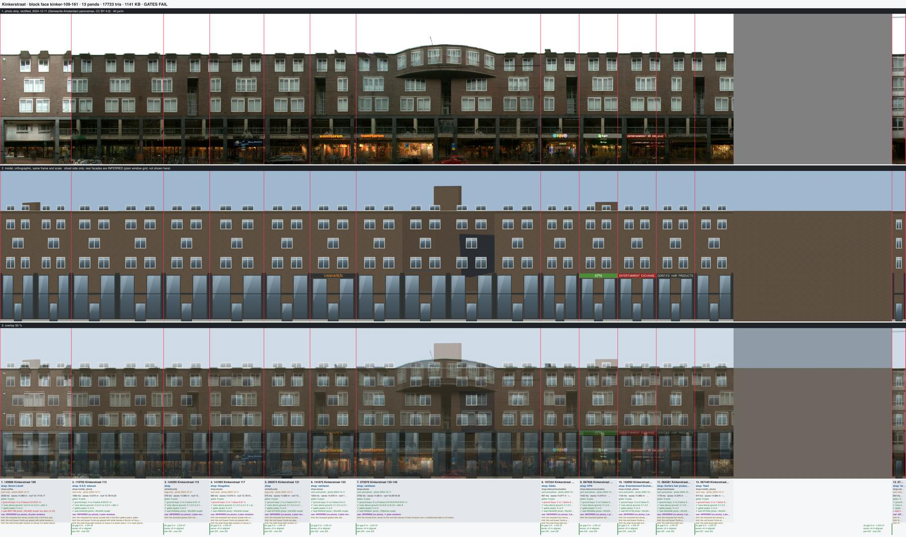
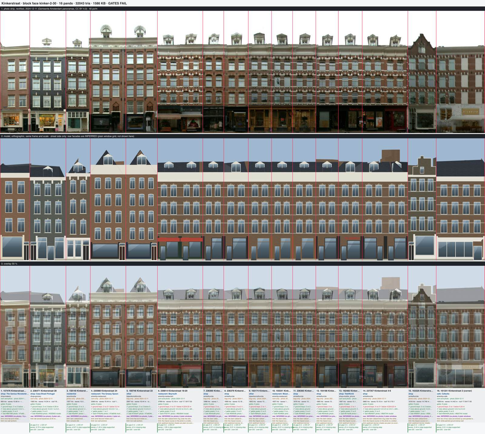
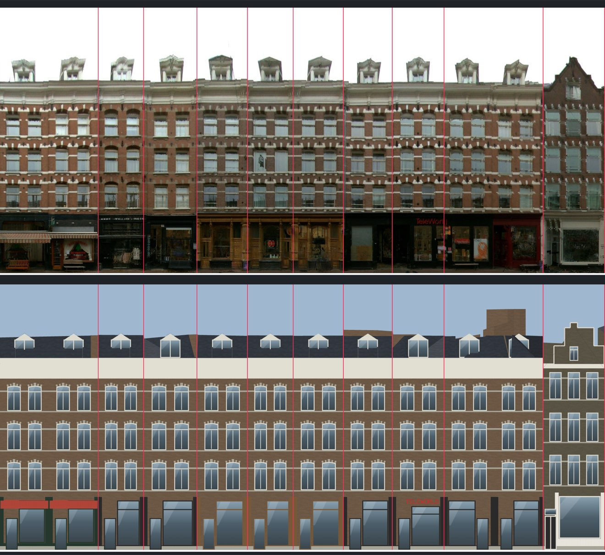

# Kinkerstraat house types (Oud-West library, 2026-10-14)

Plan Part 2 step 3: a type library for Kinkerstraat's 217 surveyed pands, read off the 28 face strips
(Gemeente Amsterdam panoramas, CC BY 4.0, 2024-11-29 and 2024-12-11; open data only), proved on two faces.

## Method

1. **Per-face detection.** `scripts/research/detect-house-types.ts --module=4.5 --body=4.5,13.5 --crown=13.5,19` on every
   Kinkerstraat strip (outputs in `staging/street-types/kinkerstraat/detect/`). It links repeated modules inside one face
   (109-161: 9 + 7 + 2 modules; 31-49: 7; 315-359: 10 + 4 + 3; 206-242: 6 + 4 + 2 + 2 + 2).
2. **Street-wide clustering.** `scripts/research/cluster-street-types.ts --street=kinkerstraat` (new). Per 4.5 m module: a
   16x40 body thumbnail from 4.4 m to 1 m under the pand's own surveyed eaves, a 16x16 crown thumbnail, and the strip
   palette. Distance = (1 - body NCC, best of direct and mirrored) / 2 + 0.6 x colour distance; average linkage, cut 0.42.
   362 modules, 361 with photo, 43 clusters of two or more, 19 singletons. Clusters cross faces (C01: 10 faces) but also
   mix eras (C01 holds 1982 modules next to 1890s ones), so they are evidence, not the assignment.
3. **Types** were written by eye from the clusters and zoom crops, each with exemplar pands in `evidence`.
4. **Assignment.** Exemplar pands keep their type (`hand`). Every other pand gets the type of its nearest exemplars
   (mean of the 3 smallest distances, leave-one-out), restricted by BAG year: 1970 or later only the infill type, earlier
   only historic types within 12 years of the type's year (`auto`). The per-face tables below give the cluster, the body
   NCC to the cluster medoid, the type, how it was assigned and the body NCC to the type's best exemplar.
5. **Palettes** come from `scripts/block-face/palette-from-strip.ts` (new; `src/canalRecall/blockFace/stripPalette.ts`):
   per pand, body pixels are classed glass (dark or blue), accent (light, low saturation) or wall; rows whose PIER
   columns (columns that are mostly wall) are accent-coloured are bands, so curtains and frames do not count as bands.
   It prints wall, accent, frame, band, cornice and fascia medians and band heights (`staging/street-types/kinkerstraat/palette.{json,txt}`).
   The strips are dull (overcast 2024-12-11, low sun 2024-11-29), so whites measure as light greys (#a7a89d-#c5c8b1);
   the palettes keep the measured values so the review's photo-vs-model wall check stays meaningful.

## Types

| Type | Built | What it is | Pands (hand + auto) |
|---|---|---|---|
| `kinker-1890-plain-brick` | 1883-1897 | plain red-brown brick, 3 axes (2 on narrow pands), flat-headed T-windows, heavy cream cornice, one pediment dormer | **53** (22 + 31) |
| `kinker-1890-brick-arched` | 1888-1897 | red-brown brick, 2 axes per ~4 m module, segmental T-windows under white blocked arches with keystones, white sill and impost courses, cream frieze cornice, pediment dormer; crowns none / step gable / tower | **51** (19 + 32) |
| `kinker-1985-infill` | 1976-1992 | dark brown brick, two-storey arcade with gallery, three storeys of two-light windows (one wide light on the middle storey), brick roof boxes | **38** (18 + 20) |
| `kinker-1902-balcony-axis` | 1902-1903 | dark red-brown brick, 3 axes, segmental heads under band-brick arches, centre stack of French windows with balconettes; crowns dormer / curved gable / step gable | **36** (13 + 23) |
| `kinker-1895-painted-band` | 1886-1897 | black-painted or dark brown brick, 2 axes, white blocked heads or tall keystones, white sills and frames | **15** (8 + 7) |
| `kinker-1886-neo-renaissance` | 1886-1893 | brown brick with white speklagen, blocked arches with white tympana, stepped or pointed gables | **11** (9 + 2) |
| `kinker-1900-stucco-front` | 1897-1898 | grey/white painted front, stone-lintel surrounds, plain cornice, pediment dormers | **3** (3 + 0) |
| (no photo) | | grey placeholder span on the strip or no face | 10 |

Of 217 survey pands, 207 are typed (78 by hand, 129 by nearest exemplars). The plan expected a stucco type with
pediment dormers to be common; the strips show three painted fronts only. The plan's "white window surrounds with
ears" did not turn up on any Kinkerstraat strip: the white dressing here is blocked heads (springers + keystone),
keystone-only heads and continuous painted courses.

### Measured palettes (median of each type's exemplar pands)

| Type | n | wall | accent (white) | band rows | cornice | fascia |
|---|---|---|---|---|---|---|
| 1890-brick-arched | 15 | #5b4f3f (2-30 row: #604e3d) | #a7a89d | #acaf9f (n=11) | #727162 (236814 light pixels: #bebdae) | #1c1e0b |
| 1895-painted-band | 8 | #5d5f57 (black-painted 236471 #565b56; dark brown 158140 #5d5042) | #a8a99a | #c5c8b1 (n=3) | #49443b | #413f34 |
| 1890-plain-brick | 22 | #766449 | #b6b8a5 | #b8b9a7 (n=15) | #b4b69e | #4f4b3f |
| 1902-balcony-axis | 13 | #5b4532 | #a6aa9a | #c0cec3 (n=2) | #56432f | #3e301f |
| 1886-neo-renaissance | 9 | #696052 | #b5b7a4 | #b2bbab (n=8) | #7f7965 | #4b3f34 |
| 1900-stucco-front | 3 | #777b74 | #a1aba0 | #a3a89c (n=1) | #5d6259 | #444a44 |
| 1985-infill | 18 | #4e4336 | #a5aea1 | #abb0a0 (n=3) | #4e4436 | #3f3121 |

Band heights on the 18-4 row (162482, Kinkerstraat 8; 236814, 18-20): 5.1-5.2, 7.15-7.28, 7.95-8.05, 9.97-10.07,
10.8-10.9 and 12.85-12.95 m. That is a sill course and an impost (springing) course on each upper storey, 2.0 m apart
within a storey and 0.75-0.8 m from one storey's springing course to the next storey's sill course.

## Kit components added (all optional; absent = byte-identical)

| Component | Key | Geometry |
|---|---|---|
| Tympanum | `windowHead.tympanum: "stone" \| "band"` (segmental or round heads) | The glass stops square at the springing line (head minus the arch rise). The arch segment above it (the arc from springing to crown and the chord back) is an ornament fill 2 cm proud in stone or band brick. Ring blocks and the keystone stay where they were. |
| Brick roof box | `dormerStyle: "box"` | A flat-topped dormer (roof rise 0) whose cheeks and back are in the wall material, 0.75 m high and 5 cm behind the facade, on the dormer spans the front already has. |

Byte-identity: `npm run test:fit-golden` reports all 148 house recipes identical. All 22 non-Kinkerstraat face chunks
hash the same with this lane's `fit.ts`/`intent.ts` as with origin/main's (`compile.ts` per face, sha256 of `chunk.glb`).
Tests: `src/canalRecall/buildingRecipe/kinkerstraat.test.ts` (schema, tympanum geometry, box dormer, the two proof faces as
named regressions).

Keys from other lanes used here, so that nothing is duplicated: `windows: "t-window"`, `windowHead {kind, archRing
{colour, style: "blocks", keystone}}`, `windowHeights`, `windowShare`, `storeyHeights`, `cornice: "frieze"`,
`windowSurround: "sill"` and `bands: "speklagen"` come from the canal-windows lane (on main). The sill and head
courses of `kinker-1890-brick-arched` belong to the Oud-West 1900 lane's `bands: "painted"` + `bandHeights`, and the
black paint of `kinker-1895-painted-band` belongs to its `wallMaterial: "painted-brick"`. Both are wired since the
Nassaukade 506 merge (2026-10-14):

- `kinker-1890-brick-arched` carries `"bands": "painted", "bandLines": ["sill", "transom"], "bandHeights": {"sill": 0.10,
  "transom": 0.12}`. The hand-off planned `{"sill": 0.04, "head": 0.05}` with the default sill + head lines. On the sheet
  that drew 1.6-2 px lines (40 px/m), invisible at gallery size, and put the upper line on the arch springing, about
  0.75 m above the photo's course, which crosses the upper light. The type's own band rows (5.1-5.2, 7.15-7.28 m on
  162482 and 236814) are 0.10-0.13 m tall, so the heights are those, and the upper line is the transom band (0.78 of the
  window height), which lands within about 0.3 m of the photo's course.
- `kinker-1895-painted-band`'s `black-painted` palette is `wallMaterial: "painted-brick"` instead of the `stucco` slot.

## Proof faces

Sheets (photo | model | 50 % overlay | uses, gates, facade-compare, wall colour | party lines): full size under
`staging/block-face/<face>/review/strip-sheet.png`, copies here.

### kinker-109-161 (odd side, 13 pands, one 1989 block)

All 13 pands place `kinker-1985-infill`, wide pands as ~6 m modules (25 m 072076 = 4 modules). Shops come from zoom crops:
vanHaren, kpn, Entertainment Exchange and Dorita's are legible (`osm-and-photo`, lettered); Simon Lévelt, S.S.E. telecom,
Hoogstins, Tele2 and Vera Mode are OSM names only (`osm-only`). 17,723 tris, gates, interference and GLB audit pass;
facade-compare: every upper row and attic row matches (2,1,2 + roof boxes per module); 4 ground-bay counts differ
(arcade piers vs shop panes).

Verdict against the photo: the storey lines, window axes, the wide middle-storey window, the flat top with roof boxes
and the wall colour (11 of 13 pands within tolerance) read right at gallery size. Still wrong: the ground is a flush
double-height shopfront, while the photo has a recessed arcade with a first-floor gallery behind dark piers; the
recessed glazed stair slots at 115/117, 123 and 153 are drawn as wall; the curved drum corner over 125 is missing (its
3DBAG mass shows as a box); the roof boxes have white-framed glass fronts where the photo's are dark. 149986's white
shop insert fails the wall check.

First pass → second pass: the first type put a balcony storey of French windows over a 1.3 x storey ground and added
white pointed `plain` dormers. The storey lines then sat 1 storey off and the dormers read like attic gables. A
double-height arcade shop (`shopfront.storeys: 2`) and the new `box` dormers fixed both.

### kinker-2-30 (even side, 16 pands)

Nine pands of `kinker-1890-brick-arched` (18-20 and 4-6 as two modules each, the corner 2 with the step-gable crown, the
corner block with 4 axes), 30, 24 and 22 as `kinker-1890-plain-brick` (24 and 22 with 5 storeys, segmental heads and the
frieze cornice as overrides), and 28 and 26 as `kinker-1895-painted-band` (28 with flat heads under keystones). The 18-4
row's cornice is measured on the strip (row 235, 15.2 m), because 3DBAG's 16.6-17.2 m eaves read the mansards; six
pands re-pitch the front roof from it. Shops: Beyrouth (lettered on the glass) and TeleWorld (red letters) are
`osm-and-photo`; The Genius Worstenbrood and Cafecito are `osm-and-photo` without lettering; Casa Brasil Portugal, The
Greasy Spoon and Mozzico are `osm-only`; the rest are BAG uses read on the photo. 28,695 tris; gates, interference and
audit pass. Facade-compare: every upper row, attic row and peak count matches; 9 ground-bay counts differ. All 16 wall
colours are within tolerance.

Verdict against the photo: storey lines, window axes, T-windows, blocked arch rings with keystones, the cornice line and
the dormer rhythm read right at gallery size, and so do the pui colours (timber 12A-12C, black, red, white). The 18-4
row's white sill and impost courses are now drawn (`bands: painted`, sheet re-rendered after the Nassaukade merge): the
sill course sits on the photo's sill line; the upper course sits on the T-window transom, about 0.3 m above the photo's
course; both are a grey stone colour where the photo's are bright white, and continuous where the photo's upper course
is a dotted line of blocks. Also still wrong: the frieze is a plain cream slab (the photo has consoles and panels); the dormers are
plain pediment boxes (the photo's have scrolled cheeks); 22-24's round-topped shell dormers are drawn as pediments; the
corner block's two blind white-painted axes are glazed; Kinkerstraat 2's dashed white head band is missing. The
orthographic view also shows 3DBAG roof masses above the cornice (the mansards, and a tall rear block over 4-6).

Second pass (after the first sheet): the `pointed` round-dormer variant on 22-24 rose 2 m too high, so it became the
pediment dormer. 22-24 got measured storey heights (ground 3.2 m). Kinkerstraat 2 and the corner block got a simple or
heavy cornice instead of the 1.6 m frieze, which had swallowed their top windows, plus flat heads. Kinkerstraat 2 got
its own dark brick (#4b4639; the review had flagged it 0.11 too light). Facade-compare rows went from 16 FAIL to 0 FAIL
above the ground once per-house photo rows counted modules and dormers.

## What the kit still cannot say (Kinkerstraat)

- **A painted course at an arbitrary height in the window** (`bands: painted` puts the transom line at a fixed 0.78
  of the window; the 18-4 row's course is at about 0.63). Also the dotted
  variant: on 18-4 and 296-300 the impost course is a line of white blocks joined to the arch springers, not a
  continuous band.
- **Recessed arcade with a first-floor gallery** (109-161, 173-225): piers in front, shops set back ~3 m, a gallery
  rail at 3.5-5 m.
- **Set-back top storey** in a lighter material (173-225: cream top storey behind a balustrade) and the **curved drum
  corner** on 125.
- **Recessed glazed stair slots** between infill modules.
- **Sunburst voussoirs** (radiating white blocks, 49-53) and several speklagen per storey that step round the arches.
  The kit's speklagen are evenly spaced.
- **Round-topped dormers with a shell hood** (22-24) and **scrolled dormer cheeks** (the 18-4 row and most 1890s
  dormers).
- **Frieze consoles and panels** under the cornice. The frieze is a plain slab.
- **Blind (bricked-up, painted) window axes** (corner of 2-30).
- **Dark roof-box fronts.** The box dormer's front is glazed with trim-colour frames.
- **Iron wall anchors** between the windows (every 1880s-1890s front).
- **Narrow centre French windows** of the 1902 balcony-axis type. The kit widens balcony windows by 15 %, but the photo's
  are narrower than the side windows.
- **Brick flat-arch lintels** (strekken) over the plain-brick type's windows.

## Files

- `scripts/block-face/types/oud-west/kinker-*.json`: the seven types.
- `scripts/block-face/faces/kinker-109-161/intent.json`, `scripts/block-face/faces/kinker-2-30/intent.json`: proof faces
  (compiled, not installed).
- `scripts/research/cluster-street-types.ts`: street-wide clustering and assignment.
- `scripts/block-face/palette-from-strip.ts` and `src/canalRecall/blockFace/stripPalette.ts`: palette medians.
- `src/canalRecall/buildingRecipe/{intent,fit}.ts`: `windowHead.tympanum`, `dormerStyle: "box"`.
- `src/canalRecall/buildingRecipe/kinkerstraat.test.ts`: tests.

## Cluster report per face

Generated by `cluster-street-types.ts`. Columns: modules per pand, the cluster of its modules (majority), body NCC to
the cluster medoid, assigned type, `hand` (exemplar) or `auto` (nearest exemplars), body NCC to the type's best
exemplar, the measured wall median and accent share.

### Clusters (two or more modules)

| cluster | modules | medoid | faces |
|---|---|---|---|
| C01 | 41 | 236886 | kinker-120-138, kinker-334-374, kinker-386-390, kinker-206-242, kinker-244-332, kinker-363-371, kinker-186-202, kinker-2-30, kinker-31-49, kinker-173-225 |
| C02 | 40 | 215185/3 | kinker-142-178, kinker-265-313, kinker-244-332, kinker-182-184, kinker-315-359, kinker-186-202, kinker-56-84 |
| C03 | 35 | 160344/1 | kinker-173-225, kinker-206-242, kinker-244-332, kinker-315-359, kinker-334-374 |
| C04 | 30 | 072076/1 | kinker-1-29, kinker-244-332, kinker-109-161 |
| C05 | 15 | 148565/3 | kinker-120-138, kinker-173-225, kinker-363-371, kinker-186-202 |
| C06 | 15 | 236631/2 | kinker-186-202, kinker-206-242, kinker-315-359, kinker-244-332 |
| C07 | 14 | 235967 | kinker-1-29, kinker-31-49, kinker-315-359 |
| C08 | 13 | 236027/1 | kinker-1-29, kinker-31-49, kinker-86-110 |
| C09 | 11 | 092013/9 | kinker-89-105 |
| C10 | 9 | 067825/3 | kinker-109-161, kinker-244-332, kinker-382-382, kinker-386-390 |
| C11 | 8 | 137280/6 | kinker-32-54 |
| C12 | 8 | 236325/1 | kinker-56-84 |
| C13 | 7 | 236453/2 | kinker-142-178, kinker-86-110, kinker-65-87 |
| C14 | 7 | 163174 | kinker-2-30 |
| C15 | 7 | 165323 | kinker-334-374, kinker-376-380 |
| C16 | 5 | 237357/1 | kinker-112-116, kinker-140-142, kinker-2-30 |
| C17 | 5 | 156969/2 | kinker-140-142, kinker-142-178 |
| C18 | 5 | 137280/13 | kinker-32-54 |
| C19 | 5 | 157331 | kinker-65-87 |
| C20 | 4 | 158478 | kinker-1-29, kinker-112-116 |
| C21 | 4 | 160746 | kinker-1-29, kinker-376-380, kinker-2-30 |
| C22 | 4 | 092013/2 | kinker-89-105 |
| C23 | 3 | 157023 | kinker-1-29, kinker-31-49 |
| C24 | 3 | 233461/7 | kinker-120-138, kinker-244-332 |
| C25 | 3 | 159351/1 | kinker-186-202 |
| C26 | 3 | 236953 | kinker-206-242 |
| C27 | 3 | 236233 | kinker-244-332, kinker-334-374 |
| C28 | 3 | 233496/3 | kinker-244-332 |
| C29 | 3 | 236773/2 | kinker-49-63 |
| C30 | 3 | 153083 | kinker-49-63 |
| C31 | 2 | 166843/1 | kinker-1-29 |
| C32 | 2 | 159971 | kinker-1-29 |
| C33 | 2 | 079593 | kinker-109-161, kinker-142-178 |
| C34 | 2 | 139609/1 | kinker-142-178 |
| C35 | 2 | 151677/4 | kinker-173-225 |
| C36 | 2 | 236981 | kinker-182-184, kinker-244-332 |
| C37 | 2 | 160226/1 | kinker-186-202 |
| C38 | 2 | 158140 | kinker-2-30 |
| C39 | 2 | 161331/1 | kinker-2-30 |
| C40 | 2 | 163768 | kinker-206-242 |
| C41 | 2 | 161457 | kinker-31-49 |
| C42 | 2 | 160810/1 | kinker-49-63 |
| C43 | 2 | 164246 | kinker-49-63 |

singletons: 19

### kinker-1-29

| pand | address | year | modules | cluster | NCC to medoid | type | how | NCC to type | wall | accent |
|---|---|---|---|---|---|---|---|---|---|---|
| 166843 | Kinkerstraat 1 | 1883 | 2 | C31 | 0.83 | kinker-1890-plain-brick | auto | 0.41 | #4c3927 | 0 |
| 158478 | Kinkerstraat 1 | 1883 | 1 | C20 | 1 | kinker-1890-brick-arched | auto | 0.43 | #534231 | 0 |
| 166689 | Kinkerstraat 3 | 1883 | 1 | C20 | 0.77 | kinker-1890-plain-brick | auto | 0.82 | #563e2f | 0 |
| 156139 | Kinkerstraat 5 | 1883 | 1 | C07 | 0.51 | kinker-1890-plain-brick | auto | 0.58 | #514231 | 0.006 |
| 103619 | Kinkerstraat 7–17 | 1900 | 7 | C04 | 0.51 | kinker-1890-brick-arched | auto | 0.33 | #544b3a | 0.002 |
| 158983 | Kinkerstraat 19 | 1885 | 1 | C21 | 0.58 | kinker-1890-plain-brick | auto | 0.6 | #685340 | 0.07 |
| 165338 | Kinkerstraat 21 | 1885 | 1 | C32 | 0.69 | kinker-1890-plain-brick | auto | 0.39 | #695340 | 0.112 |
| 159971 | Kinkerstraat 23 | 1885 | 1 | C32 | 1 | kinker-1890-plain-brick | auto | 0.43 | #725f4b | 0.223 |
| 157023 | Kinkerstraat 25 | 1883 | 1 | C23 | 1 | kinker-1890-plain-brick | auto | 0.83 | #745f4b | 0.155 |
| 155746 | Kinkerstraat 27 | 1883 | 1 | C23 | 0.68 | kinker-1890-plain-brick | auto | 0.61 | #6f5b48 | 0.036 |
| 158003 | Kinkerstraat 29 | 1883 | 1 | C08 | 0.46 | kinker-1890-plain-brick | auto | 0.64 | #73614d | 0.143 |

### kinker-109-161

| pand | address | year | modules | cluster | NCC to medoid | type | how | NCC to type | wall | accent |
|---|---|---|---|---|---|---|---|---|---|---|
| 149986 | Kinkerstraat 109 | 1989 | 2 | C10 | 0.63 | kinker-1985-infill | hand | 0.82 | #817567 | 0.069 |
| 119702 | Kinkerstraat 113–139 | 1989 | 3 | C04 | 0.65 | kinker-1985-infill | hand | 0.85 | #463f33 | 0.038 |
| 144295 | Kinkerstraat 115–139 | 1989 | 1 | C04 | 0.53 | kinker-1985-infill | hand | 0.68 | #443d30 | 0.026 |
| 141903 | Kinkerstraat 117–135 | 1989 | 2 | C04 | 0.72 | kinker-1985-infill | hand | 0.87 | #494135 | 0.058 |
| 095974 | Kinkerstraat 121–135 | 1989 | 1 | C04 | 0.82 | kinker-1985-infill | hand | 0.83 | #494236 | 0.07 |
| 141675 | Kinkerstraat 131–135 | 1989 | 1 | C04 | 0.59 | kinker-1985-infill | hand | 0.86 | #464033 | 0.036 |
| 072076 | Kinkerstraat 125–149 | 1989 | 6 | C04 | 0.59 | kinker-1985-infill | hand | 0.82 | #4a4336 | 0.026 |
| 107234 | Kinkerstraat 141–151 | 1989 | 1 | C04 | 0.64 | kinker-1985-infill | hand | 0.86 | #4f4639 | 0.076 |
| 067928 | Kinkerstraat 143–153 | 1989 | 1 | C04 | 0.86 | kinker-1985-infill | hand | 0.86 | #544a3d | 0.082 |
| 132092 | Kinkerstraat 155 | 1989 | 1 | C04 | 0.66 | kinker-1985-infill | hand | 0.88 | #52473a | 0.083 |
| 084581 | Kinkerstraat 157 | 1989 | 1 | C04 | 0.62 | kinker-1985-infill | hand | 0.72 | #4e4436 | 0.048 |
| 067449 | Kinkerstraat 159 | 1989 | 1 | C04 | 0.51 | kinker-1985-infill | hand | 0.79 | #4e4639 | 0.053 |
| 079593 | Kinkerstraat 161 | 1989 | 1 | C33 | 1 | kinker-1985-infill | auto | 0.44 | #727970 | 0.133 |

### kinker-112-116

| pand | address | year | modules | cluster | NCC to medoid | type | how | NCC to type | wall | accent |
|---|---|---|---|---|---|---|---|---|---|---|
| 164444 | Kinkerstraat 116 | 1895 | 1 | C16 | 0.42 | kinker-1890-brick-arched | auto | 0.47 | #5b493a | 0.062 |
| 166997 | Kinkerstraat 112–114 | 1895 | 2 | C20 | 0.37 | kinker-1890-brick-arched | auto | 0.33 | #534030 | 0.027 |

### kinker-120-138

| pand | address | year | modules | cluster | NCC to medoid | type | how | NCC to type | wall | accent |
|---|---|---|---|---|---|---|---|---|---|---|
| 233461 | Kinkerstraat 126–138 | 1895 | 7 | C05 | 0.22 | kinker-1902-balcony-axis | auto | 0.5 | #544131 | 0.003 |
| 236198 | Kinkerstraat 122 | 1895 | 1 | C05 | 0.43 | kinker-1890-plain-brick | auto | 0.39 | #413729 | 0.014 |
| 153271 | Kinkerstraat 120 | 1895 | 1 | C05 | 0.35 | kinker-1902-balcony-axis | auto | 0.57 | #5b4436 | 0.012 |

### kinker-140-142

| pand | address | year | modules | cluster | NCC to medoid | type | how | NCC to type | wall | accent |
|---|---|---|---|---|---|---|---|---|---|---|
| 237340 | Kinkerstraat 140–142 | 1895 | 2 | C17 | 0.24 | kinker-1890-brick-arched | auto | 0.44 | #625041 | 0.086 |

### kinker-142-178

| pand | address | year | modules | cluster | NCC to medoid | type | how | NCC to type | wall | accent |
|---|---|---|---|---|---|---|---|---|---|---|
| 237396 | Kinkerstraat 178 | 1989 | 1 | C02 | 0.72 | kinker-1985-infill | auto | 0.65 | #4f5146 | 0.015 |
| 233413 | Kinkerstraat 176 | 1989 | 2 | C02 | 0.64 | kinker-1985-infill | auto | 0.63 | #525549 | 0.044 |
| 237004 | Kinkerstraat 168–174 | 1989 | 2 | C02 | 0.47 | kinker-1985-infill | auto | 0.54 | #55564a | 0.045 |
| 160298 | Kinkerstraat 166 | 1905 | 1 | C17 | 0.5 | kinker-1895-painted-band | auto | 0.46 | #5c4b3c | 0.1 |
| 156969 | Kinkerstraat 162–164 | 1905 | 2 | C17 | 0.92 | kinker-1895-painted-band | auto | 0.52 | #5d4b3a | 0.044 |
| 160768 | Kinkerstraat 160 | 1904 | 1 | C17 | 0.75 | kinker-1895-painted-band | auto | 0.43 | #6a5340 | 0.122 |
| 139609 | Kinkerstraat 156–158 | 1976 | 3 | C34 | 0.45 | kinker-1985-infill | auto | 0.42 | #514a3c | 0.087 |
| 157726 | Kinkerstraat 154 | 1904 | 1 | C13 | 0.43 | kinker-1895-painted-band | auto | 0.53 | #7f6753 | 0.043 |
| 155310 | Kinkerstraat 152 | 1895 | 1 | C13 | 0.29 | kinker-1890-plain-brick | auto | 0.59 | #89664e | 0.057 |
| 236491 | Kinkerstraat 144–150 | 1904 | 1 | single |  | kinker-1895-painted-band | auto | 0.46 | #947962 | 0.218 |
| 164341 | Kinkerstraat 142 | 1895 | 1 | C33 | 0.39 | kinker-1886-neo-renaissance | auto | 0.23 | #817769 | 0.121 |

### kinker-173-225

| pand | address | year | modules | cluster | NCC to medoid | type | how | NCC to type | wall | accent |
|---|---|---|---|---|---|---|---|---|---|---|
| 148565 | Kinkerstraat 173–177 | 1982 | 3 | C05 | 0.7 | kinker-1985-infill | hand | 0.58 | #4b3f2f | 0.007 |
| 115555 | Kinkerstraat 177 | 1982 | 2 | C05 | 0.64 | kinker-1985-infill | auto | 0.64 | #4b3e2d | 0.003 |
| 085030 | Kinkerstraat 179–181 | 1982 | 2 | C01 | 0.45 | kinker-1985-infill | hand | 0.83 | #50412f | 0.026 |
| 087255 | Kinkerstraat 183 | 1982 | 1 | C01 | 0.36 | kinker-1985-infill | hand | 0.83 | #524a39 | 0.02 |
| 119385 | Kinkerstraat 185 | 1982 | 1 | C03 | 0.62 | kinker-1985-infill | hand | 0.44 | #554334 | 0.047 |
| 111903 | Kinkerstraat 187 | 1982 | 1 | C01 | 0.36 | kinker-1985-infill | hand | 0.91 | #504230 | 0.018 |
| 151677 | Kinkerstraat 189–207 | 1982 | 7 | C01 | 0.19 | kinker-1985-infill | hand | 0.6 | #4d3e2d | 0.003 |
| 078442 | Kinkerstraat 205 | 1982 | 1 | C05 | 0.45 | kinker-1985-infill | auto | 0.72 | #4b3c2b | 0.007 |
| 130890 | Kinkerstraat 205–211 | 1982 | 2 | C03 | 0.57 | kinker-1985-infill | auto | 0.56 | #50402f | 0.067 |
| 131204 | Kinkerstraat 213–225 | 1982 | 4 | C03 | 0.59 | kinker-1985-infill | auto | 0.56 | #514131 | 0.063 |

### kinker-182-184

| pand | address | year | modules | cluster | NCC to medoid | type | how | NCC to type | wall | accent |
|---|---|---|---|---|---|---|---|---|---|---|
| 236981 | Kinkerstraat 184 | 1989 | 1 | C36 | 1 | kinker-1985-infill | auto | 0.45 | #4c4f44 | 0.003 |
| 233470 | Kinkerstraat 182 | 1989 | 1 | C02 | 0.36 | kinker-1985-infill | auto | 0.51 | #4e5146 | 0.003 |

### kinker-186-202

| pand | address | year | modules | cluster | NCC to medoid | type | how | NCC to type | wall | accent |
|---|---|---|---|---|---|---|---|---|---|---|
| 157310 | Kinkerstraat 202 | 1905 | 1 | C06 | 0.25 | kinker-1890-brick-arched | hand |  | #504235 | 0.038 |
| 161134 | Kinkerstraat 200 | 1905 | 1 | C06 | 0.49 | kinker-1890-brick-arched | hand |  | #534437 | 0.041 |
| 159351 | Kinkerstraat 192–198 | 1904 | 4 | C25 | 0.54 | kinker-1890-brick-arched | hand |  | #554539 | 0.021 |
| 129253 | Kinkerstraat 188 | 1917 | 2 | C02 | 0.38 | kinker-1890-brick-arched | hand |  | #525448 | 0.033 |
| 160226 | Kinkerstraat 186 | 1897 | 2 | C37 | 0.79 | kinker-1890-brick-arched | auto | 0.27 | #534b3e | 0.029 |
| 073962 |  |  | 1 | C05 | 0.43 | kinker-1890-plain-brick | auto | 0.47 | #4b432d | 0.008 |

### kinker-2-30

| pand | address | year | modules | cluster | NCC to medoid | type | how | NCC to type | wall | accent |
|---|---|---|---|---|---|---|---|---|---|---|
| 157476 | Kinkerstraat 30 | 1886 | 1 | single |  | kinker-1890-plain-brick | hand |  | #836d5c | 0.123 |
| 236471 | Kinkerstraat 28 | 1886 | 1 | single |  | kinker-1895-painted-band | hand |  | #585d57 | 0.205 |
| 158140 | Kinkerstraat 26 | 1888 | 1 | C38 | 1 | kinker-1895-painted-band | hand |  | #5f5244 | 0.133 |
| 235988 | Kinkerstraat 24 | 1888 | 1 | C21 | 0.75 | kinker-1890-plain-brick | hand | 0.75 | #735c49 | 0.098 |
| 160746 | Kinkerstraat 22 | 1888 | 1 | C21 | 1 | kinker-1890-plain-brick | hand | 0.75 | #705946 | 0.09 |
| 236814 | Kinkerstraat 18–20 | 1888 | 2 | C14 | 0.63 | kinker-1890-brick-arched | hand | 0.84 | #725b45 | 0.152 |
| 236360 | Kinkerstraat 16 | 1888 | 1 | C14 | 0.9 | kinker-1890-brick-arched | hand | 0.9 | #6a5541 | 0.097 |
| 236379 | Kinkerstraat 14 | 1888 | 1 | C38 | 0.61 | kinker-1890-brick-arched | hand | 0.6 | #6d5641 | 0.076 |
| 163174 | Kinkerstraat 12 | 1888 | 1 | C14 | 1 | kinker-1890-brick-arched | hand | 0.9 | #5e5345 | 0.07 |
| 155541 | Kinkerstraat 12 | 1888 | 1 | C14 | 0.9 | kinker-1890-brick-arched | hand | 0.9 | #585043 | 0.052 |
| 236383 | Kinkerstraat 12 | 1888 | 1 | C14 | 0.9 | kinker-1890-brick-arched | hand | 0.9 | #5b4f41 | 0.085 |
| 164188 | Kinkerstraat 10 | 1888 | 1 | C14 | 0.87 | kinker-1890-brick-arched | hand | 0.87 | #645647 | 0.104 |
| 162482 | Kinkerstraat 8 | 1888 | 1 | C16 | 0.77 | kinker-1890-brick-arched | hand | 0.77 | #614f3e | 0.082 |
| 237357 | Kinkerstraat 4–6 | 1888 | 2 | C16 | 0.87 | kinker-1890-brick-arched | hand | 0.75 | #624e3c | 0.043 |
| 163325 | Kinkerstraat 2 | 1889 | 1 | C01 | 0.4 | kinker-1890-brick-arched | hand |  | #4a4336 | 0.003 |
| 161331 |  |  | 2 | C39 | 0.67 | kinker-1890-brick-arched | hand |  | #59493b | 0.067 |

### kinker-206-242

| pand | address | year | modules | cluster | NCC to medoid | type | how | NCC to type | wall | accent |
|---|---|---|---|---|---|---|---|---|---|---|
| 236953 | Kinkerstraat 242 | 1896 | 1 | C26 | 1 | kinker-1895-painted-band | hand | 0.72 | #575f57 | 0.003 |
| 237297 | Kinkerstraat 240 | 1896 | 1 | single |  | kinker-1895-painted-band | hand | 0.52 | #585f5a | 0.008 |
| 160838 | Kinkerstraat 238 | 1896 | 1 | C26 | 0.72 | kinker-1895-painted-band | hand | 0.78 | #757a72 | 0.011 |
| 165141 | Kinkerstraat 236 | 1896 | 1 | C26 | 0.57 | kinker-1895-painted-band | hand | 0.78 | #5d574d | 0.019 |
| 152992 | Kinkerstraat 234 | 1896 | 1 | C06 | 0.5 | kinker-1895-painted-band | hand |  | #574232 | 0.012 |
| 163768 | Kinkerstraat 232 | 1897 | 1 | C40 | 1 | kinker-1890-plain-brick | hand | 0.9 | #4b4034 | 0 |
| 162560 | Kinkerstraat 230 | 1897 | 1 | C40 | 0.9 | kinker-1890-plain-brick | hand | 0.9 | #4c4035 | 0 |
| 161056 | Kinkerstraat 228 | 1897 | 1 | C01 | 0.34 | kinker-1890-plain-brick | hand | 0.54 | #4c3f32 | 0 |
| 166034 | Kinkerstraat 224 | 1897 | 2 | C03 | 0.71 | kinker-1890-brick-arched | auto | 0.67 | #4d4135 | 0.051 |
| 236982 | Kinkerstraat 222 | 1897 | 1 | C01 | 0.47 | kinker-1890-plain-brick | hand | 0.52 | #473d2f | 0.007 |
| 237261 | Kinkerstraat 220 | 1897 | 1 | C01 | 0.79 | kinker-1890-plain-brick | hand | 0.79 | #4a3f32 | 0.012 |
| 236886 | Kinkerstraat 218 | 1897 | 1 | C01 | 1 | kinker-1890-plain-brick | hand | 0.79 | #4e3f30 | 0.01 |
| 233589 | Kinkerstraat 212–216 | 1897 | 3 | C01 | 0.57 | kinker-1890-plain-brick | auto | 0.62 | #4a3f31 | 0.011 |
| 160871 | Kinkerstraat 208–210 | 1904 | 2 | C01 | 0.47 | kinker-1890-brick-arched | hand |  | #473f32 | 0.02 |
| 159816 | Kinkerstraat 206 | 1904 | 1 | single |  | kinker-1890-brick-arched | hand |  | #584e3f | 0.016 |

### kinker-227-263

| pand | address | year | modules | cluster | NCC to medoid | type | how | NCC to type | wall | accent |
|---|---|---|---|---|---|---|---|---|---|---|
| 078005 | Kinkerstraat 227–263 | 1983 | 1 | single |  | kinker-1985-infill | auto | 0.54 | #5d685f | 0.028 |

### kinker-244-332

| pand | address | year | modules | cluster | NCC to medoid | type | how | NCC to type | wall | accent |
|---|---|---|---|---|---|---|---|---|---|---|
| 159927 | Kinkerstraat 326–332 | 1899 | 4 | C04 | 0.34 | kinker-1890-brick-arched | auto | 0.44 | #54463a | 0.007 |
| 236616 | Kinkerstraat 322–324 | 1899 | 2 | C03 | 0.51 | kinker-1890-brick-arched | auto | 0.55 | #5e4331 | 0.025 |
| 153405 | Kinkerstraat 320–324 | 1899 | 1 | C03 | 0.66 | kinker-1890-brick-arched | auto | 0.6 | #5e4637 | 0.029 |
| 236512 | Kinkerstraat 316–318 | 1898 | 2 | C03 | 0.68 | kinker-1902-balcony-axis | auto | 0.48 | #563f2d | 0.041 |
| 157584 | Kinkerstraat 314 | 1898 | 1 | C03 | 0.6 | kinker-1890-brick-arched | auto | 0.61 | #594333 | 0.045 |
| 235902 | Kinkerstraat 312 | 1898 | 1 | C03 | 0.77 | kinker-1890-brick-arched | auto | 0.7 | #574638 | 0.061 |
| 236531 | Kinkerstraat 308–310 | 1898 | 2 | C03 | 0.79 | kinker-1890-brick-arched | auto | 0.62 | #504131 | 0.024 |
| 236250 | Kinkerstraat 306 | 1898 | 1 | C03 | 0.73 | kinker-1890-brick-arched | auto | 0.54 | #554433 | 0.038 |
| 236258 | Kinkerstraat 304 | 1898 | 1 | C03 | 0.74 | kinker-1890-brick-arched | auto | 0.58 | #353731 | 0.037 |
| 235916 | Kinkerstraat 298–302 | 1898 | 3 | C06 | 0.45 | kinker-1890-brick-arched | hand | 0.74 | #554334 | 0.02 |
| 235880 | Kinkerstraat 296 | 1898 | 1 | C06 | 0.54 | kinker-1890-brick-arched | auto | 0.81 | #4d473c | 0.038 |
| 156795 | Kinkerstraat 294 | 1897 | 1 | C06 | 0.85 | kinker-1890-brick-arched | auto | 0.87 | #5a4a3e | 0.067 |
| 061473 | Kinkerstraat 288–292 | 1990 | 3 | C02 | 0.59 | kinker-1985-infill | auto | 0.69 | #515248 | 0.023 |
| 236631 | Kinkerstraat 284–286 | 1897 | 2 | C06 | 0.97 | kinker-1890-brick-arched | hand | 0.94 | #554c3b | 0.038 |
| 167053 | Kinkerstraat 282 | 1897 | 1 | C27 | 0.85 | kinker-1890-brick-arched | hand | 0.45 | #4f4437 | 0.035 |
| 236233 | Kinkerstraat 280 | 1897 | 1 | C27 | 1 | kinker-1890-brick-arched | auto | 0.85 | #575045 | 0.088 |
| 154164 | Kinkerstraat 278 | 1897 | 1 | C06 | 0.6 | kinker-1890-brick-arched | auto | 0.6 | #4f453b | 0.062 |
| 157025 | Kinkerstraat 274–276 | 1897 | 2 | C24 | 0.44 | kinker-1890-plain-brick | auto | 0.44 | #4a3d2f | 0.014 |
| 160192 | Kinkerstraat 272 | 1897 | 1 | C03 | 0.67 | kinker-1890-brick-arched | auto | 0.53 | #504235 | 0.027 |
| 159323 | Kinkerstraat 270 | 1897 | 1 | C01 | 0.65 | kinker-1890-plain-brick | auto | 0.77 | #4f4133 | 0.005 |
| 153531 | Kinkerstraat 262–268 | 1897 | 1 | C10 | 0.43 | kinker-1900-stucco-front | hand | 0.45 | #777a73 | 0.023 |
| 156893 | Kinkerstraat 266 | 1897 | 1 | C10 | 0.59 | kinker-1900-stucco-front | hand | 0.85 | #777b74 | 0.004 |
| 236219 | Kinkerstraat 264 | 1897 | 1 | C10 | 0.58 | kinker-1900-stucco-front | hand | 0.85 | #767c75 | 0.029 |
| 237017 | Kinkerstraat 260 | 1897 | 2 | C01 | 0.62 | kinker-1890-plain-brick | auto | 0.74 | #48392a | 0 |
| 156816 | Kinkerstraat 252–258 | 1897 | 4 | C01 | 0.6 | kinker-1890-plain-brick | auto | 0.6 | #574434 | 0.01 |
| 233496 | Kinkerstraat 244–248 | 1897 | 4 | C28 | 0.65 | kinker-1890-brick-arched | auto | 0.32 | #3f4339 | 0.004 |

### kinker-265-313

| pand | address | year | modules | cluster | NCC to medoid | type | how | NCC to type | wall | accent |
|---|---|---|---|---|---|---|---|---|---|---|
| 215185 | Kinkerstraat 265–283 | 1992 | 13 | C02 | 0.66 | kinker-1985-infill | auto | 0.63 | #56594d | 0.026 |
| 126730 | Kinkerstraat 285–291 | 1992 | 2 | C02 | 0.72 | kinker-1985-infill | auto | 0.73 | #565a4d | 0.037 |
| 093995 | Kinkerstraat 293–313 | 1992 | 7 | C02 | 0.63 | kinker-1985-infill | auto | 0.66 | #54574b | 0.018 |

### kinker-31-49

| pand | address | year | modules | cluster | NCC to medoid | type | how | NCC to type | wall | accent |
|---|---|---|---|---|---|---|---|---|---|---|
| 158968 | Kinkerstraat 31 | 1885 | 1 | C01 | 0.48 | kinker-1890-plain-brick | auto | 0.54 | #44453a | 0.019 |
| 160646 | Kinkerstraat 33 | 1885 | 1 | C01 | 0.55 | kinker-1890-plain-brick | auto | 0.68 | #4a493b | 0.008 |
| 155369 | Kinkerstraat 35 | 1885 | 1 | C07 | 0.62 | kinker-1890-plain-brick | hand | 0.73 | #49382c | 0.042 |
| 160073 | Kinkerstraat 37 | 1885 | 1 | C23 | 0.74 | kinker-1890-plain-brick | hand | 0.83 | #74614e | 0.095 |
| 160074 | Kinkerstraat 39 | 1885 | 1 | C08 | 0.53 | kinker-1890-plain-brick | hand | 0.79 | #766450 | 0.121 |
| 167106 | Kinkerstraat 41 | 1886 | 1 | C08 | 0.44 | kinker-1890-plain-brick | hand | 0.79 | #88705b | 0.154 |
| 159384 | Kinkerstraat 43 | 1886 | 1 | C08 | 0.45 | kinker-1890-plain-brick | hand | 0.69 | #94765f | 0.183 |
| 154359 | Kinkerstraat 45 | 1886 | 1 | C41 | 0.52 | kinker-1890-plain-brick | hand | 0.74 | #b19175 | 0.135 |
| 161457 | Kinkerstraat 47 | 1886 | 1 | C41 | 1 | kinker-1890-plain-brick | hand | 0.83 | #b5947a | 0.246 |
| 157926 | Kinkerstraat 49 | 1893 | 1 | single |  | kinker-1890-plain-brick | auto | 0.46 | #b39479 | 0.304 |

### kinker-315-359

| pand | address | year | modules | cluster | NCC to medoid | type | how | NCC to type | wall | accent |
|---|---|---|---|---|---|---|---|---|---|---|
| 080487 | Kinkerstraat 315–319 | 1987 | 3 | C02 | 0.49 | kinker-1985-infill | auto | 0.54 | #5d5c48 | 0.02 |
| 160018 | Kinkerstraat 321 | 1903 | 1 | C07 | 0.47 | kinker-1902-balcony-axis | auto | 0.59 | #5f4530 | 0.056 |
| 156907 | Kinkerstraat 323 | 1903 | 1 | C06 | 0.39 | kinker-1902-balcony-axis | auto | 0.56 | #5d4431 | 0.071 |
| 165777 | Kinkerstraat 325 | 1903 | 1 | C03 | 0.58 | kinker-1902-balcony-axis | hand | 0.73 | #5e4936 | 0.085 |
| 237373 | Kinkerstraat 327–331 | 1903 | 3 | C07 | 0.52 | kinker-1902-balcony-axis | hand | 0.58 | #5b4330 | 0.05 |
| 153818 | Kinkerstraat 333 | 1903 | 1 | C06 | 0.5 | kinker-1902-balcony-axis | auto | 0.46 | #58412e | 0.035 |
| 236064 | Kinkerstraat 335 | 1903 | 1 | C07 | 0.6 | kinker-1902-balcony-axis | hand | 0.6 | #5d4532 | 0.049 |
| 160024 | Kinkerstraat 337 | 1903 | 1 | C07 | 0.89 | kinker-1902-balcony-axis | hand | 0.89 | #5b4532 | 0.039 |
| 235967 | Kinkerstraat 339 | 1903 | 1 | C07 | 1 | kinker-1902-balcony-axis | hand | 0.89 | #5c4531 | 0.046 |
| 152535 | Kinkerstraat 341 | 1903 | 1 | C07 | 0.81 | kinker-1902-balcony-axis | hand | 0.81 | #5a4331 | 0.038 |
| 153447 | Kinkerstraat 343 | 1903 | 1 | C06 | 0.48 | kinker-1902-balcony-axis | auto | 0.46 | #5c432f | 0.042 |
| 159990 | Kinkerstraat 345 | 1903 | 1 | single |  | kinker-1902-balcony-axis | auto | 0.33 | #5e4531 | 0.031 |
| 236156 | Kinkerstraat 347 | 1903 | 1 | C03 | 0.57 | kinker-1902-balcony-axis | hand | 0.73 | #5f4735 | 0.046 |
| 158118 | Kinkerstraat 349 | 1903 | 1 | C07 | 0.68 | kinker-1902-balcony-axis | hand | 0.87 | #5c4430 | 0.037 |
| 164070 | Kinkerstraat 351 | 1903 | 1 | C07 | 0.77 | kinker-1902-balcony-axis | hand | 0.87 | #5b432f | 0.033 |
| 167386 | Kinkerstraat 353 | 1903 | 1 | C06 | 0.36 | kinker-1902-balcony-axis | auto | 0.56 | #58402d | 0.027 |
| 158666 | Kinkerstraat 355 | 1903 | 1 | C07 | 0.79 | kinker-1902-balcony-axis | auto | 0.85 | #59422f | 0.033 |
| 236481 | Kinkerstraat 357 | 1903 | 1 | C03 | 0.75 | kinker-1902-balcony-axis | auto | 0.79 | #584633 | 0.059 |
| 155496 | Kinkerstraat 359 | 1903 | 1 | C07 | 0.58 | kinker-1902-balcony-axis | auto | 0.69 | #58412f | 0.03 |

### kinker-32-54

| pand | address | year | modules | cluster | NCC to medoid | type | how | NCC to type | wall | accent |
|---|---|---|---|---|---|---|---|---|---|---|
| 137280 | Kinkerstraat 32–54 | 1999 | 13 | C11 | 0.37 | kinker-1985-infill | auto | 0.19 | #8e654d | 0.063 |

### kinker-334-374

| pand | address | year | modules | cluster | NCC to medoid | type | how | NCC to type | wall | accent |
|---|---|---|---|---|---|---|---|---|---|---|
| 166359 | Kinkerstraat 374 | 1902 | 1 | C15 | 0.62 | kinker-1890-brick-arched | auto | 0.35 | #574434 | 0.08 |
| 161284 | Kinkerstraat 372 | 1902 | 1 | C03 | 0.54 | kinker-1890-brick-arched | auto | 0.44 | #574433 | 0.091 |
| 158310 | Kinkerstraat 370 | 1902 | 1 | C15 | 0.47 | kinker-1902-balcony-axis | auto | 0.27 | #564332 | 0.071 |
| 163986 | Kinkerstraat 368 | 1902 | 1 | C15 | 0.59 | kinker-1902-balcony-axis | auto | 0.27 | #543f2f | 0.058 |
| 236565 | Kinkerstraat 366 | 1902 | 1 | C15 | 0.71 | kinker-1902-balcony-axis | auto | 0.31 | #563f2f | 0.062 |
| 164085 | Kinkerstraat 364 | 1902 | 1 | C15 | 0.58 | kinker-1902-balcony-axis | auto | 0.25 | #56402f | 0.039 |
| 167064 | Kinkerstraat 362 | 1902 | 1 | C03 | 0.58 | kinker-1890-brick-arched | auto | 0.44 | #514738 | 0.02 |
| 159164 | Kinkerstraat 360 | 1902 | 1 | C01 | 0.49 | kinker-1902-balcony-axis | hand | 0.78 | #554635 | 0.001 |
| 164263 | Kinkerstraat 358 | 1902 | 1 | C01 | 0.53 | kinker-1902-balcony-axis | hand | 0.86 | #504637 | 0.002 |
| 166628 | Kinkerstraat 356 | 1902 | 1 | C01 | 0.54 | kinker-1902-balcony-axis | hand | 0.86 | #544635 | 0.003 |
| 160054 | Kinkerstraat 354 | 1902 | 1 | C01 | 0.52 | kinker-1902-balcony-axis | hand | 0.8 | #524536 | 0.004 |
| 160347 | Kinkerstraat 352 | 1902 | 1 | C03 | 0.5 | kinker-1890-brick-arched | auto | 0.42 | #524536 | 0.015 |
| 155971 | Kinkerstraat 350 | 1902 | 1 | C03 | 0.4 | kinker-1890-brick-arched | auto | 0.43 | #514536 | 0.019 |
| 157710 | Kinkerstraat 348 | 1902 | 1 | C27 | 0.43 | kinker-1890-brick-arched | auto | 0.41 | #4e483d | 0.068 |
| 156317 | Kinkerstraat 346 | 1902 | 1 | C03 | 0.64 | kinker-1890-brick-arched | auto | 0.55 | #453d30 | 0.02 |
| 167305 | Kinkerstraat 344 | 1902 | 1 | C03 | 0.67 | kinker-1890-brick-arched | auto | 0.52 | #4c4133 | 0.033 |
| 160344 | Kinkerstraat 338–342 | 1915 | 3 | C03 | 0.91 |  | auto |  | #4d4436 | 0.022 |
| 072741 | Kinkerstraat 334–336 | 1915 | 2 | C03 | 0.77 |  | auto |  | #514335 | 0.005 |

### kinker-363-371

| pand | address | year | modules | cluster | NCC to medoid | type | how | NCC to type | wall | accent |
|---|---|---|---|---|---|---|---|---|---|---|
| 089984 | Kinkerstraat 363–365 | 1916 | 2 | C01 | 0.49 |  | auto |  | #433526 | 0 |
| 089983 | Kinkerstraat 367 | 1916 | 1 | C05 | 0.54 |  | auto |  | #4e4233 | 0.009 |
| 237269 | Kinkerstraat 369 | 1914 | 2 | C01 | 0.5 | kinker-1902-balcony-axis | auto | 0.47 | #504332 | 0.012 |
| 101517 | Kinkerstraat 371 | 1914 | 2 | C01 | 0.47 | kinker-1902-balcony-axis | auto | 0.5 | #564533 | 0.007 |

### kinker-376-380

| pand | address | year | modules | cluster | NCC to medoid | type | how | NCC to type | wall | accent |
|---|---|---|---|---|---|---|---|---|---|---|
| 160877 | Kinkerstraat 380 | 1902 | 1 | C21 | 0.6 | kinker-1890-plain-brick | auto | 0.68 | #544133 | 0.069 |
| 158308 | Kinkerstraat 378 | 1902 | 1 | C15 | 0.85 | kinker-1902-balcony-axis | auto | 0.46 | #554130 | 0.022 |
| 165323 | Kinkerstraat 376 | 1902 | 1 | C15 | 1 | kinker-1902-balcony-axis | auto | 0.4 | #543f2f | 0.022 |

### kinker-382-382

| pand | address | year | modules | cluster | NCC to medoid | type | how | NCC to type | wall | accent |
|---|---|---|---|---|---|---|---|---|---|---|
| 067825 | Kinkerstraat 382–384 | 1914 | 3 | C10 | 0.94 | kinker-1902-balcony-axis | auto | 0.49 | #7c7d73 | 0.018 |

### kinker-386-390

| pand | address | year | modules | cluster | NCC to medoid | type | how | NCC to type | wall | accent |
|---|---|---|---|---|---|---|---|---|---|---|
| 071767 | Kinkerstraat 390 | 1914 | 1 | C10 | 0.63 | kinker-1902-balcony-axis | auto | 0.36 | #686963 | 0 |
| 130085 | Kinkerstraat 386–388 | 1914 | 2 | C01 | 0.47 | kinker-1902-balcony-axis | auto | 0.65 | #443b30 | 0.005 |

### kinker-392-392

| pand | address | year | modules | cluster | NCC to medoid | type | how | NCC to type | wall | accent |
|---|---|---|---|---|---|---|---|---|---|---|
| 197936 | Kinkerstraat 392 | 1914 | 1 | - |  | no strip (grey placeholder span) |  |  |  | 0 |

### kinker-49-63

| pand | address | year | modules | cluster | NCC to medoid | type | how | NCC to type | wall | accent |
|---|---|---|---|---|---|---|---|---|---|---|
| 160810 | Kinkerstraat 49 | 1892 | 2 | C42 | 0.69 | kinker-1886-neo-renaissance | hand | 0.4 | #5c5248 | 0.102 |
| 236773 | Kinkerstraat 51 | 1886 | 3 | C29 | 0.64 | kinker-1886-neo-renaissance | hand | 0.47 | #63584a | 0.075 |
| 164246 | Kinkerstraat 53 | 1886 | 1 | C43 | 1 | kinker-1886-neo-renaissance | hand | 0.38 | #6e6352 | 0.183 |
| 161889 | Kinkerstraat 53 | 1886 | 1 | C43 | 0.38 | kinker-1886-neo-renaissance | hand | 0.38 | #6f6253 | 0.127 |
| 162119 | Kinkerstraat 55 | 1891 | 1 | C30 | 0.52 | kinker-1890-brick-arched | auto | 0.51 | #746554 | 0.089 |
| 153083 | Kinkerstraat 57 | 1891 | 1 | C30 | 1 | kinker-1890-brick-arched | auto | 0.43 | #7b634f | 0.125 |
| 163977 | Kinkerstraat 59 | 1891 | 1 | C30 | 0.68 | kinker-1890-plain-brick | auto | 0.36 | #8d735a | 0.116 |
| 159845 | Kinkerstraat 61 | 1891 | 1 | single |  | kinker-1895-painted-band | auto | 0.28 | #7f6852 | 0.053 |
| 133467 | Kinkerstraat 63 | 1891 | 1 | single |  | kinker-1890-brick-arched | auto | 0.36 | #776354 | 0.147 |

### kinker-56-84

| pand | address | year | modules | cluster | NCC to medoid | type | how | NCC to type | wall | accent |
|---|---|---|---|---|---|---|---|---|---|---|
| 152566 | Kinkerstraat 76–84 | 1979 | 4 | C02 | 0.5 | kinker-1985-infill | auto | 0.58 | #625d52 | 0.049 |
| 158903 | Kinkerstraat 72–74 | 1893 | 1 | C12 | 0.56 | kinker-1886-neo-renaissance | auto | 0.66 | #615e51 | 0.191 |
| 161359 | Kinkerstraat 68–70 | 1893 | 2 | C12 | 0.57 | kinker-1886-neo-renaissance | hand | 0.77 | #605f54 | 0.131 |
| 236325 | Kinkerstraat 64–66 | 1893 | 2 | C12 | 0.89 | kinker-1886-neo-renaissance | hand | 0.78 | #68675a | 0.133 |
| 236441 | Kinkerstraat 56–62 | 1893 | 4 | C12 | 0.38 | kinker-1886-neo-renaissance | hand | 0.47 | #69685a | 0.138 |

### kinker-65-87

| pand | address | year | modules | cluster | NCC to medoid | type | how | NCC to type | wall | accent |
|---|---|---|---|---|---|---|---|---|---|---|
| 106015 | Kinkerstraat 65 | 1893 | 1 | single |  | kinker-1886-neo-renaissance | hand |  | #714a2d | 0.055 |
| 156997 | Kinkerstraat 67 | 1893 | 1 | single |  | kinker-1886-neo-renaissance | hand |  | #816043 | 0.11 |
| 236453 | Kinkerstraat 69–73 | 1893 | 4 | C13 | 0.72 | kinker-1895-painted-band | hand | 0.67 | #77624a | 0.044 |
| 155934 | Kinkerstraat 75 | 1893 | 1 | C19 | 0.61 | kinker-1890-plain-brick | hand | 0.61 | #725a3e | 0.147 |
| 096181 | Kinkerstraat 77 | 1893 | 1 | C19 | 0.84 | kinker-1890-plain-brick | hand | 0.84 | #7c6546 | 0.096 |
| 157331 | Kinkerstraat 79 | 1893 | 1 | C19 | 1 | kinker-1890-plain-brick | hand | 0.84 | #826b4c | 0.155 |
| 156102 | Kinkerstraat 81 | 1893 | 1 | C19 | 0.74 | kinker-1890-plain-brick | hand | 0.75 | #866c4c | 0.21 |
| 162717 | Kinkerstraat 83 | 1893 | 1 | single |  | kinker-1890-plain-brick | hand | 0.26 | #7c664a | 0.185 |
| 161747 | Kinkerstraat 85 | 1893 | 1 | C19 | 0.66 | kinker-1890-plain-brick | hand | 0.66 | #7d6647 | 0.069 |
| 156991 | Kinkerstraat 87 | 1893 | 1 | single |  | kinker-1890-plain-brick | auto | 0.43 | #725e43 | 0.083 |

### kinker-86-110

| pand | address | year | modules | cluster | NCC to medoid | type | how | NCC to type | wall | accent |
|---|---|---|---|---|---|---|---|---|---|---|
| 165799 | Kinkerstraat 110 | 1893 | 1 | single |  | kinker-1890-plain-brick | auto | 0.59 | #7f6446 | 0.301 |
| 236027 | Kinkerstraat 106–108 | 1893 | 2 | C08 | 0.94 | kinker-1890-plain-brick | auto | 0.54 | #877152 | 0.163 |
| 159635 | Kinkerstraat 104 | 1893 | 1 | C13 | 0.39 | kinker-1895-painted-band | auto | 0.54 | #857150 | 0.088 |
| 152925 | Kinkerstraat 102 | 1893 | 1 | C08 | 0.69 | kinker-1890-plain-brick | auto | 0.55 | #907f62 | 0.179 |
| 160809 | Kinkerstraat 100 | 1893 | 1 | C08 | 0.56 | kinker-1890-plain-brick | auto | 0.54 | #9b8b6a | 0.201 |
| 158180 | Kinkerstraat 98 | 1893 | 1 | C08 | 0.81 | kinker-1890-plain-brick | auto | 0.58 | #846c4e | 0.13 |
| 156028 | Kinkerstraat 96 | 1893 | 1 | C08 | 0.79 | kinker-1890-plain-brick | auto | 0.54 | #86674b | 0.137 |
| 236213 | Kinkerstraat 92–94 | 1893 | 2 | C08 | 0.62 | kinker-1890-plain-brick | auto | 0.61 | #8b7152 | 0.135 |
| 155794 | Kinkerstraat 90 | 1893 | 1 | C08 | 0.54 | kinker-1890-plain-brick | auto | 0.52 | #9c7c56 | 0.139 |
| 233580 | Kinkerstraat 86–88 | 1893 | 1 | single |  | kinker-1890-plain-brick | auto | 0.56 | #d7a569 | 0.032 |

### kinker-89-105

| pand | address | year | modules | cluster | NCC to medoid | type | how | NCC to type | wall | accent |
|---|---|---|---|---|---|---|---|---|---|---|
| 092013 | Kinkerstraat 89–105 | 1987 | 15 | C09 | 0.44 | kinker-1985-infill | auto | 0.32 | #6e6c59 | 0.035 |

### -

| pand | address | year | modules | cluster | NCC to medoid | type | how | NCC to type | wall | accent |
|---|---|---|---|---|---|---|---|---|---|---|
| 159740 | Kinkerstraat 118 | 1895 | 0 | - |  | no face / no strip span |  |  |  | 0 |
| 236035 | Kinkerstraat 142 | 1895 | 0 | - |  | no face / no strip span |  |  |  | 0 |
| 233545 | Kinkerstraat 180 | 1989 | 0 | - |  | no face / no strip span |  |  |  | 0 |
| 154341 | Kinkerstraat 204 | 1904 | 0 | - |  | no face / no strip span |  |  |  | 0 |
| 159236 | Kinkerstraat 240 | 1896 | 0 | - |  | no face / no strip span |  |  |  | 0 |
