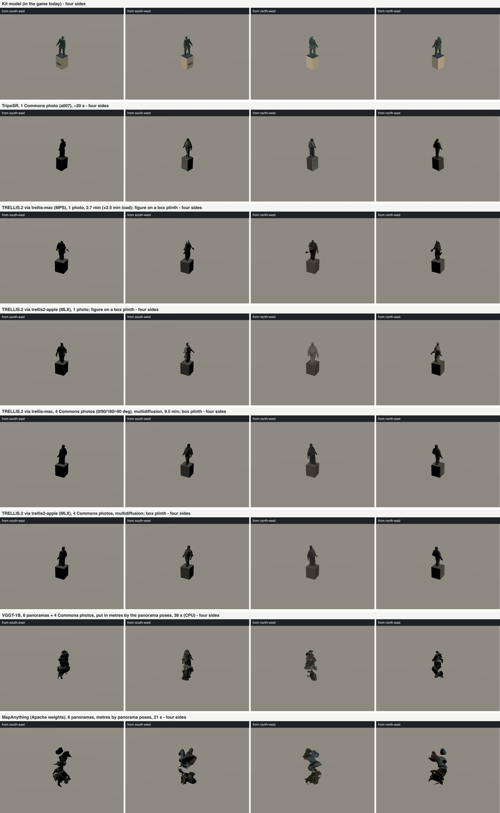

# Multi-view reconstruction tools: survey and trial (2026-10-14)

Question from the user: are there multi-photo reconstruction tools beyond the
single-photo TripoSR prototype (`docs/sculpture-reconstruction-20261014.md`),
for example Microsoft TRELLIS.2, and do they now run locally on this Mac
(M4 Pro, 48 GB unified memory, macOS 26, no NVIDIA GPU)?

State checked on 2026-10-14 from the project pages and model cards listed
under each row. "EU" means use in the Netherlands is within the licence;
"hobby" means a non-commercial, open-data project that publishes its output.

## Survey

Two families matter here, and they answer different questions:

- **Generative image-to-3D** (TRELLIS, TRELLIS.2, Hunyuan3D, SAM 3D, SF3D,
  SPAR3D, InstantMesh, Wonder3D/Era3D, TripoSR). They produce a complete,
  watertight object from one or a few images. The hidden sides are invented
  by a learned prior.
- **Feed-forward multi-view geometry** (DUSt3R/MASt3R, VGGT, MapAnything, π³,
  Depth Anything 3) and **classic photogrammetry** (COLMAP + OpenMVS, Apple
  Object Capture, Gaussian splatting). They measure only what the photos see.
  They need several views with overlap and give points, depth or splats, which
  still have to be meshed.

| Tool | Multi-image input | Licence (EU / hobby) | Apple Silicon | Memory | Output | Runtime per object |
| --- | --- | --- | --- | --- | --- | --- |
| **TRELLIS** (Microsoft, v1, Dec 2024) | Yes, experimental: `run_multi_image`, unposed, any count, tuning-free (alternates or averages the image conditions per step) | MIT code and weights (diffoctreerast, FlexiCubes own licences); EU yes, hobby yes | No official port; CUDA (spconv, flash-attn, nvdiffrast) | 16 GB VRAM | Gaussians, radiance field, mesh, GLB | ~10–20 s on A100 |
| **TRELLIS.2-4B** (Microsoft, Dec 2025) | **No**: `run(image)` takes one image; no multi-image path in the pipeline | MIT code and weights; **conditioner DINOv3 is gated** (DINOv3 License: worldwide, redistribution allowed, AUP, trade controls); rembg **RMBG-2.0 is CC BY-NC 4.0** (bypassable with your own cut-out) | Upstream CUDA only (Linux, 24 GB) | 24 GB VRAM | PBR-textured GLB (O-Voxel) | 3 s (512³) to 60 s (1536³) on H100 |
| **trellis-mac** (shivampkumar; 489 stars, 8 open issues, last commit `d58628f4` 2026-04-28; clones TRELLIS.2 `main` unpinned, here `75fbf018` of 2026-06-05) | No (single image; batching only reuses the loaded pipeline). Re-added here, see trial | MIT port; same weight gates as TRELLIS.2 | **Yes, PyTorch MPS** (ran here): flash-attn → SDPA (padded), flex_gemm → `mtlgemm` Metal or `conv_none` gather-scatter, o_voxel hashmap → pure-Python mesh extract, nvdiffrast → `mtldiffrast` Metal or Python, cumesh skipped (no hole fill) | 24 GB+ recommended; **20.4 GB peak measured** | Vertex-colour OBJ + PBR GLB | **2.7 min generate + 2.5 min load** here (512 pipeline, pure-PyTorch conv, loaded machine) |
| **trellis2-apple** (pedronaugusto; fork of TRELLIS.2, 45 stars, 1 open issue, last commit `17347247` 2026-08-05) | No (fork of TRELLIS.2 `run(image)`; adds a texturing pipeline). Re-added here | MIT; same weight gates | **Yes, MLX** models inside the upstream orchestration (ran here), Metal postprocessing (`mtldiffrast`, `mtlbvh`, `mtlmesh` as cumesh, `mtlgemm` as flex_gemm) optional; needs torch ≥ 2.11 | **26.5 GB peak measured** | PBR GLB, alpha modes | **2.0 min generate, 3 s load** here |
| **Hunyuan3D 2.0/2.1, 2mv** (Tencent) | 2mv: yes, posed front/left/back/right | Tencent Hunyuan Community Licence: **excludes the EU, UK and South Korea**. No 2026 change found. **Not usable here** | CUDA | 6–24 GB | Mesh + texture | ~30 s on GPU |
| **Hunyuan3D 3.0/3.1** | Yes, up to 4 (3.0) / 8 (3.1) views | Hosted API only; no open weights found | n/a | n/a | Mesh | n/a |
| **SAM 3D Objects** (Meta, Nov 2025) | No: one image plus a mask per object | SAM Licence: worldwide incl. EU, royalty-free, AUP and trade controls; weights gated on HF | **No**: Linux, NVIDIA ≥ 32 GB VRAM | 32 GB VRAM | Gaussian splat (+ mesh), with pose/layout | not stated |
| **SF3D / SPAR3D** (Stability) | No: one image (SPAR3D accepts an edited point cloud) | Stability AI Community Licence: free under USD 1 M revenue, EU yes | SPAR3D: **MPS experimental** (macOS ≥ 15.2, fallback on), CPU slow | 6–10.5 GB | Textured GLB | ~1 s GPU |
| **InstantMesh** (Tencent ARC) | No: one image → Zero123++ six views → LRM | Apache 2.0 | CUDA ≥ 12.1 | ~16 GB | Mesh | ~10 s GPU |
| **Wonder3D / Era3D** | No: one image → multi-view diffusion | Wonder3D AGPL-3.0 (unverified for Era3D) | CUDA | 16+ GB | Mesh via NeuS/instant-nsr | 2–3 min GPU |
| **TripoSR** (prototype) | No | MIT | Yes, MPS (with stubbed marching cubes) | ~6 GB | Mesh | ~20 s here |
| **DUSt3R / MASt3R** (Naver) | Yes, unposed; pairs plus global alignment (MASt3R-SfM for many) | **CC BY-NC-SA 4.0** code and weights, plus training-data licences (MapFree "very restrictive"); hobby/non-commercial only | Pure PyTorch; CUDA default, CPU/MPS possible | ~8–16 GB for tens of images | Point maps, matches, cameras | seconds per pair; minutes for 30 views |
| **VGGT** (Meta, CVPR 2025) | Yes, unposed, 1 to hundreds of views | Code: commercial use allowed (no military). Weights: `VGGT-1B` **CC BY-NC 4.0** (ungated); `VGGT-1B-Commercial` gated form | Pure PyTorch; CUDA in examples, CPU fallback; MPS untested upstream | ~1.2 B params, ~5 GB fp32 | Cameras, depth + confidence, point maps, tracks; COLMAP export for gsplat | < 1 s for tens of frames on H100 |
| **MapAnything** (Meta, Sep 2025, 3DV 2026) | Yes, unposed; optional intrinsics, poses, depth; metric scale | Code Apache 2.0; weights **`map-anything-apache` Apache 2.0** (EU yes, commercial yes) or `map-anything` CC BY-NC | Pure PyTorch; CUDA or CPU in examples; MPS untested upstream | memory-efficient mode, up to 2000 views on 140 GB | Metric world points, depth, rays, cameras, confidence; COLMAP/GLB export | seconds |
| **π³ / Pi3X** | Yes, unposed, permutation-equivariant (no reference view) | Code BSD; **weights CC BY-NC 4.0** | Pure PyTorch | similar to VGGT | Points, cameras | seconds |
| **Depth Anything 3** (ByteDance, Nov 2025) | Yes, any number of views, with or without poses | Code Apache; **DA3-BASE/SMALL/METRIC/MONO Apache 2.0, GIANT and LARGE CC BY-NC** per the README (HF tags `DA3-LARGE-1.1` as Apache; conflict) | Pure PyTorch + xformers on CUDA; MPS not mentioned | DA3-Streaming < 12 GB | Depth, rays, cameras, 3D Gaussians, GLB/PLY | seconds |
| **COLMAP 4 + OpenMVS** | Yes, unposed, needs overlap and texture | COLMAP BSD; OpenMVS AGPL-3.0 (fine for a tool run) | **Yes, CPU** (Homebrew `colmap` installed here) | RAM only | Sparse + dense points, mesh | minutes |
| **Apple Object Capture** (RealityKit `PhotogrammetrySession`) | Yes, unposed, ~20–200 photos with overlap | Apple SDK, free on macOS; output is yours | **Yes, native** (needs a GPU with ray tracing, i.e. Apple Silicon) | RAM only | USDZ/OBJ textured mesh | minutes |
| **Gaussian splatting on Mac**: Brush (Apache 2.0, wgpu/Metal), OpenSplat (AGPL, MPS), msplat (Metal), gsplat-mps fork (AGPL); nerfstudio/gsplat upstream are CUDA | Needs posed images (COLMAP) | as listed | Brush/OpenSplat yes | RAM only | Splat PLY | ~10 min per scene |

## Sources

- TRELLIS.2: https://github.com/microsoft/TRELLIS.2 ; pipeline config https://huggingface.co/microsoft/TRELLIS.2-4B/blob/main/pipeline.json (conditioner `facebook/dinov3-vitl16-pretrain-lvd1689m`, rembg `briaai/RMBG-2.0`)
- TRELLIS (v1, multi-image): https://github.com/microsoft/TRELLIS
- trellis-mac: https://github.com/shivampkumar/trellis-mac ; HN thread https://hn.svelte.dev/item/47828896 ; hands-on https://lilting.ch/en/articles/trellis2-m1-max-hands-on
- trellis2-apple: https://github.com/pedronaugusto/trellis2-apple (and `requirements_macos.txt` there)
- MLX re-port weights (gated DINOv3 inside): https://huggingface.co/xocialize/trellis2-mlx
- DINOv3 License and ungated timm redistribution: https://huggingface.co/timm/vit_large_patch16_dinov3_qkvb.lvd1689m
- Hunyuan3D licence: https://huggingface.co/tencent/Hunyuan3D-2/blob/main/LICENSE ; 3.x hosted multi-view: https://www.scenario.com/models/hunyuan-3d-31-pro-multiview
- SAM 3D Objects: https://github.com/facebookresearch/sam-3d-objects (LICENSE, doc/setup.md)
- SPAR3D: https://github.com/Stability-AI/stable-point-aware-3d
- InstantMesh: https://huggingface.co/TencentARC/InstantMesh ; Wonder3D: https://github.com/xxlong0/Wonder3D
- VGGT: https://github.com/facebookresearch/vggt ; MapAnything: https://github.com/facebookresearch/map-anything
- MASt3R: https://github.com/naver/mast3r ; π³: https://github.com/yyfz/Pi3 ; Depth Anything 3: https://github.com/ByteDance-Seed/Depth-Anything-3
- Brush: https://github.com/ArthurBrussee/brush ; gsplat on Mac: https://github.com/iffyloop/gsplat-mps , https://radiancefields.com/opensplat-3dgs-now-on-mac
- Apple Object Capture: https://developer.apple.com/documentation/realitykit/photogrammetrysession
- Model gating checked with `https://huggingface.co/api/models/<repo>` on 2026-10-14.

## Multi-view trial on De Dokwerker (2026-10-14)

Full-size sheet: `artifacts/sculpture-reconstruction/de-dokwerker/compare-tools.png` (gitignored),
built by `scripts/sculptures/multiview/compare-strips.sh`. Every row is a GLB in the landmark frame,
6,000–8,000 triangles, drawn by `scripts/landmarks/landmark-strip.ts`. Nothing was installed in the
game.

**Timings are not clean.** Other lanes kept the machine at a load average of 30 to 220 during the
trial (the TripoSR rerun took an hour for a step that took 7 s in the prototype). Read the times as
upper bounds and as ratios between tools.

### Inputs

- **Panoramas** (`scripts/sculptures/pano-crops.ts`):
  - 124 municipal panoramas lie within 40 m of the statue and **none within 25 m**; the nearest is 28.0 m.
  - Every one is on the street west of the square. Seen from the statue they lie at 206–276°; the
    figure faces 252°. **The panoramas only see the front arc, about ±35°.**
  - 34 were rendered, up to four per capture year (2016–2025), each as a 50° pinhole crop at 1024 px
    and as a tight crop.
  - In the 50° crops the statue is 122–167 px tall.
- **Commons**: the seven impostor views (`scripts/sculptures/dokwerker/impostor-views.json`):
  - a007 (0°) and a004 (+45°): A.A.W.J. Rietman 2013, CC BY-SA 4.0;
  - a073 (+90°): Bert Verhoeff / Anefo 1972, CC0;
  - a053 (+135°): Jack de Nijs / Anefo 1968, CC0;
  - a061 (180°): Joop van Bilsen / Anefo 1964, CC0;
  - a059 (−90°) and a057 (−45°): Hugo van Gelderen / Anefo 1961, CC0.
- **TripoSR row**: the prototype's `routeB-triposr.glb` was gone with its worktree, so it was rerun
  with `run_triposr.py` on the 1200 px cache copy of a007 (the prototype used the full-resolution file).
- **Cut-outs** (`scripts/sculptures/multiview/prep_inputs.py`, rembg IS-Net/U²-Net):
  - good on all seven Commons crops;
  - **usable on only 2 of 34 panorama crops**: a dark bronze 150 px tall against brick defeats
    salient-object matting;
  - for those two, the plinth was cut off (`keepTop`) so that they match the figure-only Commons cut-outs.

### TRELLIS.2 on the two Apple Silicon ports

Both ports load the upstream TRELLIS.2-4B weights (MIT, 15 GB, ungated), but its pipeline needs two
gated models. Neither was used:

- **DINOv3 ViT-L/16, the conditioner.** Meta's Hugging Face repo needs manual approval, and there is no
  HF token on this machine. Meta's DINOv3 License allows redistribution, and timm publishes the same
  weights ungated (`timm/vit_large_patch16_dinov3_qkvb.lvd1689m`). `dinov3_timm_to_hf.py` maps them
  onto the transformers layout. The converted model matches timm's own forward pass to 4.9e-6 absolute.
  Using them binds the user to the DINOv3 License (acceptable-use policy, trade controls; no
  non-commercial clause). For anything published, request access on the official repo.
- **RMBG-2.0, the background remover.** It is CC BY-NC 4.0 and gated. It is bypassed by feeding RGBA
  cut-outs: TRELLIS.2 uses the alpha channel when it is present.

TRELLIS.2 has **no multi-image path**: `run()` takes one image, and neither port adds one.
`run_trellis2.py` re-adds the tuning-free method of TRELLIS v1. It replaces `get_cond` with all the
images' conditions and wraps each sampler's `_inference_model` in one of two modes:

- `stochastic`: each step uses the next image in turn;
- `multidiffusion`: each step averages the velocity over all images, at N times the cost.

| Run | Install | Load | Generate | Peak memory | Raw mesh | Converged? |
| --- | --- | --- | --- | --- | --- | --- |
| trellis-mac (MPS), 1 photo (a007) | `setup.sh` ran in 5 s from a warm uv cache (torch 2.14.1, transformers 5.19). The Metal backends were skipped (`SKIP_METAL=1`, see below), so it ran on the pure-PyTorch `conv_none` and SDPA paths | 149 s | 164 s | 20.4 GB | 692,746 triangles, 38,340 pieces | Yes. Holed surface, forearms detached, small head |
| trellis-mac, 9 images (7 Commons + 2 panorama figures), stochastic | | 129 s | 106 s | 20.5 GB | **1,360 triangles** | **No.** The sparse structure collapsed: nine views of mixed decades, crowds and grey levels, switched every step, did not agree on an occupancy |
| trellis-mac, 4 Commons (0/+90/180/−90), multidiffusion | | 135 s | 572 s | 20.4 GB | 780,674 triangles | **Yes, best TRELLIS result** |
| trellis2-apple (MLX), 1 photo (a007) | Three attempts, see below | 3 s | 120 s | 26.5 GB | 947,544 triangles | Yes |
| trellis2-apple (MLX), 4 Commons, multidiffusion | | 0.3 s | 415 s | 26.7 GB | 767,442 triangles | Yes. As coherent as the MPS run, slightly slimmer (0.92 m across the shoulders against 1.5 m) |

trellis2-apple install, exact errors:

1. `uv pip install -r requirements_macos.txt` failed because the Metal packages import torch in
   `setup.py` under build isolation. Fixed by installing torch first and using `--no-build-isolation`.
2. All four Metal packages (`mtldiffrast`, `mtlbvh`, `cumesh`/mtlmesh, `flex_gemm`/mtlgemm) fail
   with `error: cannot execute tool 'metal' due to missing Metal Toolchain`. They need
   `xcodebuild -downloadComponent MetalToolchain`, a system-level Xcode component. That was not
   installed; it is the user's call. The trellis-mac Metal backends need the same toolchain, which is
   why it ran with `SKIP_METAL=1`.
3. `o-voxel` (needed for mesh extraction) fails with
   `error: C++20 or later compatible compiler is required to use PyTorch`. Its `setup.py` hardcodes
   `-std=c++17`, but the port requires torch ≥ 2.11. Also, the Eigen submodule is empty in a tarball
   checkout. Fixed in a private copy (`-std=c++20`, Eigen 3.4.0 headers). After that the MLX pipeline
   runs without any Metal package, because MLX does the sparse convolutions itself.

Both ports produce a TRELLIS.2 surface that is open and shelled: hole filling needs cumesh, which is
skipped on the Mac. Quadric decimation stalls on such a surface (327k triangles left of a 6k target).
`decimate_scale_glb.py --remesh=192` handles this:

- it voxelises the surface;
- dilates it by two cells, floods the outside, and erodes back;
- runs marching cubes;
- decimates the result.

The output is one watertight skin. TRELLIS.2's inputs are the figure without its plinth, so
`--plinth=1.25,1.25,1.53` scales the figure to 2.60 m and stands it on a granite-grey box. That puts
the rows on the same 4.13 m total as the kit model.

### Feed-forward geometry: VGGT and MapAnything

Run with `run_geom.py`. The point maps are put in metres by `align_mesh.py`. That script fits a
similarity (Umeyama) from the predicted panorama cameras to their known capture positions and
viewing directions, so the result is north-up and metric with the ground at z = 0. It then cuts a
1 m cylinder around the statue column and meshes it with Poisson. The fit residual measures how well
the network registered the panoramas. The height is a measurement, not a rescale.

| Run | Load / infer | Camera fit residual (RMS centre, median axis) | Statue | Measured height |
| --- | --- | --- | --- | --- |
| VGGT-1B (CC BY-NC), 6 tight panorama crops (~16° field), MPS | 65 s / 23 s | **6.1 m, 13.7°: failed**. Telephoto crops make zoom and translation ambiguous | none in the cut | n/a |
| VGGT-1B, the same 6 panoramas as 50° crops, MPS | 15 s / 25 s | **0.90 m, 0.46°** | The column sits 2.1 m *behind* the anchor, because the thin dark figure takes the façades' depth. 1,686 points, front only | 4.29 m (kit 4.13) |
| VGGT-1B, 6 panoramas (50°) + 4 Commons, **CPU** (MPS aborts at 10 views: `MPSNDArray … buffer is not large enough`) | 7 s / 38 s | 0.93 m, 0.24° | Column within 0.5 m of the anchor. **Only a007 (2013, colour) registered** (54,499 points); the 1961/1964/1972 Anefo side and back views put 0 points on the statue | 4.31 m |
| MapAnything (Apache weights), 6 panoramas (50°), MPS | 149 s (also fetched DINOv2 hub code into `~/.cache/torch/hub`) / 21 s | 4.1 m, 0.9° | blob, 1,610 points | 4.53 m |

MASt3R/DUSt3R were not run. Their licence is CC BY-NC-SA plus training-data terms, and the VGGT and
MapAnything runs already show the limit: inputs, not network.

### What each row gets right and wrong

| Row | Front | Sides | Back | Scale | Mixed-date ghosting |
| --- | --- | --- | --- | --- | --- |
| Kit | Wrong cap and arms (known) | Primitive | Primitive | Set by hand | n/a |
| TripoSR, 1 photo | Good stance and chin | Plausible | Invented, smooth | Set to 4.13 m; plinth from the photo | n/a |
| TRELLIS.2, 1 photo (both ports) | Stance right. Head too small, forearms detached, surface pitted | Thin, partly holed | Invented | Set (figure 2.60 m + box) | n/a |
| TRELLIS.2, 4 photos, multidiffusion | **Head, both arms (one held away), legs, shirt mass all coherent** | **Constrained by real ±90° photos**, so the silhouette from each side is right | **Constrained by the 180° photo** | Set | None visible: averaging the velocity fields of 1961–2013 photos converged. Stochastic switching over 9 views did not |
| VGGT, panoramas + Commons | Relief of the front only, lumpy | None | None | **Measured 4.3 m, +4 %** | Every b/w Commons view failed to register; there was no ghost because they dropped out |
| MapAnything, panoramas | Blob | None | None | Measured 4.5 m (+10 %), poor fit | n/a |

### Recommendation

1. **Generative, multi-view, for single figures.** Use TRELLIS.2 with 3–4 cut-outs from different
   sides, in multidiffusion mode.
   - It is the first route here whose sides and back come from photos rather than a prior.
   - It needs about 10 minutes per statue on this Mac with trellis-mac. On the MLX port (trellis2-apple, after the two local build fixes) it took 7 minutes, 1.4x faster, with the same shape.
   - Use it for the ~18 single standing or seated figures, wherever Commons has ≥ 3 sides; De
     Dokwerker has 7.
   - Keep TripoSR as the one-photo fallback. At gallery size it is as good as single-photo TRELLIS.2
     and 10× cheaper.
   - For groups, run one cut-out set per figure. Equestrian statues are untested.
2. **Geometry networks for scale and placement only.** Use VGGT on 50° panorama crops, fixed in
   metres by the panorama poses. It measured De Dokwerker's height to within 4 % and its column to
   within 0.5 m, with nothing set by hand. Use this to check the height and anchor of every statue
   near a street. It cannot supply shape: from 28 m and more, a statue is about 150 px tall and is
   seen from one arc. Commons photos from other decades do not register (the same finding as the
   2026-10-09 COLMAP pilot).
3. **Abstract, lettered and architectural memorials:** kit primitives stay right. No tool here helps
   with slabs and letters.
4. **What a CUDA box would add:**
   - TRELLIS.2 at 1024³/1536³ in seconds, with hole filling (cumesh) and the official PBR textures;
   - TRELLIS v1's native `run_multi_image`;
   - SAM 3D Objects (needs 32 GB on NVIDIA, Linux only);
   - Hunyuan3D-2mv, which is still not licensed in the EU and so is not an option anyway;
   - 3D Gaussian splatting from a modern walk-around capture.

   It would not fix the input problem: the panoramas are too far away, and Commons covers only some
   sides of each statue.
5. **Before anything is installed:**
   - the material pass;
   - the freedom-of-panorama question from the prototype doc;
   - the DINOv3 License: request official access, which should be quick, so that the provenance
     is clean;
   - the derivative licences of the input photos: a007 is CC BY-SA 4.0, the Anefo views are CC0.

Gandhi was not run: the time went to the TRELLIS.2 ports, and the machine was heavily loaded.

### Reproduce

- Tool directories are `~/Code/map-recall2-sculpt/mv/<tool>/` (source, venv), with weights in
  `~/Code/map-recall2-sculpt/mv/weights/` (HF_HOME and the converted DINOv3).
- Run scripts: `trellis-mac/run-multi.sh <mode> <set> <backend>`, and `trellis2-apple/install*.sh`
  with their logs.
- Repo scripts: `scripts/sculptures/pano-crops.ts`, then
  `scripts/sculptures/multiview/{make_inputs_json,prep_inputs,dinov3_timm_to_hf,run_trellis2,run_geom,align_mesh}.py`,
  then `scripts/sculptures/decimate_scale_glb.py` (now with `--remesh`, `--plinth`, the welding and
  fragment filter, and a fast-simplification fallback), then `compare-strips.sh`.
