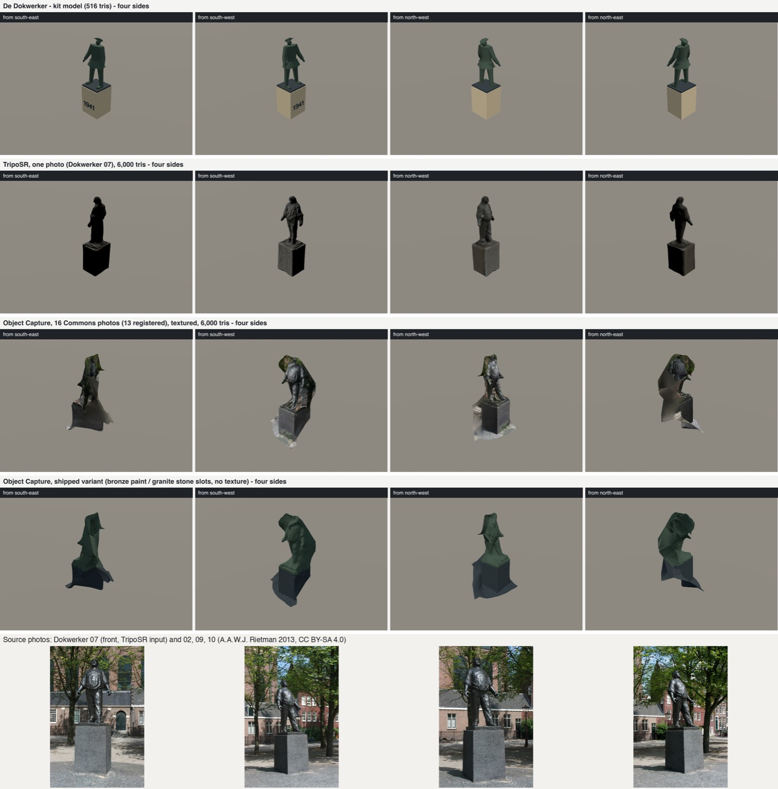
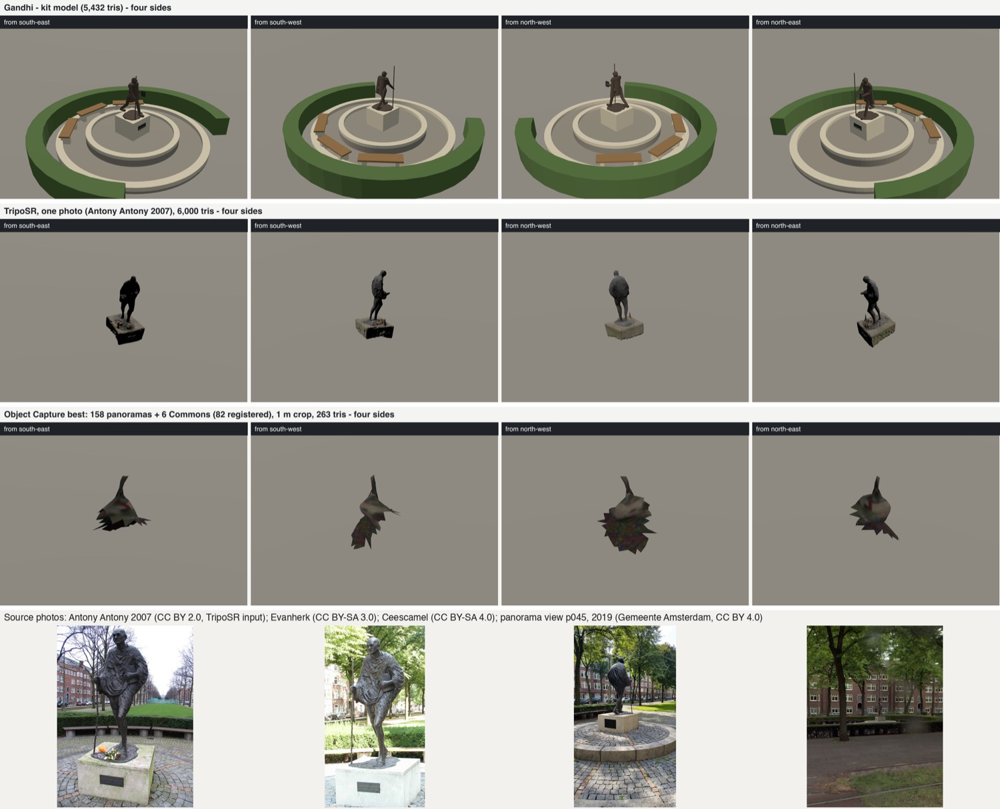

# Sculpture reconstruction from open data: a two-route prototype (2026-10-14)

The statues built this week from the figure kit (Gandhi, Theo Thijssen, Johnny
Jordaan, the Kinderbrug groups, Teun de Jager) were judged "bizarre": they are
hand-assembled primitives, not reconstructions. This prototype tested two ways
to get a real 3D shape from open data on three statues: Gandhi on the
Churchill-laan, Theo Thijssen on the Lindengracht and De Dokwerker on the
Jonas Daniël Meijerplein. Nothing was installed in the game.
`signature-landmarks.json` and the catalogue are untouched.

**Result in one line:** route B works, route A does not. Route B is
single-photo image-to-3D with TripoSR. It gave a recognisable, correctly scaled
6k-triangle figure for all three statues in about 20 s each on this Mac. It is
the best of the three models for the two single figures. Route A is the city
point cloud, and it is blocked: the municipal mobile-mapping files cannot be
downloaded. The open aerial substitute (the PDOK 8 cm surface model) cannot
represent a statue at all.

## Outputs (gitignored, under `artifacts/sculpture-reconstruction/<id>/`)

| File | What |
| --- | --- |
| `compare-kit-A-B.png` | Gallery-size sheet, three rows of four sides (SE, SW, NW, NE): kit model, route A, route B |
| `strip-kit/`, `strip-routeA/`, `strip-routeB/` `strip-four-sides.png` | The rows on their own, from `scripts/landmarks/landmark-strip.ts --glb=…` |
| `routeA-dsm8.glb` | Route A height field, vertex-coloured from the DSM RGB |
| `routeB-triposr.glb` | Route B mesh: 6,000 triangles, vertex-coloured, real height, faced |
| `routeB/` | TripoSR input (`input.png`, `cutout.png`), raw mesh `raw.ply`, `timing.json` |
| `dsm8-rgb.png`, `dsm8-height.png` | Top-down 24 × 24 m view of the DSM crop, with the OSM anchor marked |
| `../commons-provenance.json` | Licence, author, date and sha256 of every Commons photo fetched |

Paths:

- `artifacts/sculpture-reconstruction/de-dokwerker/compare-kit-A-B.png`
- `artifacts/sculpture-reconstruction/theo-thijssen-standbeeld/compare-kit-A-B.png`
- `artifacts/sculpture-reconstruction/gandhi-churchill-laan/compare-kit-A-B.png`

The inputs (tiles, photos, heights, facings, cut-out model) are pinned in
`scripts/sculptures/reconstruction-20261014.json`.

## Route A: the city point cloud

### The municipal mobile-mapping cloud is blocked on its host

The catalogue works. `api.data.amsterdam.nl/v1/puntenwolk/v2/metadata_2025`
with `geometrie[contains]=<rdX>,<rdY>` (header `Accept-Crs: EPSG:28992`)
returns one 100 × 100 m 2025 tile per statue, captured by Georizon:

| Statue | Tile | Points | Mean density over the tile |
| --- | --- | --- | --- |
| Gandhi | `631072dc…_121300484400.laz` (122 MB) | 19.3 M | ~1,900 /m² |
| Theo Thijssen | `778935f5…_120900488200.laz` + `7be80cc5…` (183 MB) | 29.9 M | ~3,000 /m² |
| De Dokwerker | `184a02fb…_122100486600.laz` (165 MB) | 26.2 M | ~2,600 /m² |

At those densities a 2.6 m bronze seen from a passing car would get thousands
of returns per side, which is enough for a real mesh.

The files cannot be fetched. Every `url` in the catalogue is on
`files.lidar.data.amsterdam.nl`, which is NXDOMAIN, also through 8.8.8.8. This
is the same blocker recorded in September (`docs/plans/appearance-programme.md`
§7). Guessed alternative paths on `api.data.amsterdam.nl` and
`data.amsterdam.nl` return 404. The 2024 table is empty. The only public
municipal tiles are the two Oud-Zuid demo tiles on GitHub, and neither covers
a statue.

- Licence: the dataset page says "openbaar" ("Geen; dit is openbare data").
- Owner: Directie Data, published by Datateam GEO.
- **Ask:** datateam.geo@amsterdam.nl to restore the host, or to send the three
  tiles above.

Density on the statues themselves was therefore not measured.

### Substitute: PDOK 2025 8 cm RGB surface model (CC BY 4.0), top-down only

`digitaaloppervlaktemodel_8cm` from PDOK 3D Basisvoorziening is a
dense-matching surface model from 2025 aerial photographs, delivered as LAZ
points. Each statue sits in one ~30 MB tile (`DSM_1212_4842`,
`DSM_1207_4880`, `DSM_1220_4865`).

**It is top-down only.** The data has one Z per 8 cm cell, so a statue is a
2.5-D height field. Sides, undercuts, arms and the gap between legs do not
exist in it. For the same reason a Poisson or ball-pivoting reconstruction
adds nothing here: the raster already is the surface. The script
`recon_dsm_heightfield.py` meshes the cells within 1.6 m of the anchor:
ground is the median of a 2.5–4.5 m ring, raised cells are kept plus a 0.4 m
apron, colours come from the DSM RGB, and a GLB is written in the landmark
frame.

| Statue | Cells within 8 m | Density | Raised cells (> 0.3 m) | Peak above ground | Real height | Recovered | Triangles |
| --- | --- | --- | --- | --- | --- | --- | --- |
| Gandhi | 31,402 | 156 /m² | 1,106 (7.1 m²) | 1.05 m | ~3.2 m | 33 % | 3,200 |
| Theo Thijssen | 31,423 | 156 /m² | 648 (4.2 m²) | **10.68 m** (tree canopy) | 2.68 m | n/a | 2,715 |
| De Dokwerker | 31,420 | 156 /m² | 651 (4.2 m²) | 3.40 m | 4.13 m | 82 % | 3,011 |

What the strips show:

- **Gandhi:** a 1 m soft mound. The dense matching smoothed the figure away;
  only the white plinth top is visible in the RGB.
- **Theo Thijssen:** the statue stands under the Lindengracht limes, so the
  model is the tree canopy, a 10 m column.
- **De Dokwerker:** the best case, on an open square. It comes out as a 3.4 m
  tapering post. The figure's shape is better in the RGB *shadow* on the
  square (`dsm8-rgb.png`) than in the heights.

**Verdict:** the aerial DSM is useful for one thing: checking position and
height of a statue in the open (it confirms the Dokwerker anchor to within
one cell). It cannot supply shape. AHN4/AHN5 LiDAR (about 10–20 points/m²,
also nadir) is sparser still and was not fetched. Route A stays worth doing
only with the municipal mobile-mapping cloud, which sees statues from the
street.

## Route B: TripoSR from one licensed photo

- **Model:** TripoSR (MIT, Tripo AI & Stability AI), weights
  `stabilityai/TripoSR` (MIT, 1.6 GB, Hugging Face cache).
- **Environment:** a pinned `uv` venv outside the repo, Python 3.11 with
  torch 2.5.1, transformers 4.35.0, huggingface-hub 0.17.3, rembg 2.0.59,
  scikit-image 0.24.0, open3d 0.18.0 and trimesh 4.0.5. The pins are in the
  scripts' inline headers.
- **Changes against upstream (`run_triposr.py`):**
  - `torchmcubes` (a CUDA/C++ extension) is replaced by
    `skimage.measure.marching_cubes` through a stub module, with the axis
    order swapped back;
  - the device is MPS, with `PYTORCH_ENABLE_MPS_FALLBACK=1` because ViT's
    bicubic position-embedding resize has no MPS kernel in torch 2.5;
  - the largest rembg component is kept as the cut-out.
- **Post-process (`decimate_scale_glb.py`, separate process):**
  - debris components below 2 % are dropped;
  - Open3D quadric decimation to 6,000 triangles;
  - the mesh is stood up from TripoSR's z-up frame, with the subject's front
    on +x (checked on a strip);
  - it is scaled to the real height, the front is turned to the statue's
    compass facing, and it is exported as a vertex-coloured GLB.
- Open3D and torch segfault when loaded in one process on macOS, hence the
  split.

| Statue | Photo (Commons) | Author, licence | Cut-out | Wall clock (load / cut-out / network / mesh) | Raw → final triangles | Scale |
| --- | --- | --- | --- | --- | --- | --- |
| De Dokwerker | `Amsterdam, De dokwerker 07.JPG` (2013) | A.A.W.J. Rietman, CC BY-SA 4.0 | U²-Net | 22 s (2.3 / 7.3 / 3.4 / 6.1) | 39,072 → 6,000 | 4.13 m, facing 252° |
| Theo Thijssen | `Lindengracht, Theo Thijssen beeld foto 1.jpg` (2017) | Alf van Beem, public domain | U²-Net | ~18 s (2.1 / 8.1 / 1.7 / 6.0) | 98,322 → 6,000 | 2.68 m, facing 0° |
| Gandhi | `Statue of Gandhi, Amsterdam.jpg` (2007) | Antony Antony, CC BY 2.0 | IS-Net | ~18 s (3.3 / 8.4 / 1.5 / 4.4) | 55,334 → 6,000 | 3.2 m, facing 90° |

- **Timing notes:** decimate, scale and export take 1.7 s. The first run also
  downloads the 1.6 GB weights. The cut-out time is mostly rembg loading its
  model.
- **Heights:** these are the kit models' plinth-plus-figure heights. The
  facings are the kit specs' estimates (Dokwerker 252° from the panoramas).
- **Gandhi cut-out:** U²-Net lost the pale limestone block and the staff,
  so IS-Net was used (`routeB-u2net-rejected/` kept for comparison).

What the strips show:

- **De Dokwerker: good.** The stance, the raised chin, the rolled sleeves,
  the hands held away from the body and the granite block all read correctly
  from the front and both sides. The back is plausible but invented: a smooth
  shirt with no folds. From behind, the silhouette is slightly too deep.
  Colour is the dark photo bronze with its baked light; the 1941 lettering
  survives faintly in the vertex colour. This is far closer to the statue than
  the 516-triangle kit model, whose cap disc and arms were already listed as
  wrong.
- **Gandhi: good figure, weak plinth.** The striding pose, the shawl and the
  book under the arm are right. Side and back are a plausible but smoothed
  shawl. Two faults:
  - the staff, a few pixels wide in the 512 px network input, became a stub;
  - the block comes out about half its real height, because the photo looks
    down on it, so with the total fixed at 3.2 m the figure is too big.
  The flowers left on the block in 2007 are baked into the plinth top. Fix by
  scaling the figure and the block separately, or by using a photo with a
  clean block.
- **Theo Thijssen: partly wrong.** The block (lettering visible in the
  colour) and the desk on four legs are right. The man leaning over the desk
  and the boy under it fuse into one hunched mass. The boy is not a separate
  figure, and the back and sides of the group are invented. Multi-figure
  groups need one run per figure, each cut out separately, or more views.

All three are watertight 6k-triangle meshes of 121 KB. That is in the range
of the kit models (516–5,432 triangles), so they fit the landmark budget as
they are. They would still need a material pass (a `materialSlot`/`tint` per
vertex-colour band, or a bronze tint over luminance) to match the city look.

### Licences and rights

- **TripoSR code and weights:** MIT, no restriction on this use.
- **Hunyuan3D-2:** not evaluated. Its Tencent community licence excludes the
  EU, UK and South Korea, so it cannot be used here.
- **TRELLIS and InstantMesh:** need CUDA and were not tried.
- **The meshes:** treat each one as a derivative of its photo. De Dokwerker
  is CC BY-SA 4.0, Gandhi is CC BY 2.0 (attribute Antony Antony), Theo
  Thijssen has no condition (public domain). Credits would go in NOTICE, as
  for the Dokwerker impostor.
- **The sculptures:** they are themselves copyright works (Andriessen died
  in 1979; Bayens' Thijssen dates from 1960). Dutch freedom of panorama
  (Auteurswet art. 18) covers depicting works permanently in public places.
  Whether it covers a 3D model is untested. The impostor route carries the
  same question.

## Recommendation for the 38 sculptures

The backlog list is `SCULPTURES` in `scripts/landmarks/build-poi-backlog.ts`.

| Class | Examples | Route | Expected quality | Cost per statue |
| --- | --- | --- | --- | --- |
| Single standing or seated figure on a plinth (about 18) | Dokwerker, Gandhi, Thorbecke, Multatuli, Carmiggelt, Anne Frank, Martin Luther King, Vondel, Rembrandt, Koningin Emma, Van Hall, Sarphati, Annick van Hardeveld, P.W. Janssen, Waterdraagster, Albert, Westerman | **B**, front photo; the impostor stays as an alternative where B hallucinates badly | Good front and sides, plausible back | about 20 s compute + 10–15 min human (pick photo, check licence, facing, height, review strip) |
| Multi-figure groups (about 6) | Theo Thijssen, Johnny Jordaan, Kinderbrug, Samen spelen, Slavernijverleden, Mama Baranka | **B per figure**: cut out each figure, run each, place them on a kit plinth by hand | Each figure good; layout by hand | 30–60 min |
| Equestrian (1) | Wilhelmina | **B**, side photo first; thin legs may need a manual fix | Probably fair; untested | 20–30 min |
| Abstract, architectural and lettered memorials (about 13) | Living by Numbers, De Knoop, Ravensbrück, Monument Indië, Kunstenaarsverzet, Hel en Vuur, Spanjemonument, No pasarán, Levensboom, Tranen, Hongerwinter, Fusillade, De Schreeuw | **Kit primitives remain right** for flat slabs, walls, letters and rings. Use B only for organic forms (De Schreeuw, Levensboom, Tranen). Check footprint and height against the DSM where in the open | n/a | as today |
| Any class, once the municipal cloud is reachable | all | **A** as ground truth for position, height and silhouette; B as the textured shape, checked against it | measured | about 1 h per statue to build the pipeline once, then minutes |

### What to automate

Most of this already exists as scripts in `scripts/sculptures/`.

1. **Photo selection.** `fetch-commons.ts` (category crawl with licence gate)
   or `fetch_commons_files.py` (named files) chooses candidates. A person
   picks the frontal one; that is the only judgement step besides review.
2. **Generation, one command.** `run_triposr.py` then
   `decimate_scale_glb.py`, then `landmark-strip.ts --glb=…`. Try U²-Net
   first and fall back to IS-Net when the plinth or a thin attribute is
   missing, as the impostor bake already does.
3. **Height and facing.** Take them from the kit spec, or from the DSM peak
   for statues in the open.
4. **Install.** Install would be a far-LOD replacement for the kit model (or
   the near LOD under `?sculptures=1`). Before any install, the integrator
   should decide:
   - the material treatment (vertex colour vs. bronze tint);
   - the freedom-of-panorama question;
   - whether a 6k-triangle figure is wanted at far range or only near.

### Blockers

- The municipal point-cloud host is NXDOMAIN; contact datateam.geo@amsterdam.nl.
- Route B's hidden sides are invented. They look plausible on single figures
  and are wrong on groups, which is unacceptable for a teaching twin unless it
  is flagged.

## Scripts (`scripts/sculptures/`)

| Script | Role |
| --- | --- |
| `probe_laz.py` | Header, dimensions and radius density of a LAZ tile around an RD point |
| `crop_topdown.py` | Square crop of a LAZ tile, written as top-down RGB and height PNGs plus an `.npz` |
| `recon_dsm_heightfield.py` | Route A: statue height field from the DSM crop, written as a GLB with a JSON summary |
| `fetch_commons_files.py` | Named Commons files with their licence gate and a provenance JSON |
| `contact_sheet.py`, `stack_strips.py` | Review sheets |
| `run_triposr.py` | Route B: cut-out and TripoSR on MPS, writing a raw PLY and timing |
| `decimate_scale_glb.py` | Route B: decimate, stand up, scale, face, and write a GLB |
| `glb-stats.ts` | Bounds and triangle count of GLBs |
| `reconstruction-20261014.json` | Pinned inputs of this run |

Python is run as `<venv>/bin/python -I <script>`, from the worktree, with the
downloads in their own directories. The inline `# /// script` headers carry
the pins, so `uv run --script` works too. To reproduce, check out TripoSR
(`VAST-AI-Research/TripoSR` main, MIT) anywhere outside the repo and pass it
as `--src`.

## Multi-view: Object Capture

TripoSR takes one photo, so its hidden sides are always invented. The
multi-view route that runs on this Mac is Apple Object Capture (RealityKit
`PhotogrammetrySession`): local, free, macOS 14+, Apple silicon. It was tested
on De Dokwerker and Gandhi with three photo sets each. Nothing was installed.

### Method

- **Tool:** `scripts/sculptures/objcap/`, a Swift package
  (`swift build -c release --package-path scripts/sculptures/objcap`). It runs
  `objcap <photo folder> <out> --detail=reduced|medium|full|raw` and writes
  `model.usdz`, `obj/` (baked-texture OBJ with MTL and PNG maps), `poses.json`
  (camera-to-model transform per registered photo) and `report.json` (status,
  seconds, registered count, exact error). Defaults: object masking on,
  feature sensitivity high, unordered samples.
- **Panorama views:** `scripts/sculptures/pano-views.ts` takes every Gemeente
  Amsterdam panorama (CC BY 4.0) within a radius, all years, through the
  `pand-reference` lookup and cache. It renders a 40° pinhole view aimed at the
  statue's mid-height from the world-aligned equirectangular, at native
  resolution (about 930 × 1240 px), with an EXIF 35 mm focal length. Each
  view's camera position (RD/NAP) and aim go in `source.json`.
  - De Dokwerker has **no panorama within 25 m**; the nearest is 28.1 m away.
    The set therefore uses a 40 m radius: 124 views from 2016 to 2025, with the
    statue about 135 px tall.
  - Gandhi: 158 views within 25 m, from 2016 to 2025, with the statue about
    180–200 px tall behind the hedge.
- **Commons photos:** fetched with `fetch_commons_files.py` at 1920 px, with
  author, licence and sha256 per file.
  - Gandhi: all six photos of the figure in `Category:Mahatma Gandhi
    (Amsterdam)`. They are by Ceescamel (CC BY-SA 4.0), Evanherk (CC BY-SA 3.0),
    Michal Huniewicz (CC BY 3.0) and Antony Antony (CC BY 2.0). The two
    plaque close-ups were left out.
  - De Dokwerker: the 16 colour photos of the bronze in `Category:De
    Dokwerker`. Seven are Rietman's 2013 series (CC BY-SA 4.0). The others are
    two 1970 Anefo shots (CC0) and single photos under CC BY-SA 3.0,
    CC BY-SA 3.0 nl, CC BY 4.0, CC BY 2.5 nl and public domain.
  - The pinned list with every licence is in
    `scripts/sculptures/multiview-20261014.json`, which
    `objcap_summary.py` regenerates.
- **Post-process:** `scripts/sculptures/objcap_post.py` runs in Blender 5.2
  (`blender -b -P … -- …`). It writes the GLBs directly with Blender's glTF
  exporter; `usdcat` was not needed.
  - **Alignment for sets with panoramas.** The rotation comes from the
    panorama views' known orientations: yaw is the bearing to the statue,
    pitch is recorded, roll is 0. Scale and offset come from the camera
    centres. The rotation agrees to within 0.2–0.5° (median), and the centres
    to within 0.6–0.8 m RMS. The optical axes then meet 2 cm (Gandhi) and
    22 cm (Dokwerker) from the OSM anchor.
  - **Why not a centres-only fit.** An Umeyama fit on the centres alone failed.
    The capture cars drive along one line, so the roll about that line is free,
    and the fit put the cameras looking at the sky.
  - **Alignment for Commons-only sets.** Up is perpendicular to the camera
    x-axes. The centre is where the optical axes meet. Yaw comes from the
    front photo (Dokwerker 07). Scale comes from the known height.
  - **Output.** The model is cropped to a cylinder about the statue, scaled
    to the real height and decimated to 6,000 triangles. Two GLBs are written:
    - `objcap-best-textured.glb`, with Object Capture's baked texture and no
      material slot (for the sheets);
    - `objcap-best.glb`, the shipped variant: no UVs, no vertex colour, and
      faces below the plinth height in material `stone` (`materialSlot`
      stone), the rest `bronze` (`materialSlot` paint, as the kit statues
      have it). Each material has a `tint`: De Dokwerker uses the kit's
      `#3d5148` bronze and `#303b43` granite, Gandhi `#4a4038` and `#c9c2ae`.

### Sets

Wall clock on the M4 Pro; triangles are the whole Object Capture mesh, then the
part inside the crop around the statue.

| Statue | Set | Photos | Registered | Detail | Result | Time | Mesh → on the statue | What it is |
| --- | --- | --- | --- | --- | --- | --- | --- | --- |
| Gandhi | Commons only | 6 | 4 | reduced | converges | 13 s | 6,020 | A crumpled 2.5-D sheet of the front of the figure; no statue shape |
| Gandhi | panoramas only | 158 | 75 | reduced | converges | 93 s | 25,000 → 158 | The square, hedges and trees; nothing above the block at the anchor |
| Gandhi | panoramas only | 158 | 76 | full | converges | 185 s | 26,427 → 278 | Same; the triangle budget is spread over the whole 60 m scene |
| Gandhi | panoramas only | 158 | – | raw | **processError** | 69 s | – | `.raw` fails with or without a USDZ request |
| Gandhi | panoramas, 14° crops ×3 | 158 | – | full | **processError** | 39 s | – | Too few features in tight, upscaled crops |
| Gandhi | both | 164 | – | full | **processError** | 49 s | – | |
| Gandhi | both | 164 | 82 (1 Commons) | reduced | converges | 210 s | 24,999 → 263 | A 3 m spike on a ground apron where the figure is (best Gandhi run) |
| De Dokwerker | panoramas only (≤ 40 m) | 124 | 114 | reduced | converges | 88 s | 24,999 → 395 | A 4.2–4.3 m column at the anchor: block plus a smooth figure hull, no limbs |
| De Dokwerker | panoramas only (≤ 40 m) | 124 | 114 | full | converges | 80 s | 29,640 → 394 | Same |
| De Dokwerker | Commons only (colour) | 16 | 13 | reduced | converges | 28 s | 25,000 → 6,000 | **Best Object Capture model**: real front surface and texture, open back |
| De Dokwerker | both | 140 | – | reduced | **processError** | 36 s | – | Same with sensitivity normal and with masking off |
| De Dokwerker | Commons, all archive photos | 274 | – | reduced | **processError** | 115 s | – | The 1950s–2020s Anefo set COLMAP registered in October |

**The exact failure.** Every request ends with
`PhotogrammetrySession.Error.processError` for the model and for `.poses`,
after 25–115 s. Object Capture never refused to start: `isSupported` is true
on this Mac. The failure is in reconstruction. In every failing set, the
photos split into groups that do not overlap: the 2013 Commons series and the
car-height panoramas 28–40 m away, or decades of archive photos. The one
successful mixed run registered a single Commons photo.

### What the strips show

Rows: kit | TripoSR | Object Capture (best set) | source photos.

- `artifacts/sculpture-reconstruction/de-dokwerker/compare-multiview.png`
  (`docs/images/sculptures/de-dokwerker-multiview.jpg`). It has an extra row
  with the shipped material-slot variant.
- `artifacts/sculpture-reconstruction/gandhi-churchill-laan/compare-multiview.png`
  (`docs/images/sculptures/gandhi-churchill-laan-multiview.jpg`).

The TripoSR rows were re-run with the prototype's script and pins. The routeB
GLBs were not on disk, and the raw triangle counts (39,072 and 55,334) match
the first run.





#### De Dokwerker

From the south-west and north-west, the Commons-only model is the real statue.
It has:

- the granite block with its texture;
- the right lean, and the hands held out from the body;
- the real bronze texture from the photos.

Seen from the front, it is the most faithful of the three rows. The failures:

- **Missing back.** The 13 registered photos cover the front arc and the
  north-west side. The back and north-east are an open shell, a draped
  curtain where the surface is closed over unseen space.
- **Foliage.** Tree leaves behind the head are baked into the top. They raise the
  top of the mesh, so after scaling to 4.13 m the figure is somewhat too
  small. The amount was not measured.
- **Shipped variant.** Without the texture, the flat-material version reads
  as a blob. The shape is only good where the photos saw it.
- **Panoramas.** They gave a correctly placed and measured but featureless
  hull: the statue is about 135 px tall at 28–40 m.

#### Gandhi

No set produced a usable figure. Four reasons:

- the six Commons photos are too few and too far apart in angle;
- the panoramas see the statue at about 190 px, dark against brick, behind a
  hedge, with poles and trunks in front;
- mixed dates (2016–2025, winter and summer) change the hedge and the trees,
  which are the only texture the matcher can use;
- the best run is a spike at the right place and height.

**Mixed-date ghosting.** It did not appear as double figures. It appears as
smooth, averaged surfaces.

### Verdict against the single-photo route

| Statue | Verdict |
| --- | --- |
| De Dokwerker | **Object Capture is better on the front and worse everywhere else.** Its front surface and texture are measured, not invented, and on the two front views it beats TripoSR. Its back is missing, while TripoSR gives a closed, plausible back. As a game model, neither the shell nor the untextured slot variant is shippable. TripoSR stays the route. Object Capture is a good *reference* for checking TripoSR's front (pose, proportions, block size) on statues with a dense Commons set. |
| Gandhi | **Object Capture fails; TripoSR stays.** No set reconstructs the figure. |

**What the panoramas are good for.** The panorama sets do give something
TripoSR cannot: a metric, georeferenced hull. They confirm a statue's
position (to 2–22 cm here) and its height, from the side. For example, the
Dokwerker column top is at 4.2–4.3 m against the 4.13 m kit height. The
aerial DSM gave 3.40 m. That makes them a cheap check of the position, height
and facing inputs to TripoSR for statues in the open.

### Realistic throughput for the ~18 single figures

- **Compute is not the limit.** Object Capture takes 0.5–3.5 min per set,
  and post-processing and strips about 1 min.
- **Photos are the limit.** A usable model needed one photographer's
  same-day series of about 10 or more overlapping colour photos around the
  statue. Among the two statues here, only De Dokwerker has one (Rietman's
  2013 walk-around), and even it covers only the front half.
- **Expected result.** For the other ~16 single figures, expect a crumpled
  sheet like Gandhi's from Commons, and a hull from the panoramas.
  - Estimate: about 15 min per statue to collect and run; 2–4 of the 18
    give a front-half reference model; none gives a complete closed figure.
- **What it would take.** A full multi-view model of these statues needs a
  dedicated walk-around capture (about 40 photos in a circle, one session),
  for example by a volunteer under CC BY-SA. Object Capture would then
  probably close the figure in minutes.
- **Point cloud.** The municipal point cloud (route A, still NXDOMAIN) would
  give the same hull as the panoramas, denser.

### Scripts added

| Script | Role |
| --- | --- |
| `objcap/` (Swift package) | Object Capture CLI: photos → USDZ, OBJ, poses, report |
| `pano-views.ts` | Aimed pinhole views of a statue from every panorama within a radius, with camera RD/NAP and licence per view |
| `objcap_post.py` (Blender) | Align (panorama orientations, or camera axes for Commons), crop, scale, decimate; textured and material-slot GLBs |
| `objcap_summary.py` | Collect every run's report and the photo provenance into `multiview-20261014.json` |
| `stack_strips.py` | Now also takes a `photo:` row of source photos |
| `fetch_commons_files.py` | Now backs off on Commons 429s and resumes |
| `glb-stats.ts --materials` | Material names, extras (`materialSlot`, `tint`) and attributes |
## Batch 1: route B as one command on the single figures (2026-10-14)

### The command

```
node --import tsx scripts/sculptures/reconstruct.ts --id=de-dokwerker
node --import tsx scripts/sculptures/reconstruct.ts --id=anne-frank-merwedeplein --box=150,70,560,640 --rembg=isnet-general-use --kit-plinth
node --import tsx scripts/sculptures/reconstruct.ts --id=<new> --title="File:X.jpg" --kit=<kit glb id> --height=2.6 --facing=250
node --import tsx scripts/sculptures/reconstruct.ts --id=<new> --photo=<jpg> --page-url=<Commons page> --author="A" --licence="CC BY 4.0" --height=2.6
```

- **Inputs.** `--id` picks defaults from `scripts/sculptures/batch1.json` (kit model, Commons title, real height, facing).
  Flags override them.
  - The photo comes from `--title` (fetched with author and licence from the Commons API, refused unless CC0, PD, CC BY or CC BY-SA)
    or from `--photo` plus `--page-url`, `--author` and `--licence`.
  - Height defaults to the kit model's bounding-box height, facing to the kit builder's `FACING`.
- **Steps.** Download, rembg cut-out (`--rembg=isnet-general-use` is the IS-Net fallback, `--box` crops one figure of a group),
  TripoSR on MPS, scikit-image marching cubes, Open3D decimation to 6k triangles, scale to the real height, turn to the facing,
  then material tagging in Node.
  - **Material.** No photo colour is baked. Bronze and stone are copied from the kit model's own `bronze` and `stone` materials
    (`materialSlot` plus `tint`, `materialSlotSource: inferred`). Triangles under `plinthTopM` take the stone slot.
  - **`--kit-plinth`.** Use it when the photo plinth is wrong: the figure is scaled to `height - plinthTop`, lifted, and stood on
    the kit's plinth triangles (all vertices under `plinthTop` and within 1.8 m of the origin).
- **Output.** `artifacts/sculpture-reconstruction/<id>/{routeB.glb, compare.png, source.json}` plus `work/` (cut-out, raw mesh,
  timings), `strips/` and `download/` (the photo, in its own directory). `compare.png` is the inputs row (photo, cut-out, network input)
  above the kit strip and the route B strip. A copy under 300 KB goes to `docs/images/sculptures/<id>.jpg`.
- **`source.json`** records the photo title, page URL, author, licence, date and sha1, the cut-out model, the settings and the timings.
  It also records the result's triangle count and size and the material extras.
- **Environment.** `scripts/sculptures/setup-env.sh` recreates the two venvs and the TripoSR checkout outside the repo
  (`~/Code/map-recall2-sculpt`, or `SCULPTURE_TOOLS`).
  - The two venvs: `venv-triposr` (torch) and `venv-o3d` (Open3D), because torch and Open3D segfault in one process.
  - The TripoSR weights were already in the Hugging Face cache.
- **Seconds** in the table are TripoSR load, cut-out, network and mesh extraction. Downloads, decimation and the two strips add
  about 30 s more.
- **Bug found and fixed.** The photo cache was keyed only by id, so re-running Anne Frank with a different photo silently reused the
  first one. It is now keyed by the sha1 of the original. Commons' `upload.wikimedia.org` rate-limits (429) after about ten
  downloads; the fetch now backs off for up to ten minutes.

### Verdicts

Strips are `docs/images/sculptures/<id>.jpg`: inputs row, kit row, route B row, all at the same camera distance. Every one was looked
at at gallery size. None of these is installed.

| id | Photo (Commons), author, licence | s | tris | Verdict | What is wrong |
| --- | --- | --- | --- | --- | --- |
| `de-dokwerker` | `Amsterdam, De dokwerker 07.JPG`, A.A.W.J. Rietman, CC BY-SA 4.0 | 17 | 6,000 | **Better than the kit** | The back is invented and smooth. The block carries the photo's stone relief and no 1941 lettering. Height and facing are the kit's estimates |
| `gandhi-churchill-laan` | `Statue of Gandhi, Amsterdam.jpg`, Antony Antony, CC BY 2.0 | 18 | 6,000 | **Better figure, worse plinth** | The block is about half its height and the flowers are baked into its top. The staff is a stub. Fix with `--kit-plinth` and a photo box above the block |
| `mama-baranka` | `Mama Baranka in 2019 (1).jpg`, Ceescamel, CC BY-SA 4.0 | 20 | 6,000 | **Better than the kit** (the kit is a cone with studs) | The back and sides are invented and lean. The hands read as a lump. A 3-photo TRELLIS.2 run is coherent all round but misses the base disc (see below) |
| `waterdraagster-bellamyplein` | `2021 Waterdraagster met vissen-Waterdraagster (1).jpg`, Ceescamel, CC BY-SA 4.0 | 18 | 6,000 | **Better than the kit** (the kit figure is a stub on the rim) | The photo looks down, so the figure leans back. The kit strip is centred on the basin, so the framing differs. No water yoke |
| `anne-frank-merwedeplein` | `Standbeeld Anne Frank - Merwedeplein - Amsterdam.jpg`, Maaike98, CC BY-SA 3.0 | 15 | 7,034 (with kit plinth) | **Needs a second photo** (about equal to the kit) | The only usable photo is tiny, with the figure behind the flowers, so the kit plinth had to be used. Face and bag are lumps. A photo of a framed sepia drawing (Jos WRSM) was tried first and rejected, because it shows a picture of the statue. The brief's Westerkerk statue is a different work; the kit model is the Merwedeplein one |
| `multatuli-standbeeld` | `Multatuli Amsterdam (4133292208).jpg`, FaceMePLS, CC BY 2.0 | 15 | 6,346 (with kit plinth) | **Worse than the kit** (needs a second photo) | The photo is a night shot. The head is lumpy and the torso is a slab. The Paul van Galen RCE photos (CC BY-SA 4.0) cut the head off at the frame edge or merge a tourist into the cut-out, so they were rejected |
| `theo-thijssen-man` | `Lindengracht, Theo Thijssen beeld foto 1.jpg`, Alf van Beem, public domain | 19 | 8,963 (with kit plinth) | **Man: better than the kit's man** | One figure per run, each on the kit block. The man is a recognisable seated figure; the back is invented. The kit desk is not in these rows |
| `theo-thijssen-boy` | same photo, boy and desk box | 17 | 8,963 | **Worse** | The boy, the desk and the crossed legs fuse into fragments. A group needs hand placement and a second photo of the desk |
| `carmiggelt-borstbeeld` | none | - | - | **Skipped** | The Commons photos found (Anefo 934-3460..3464, CC0) show the sculptor and the widow, not the bust. No frontal photo of the bust itself with a recorded licence. The first run (the Anefo portrait) was deleted |
| `winkler-prins-monument` | `Monument Anthony Winkler Prins André Volten Frederiksplein.JPG`, Brbbl, CC BY-SA 3.0 | 32 | 6,000 | **Worse** (keep the kit) | It is a stack of discs, not a figure. The cut-out loses the discs and the network gives a twisted stick |
| `walraven-van-hall` | `Walraven van Hall, vooraanzicht.jpg`, Ceescamel, CC BY-SA 4.0 | 27 | 6,000 | **Wrong class, worse** | It is a 10 m fallen tree, not a figure. The height scaling treats the root mass as upright. Needs a footprint scale and several photos |
| `spinoza-standbeeld` | `Spinoza -.jpg`, Nicolas Dings (the sculptor), CC BY-SA 4.0 | 47 | 6,000 | **Better than the kit** | The cloak, relief studs and head read from all sides. The feet are missing and the cloak is bell-like. The slab and the polyhedron are not part of it |
| `rembrandtmonument` | `Standbeeld van Rembrandt op het Rembrandtplein, RP-P-2019-371.jpg`, Rijksmuseum, CC0 | 64 | 5,999 | **Worse** (needs a modern photo) | The only licensed image is a 19th-century print with its lettering and railings, and the result keeps the print's text base. The kit model of this id is the Night Watch group, not the Rembrandt statue, so the comparison row shows a different object |
| `wilhelmina-ruiterstandbeeld` | `Ruiterstandbeeld van koningin Wilhelmina - Amsterdam - 20362367 - RCE.jpg`, Loek Tangel, CC BY-SA 4.0 | 47 | 6,000 | **Mixed, needs a side photo** | The horse and rider silhouette is right from the side, but from the front the legs, chest and pedestal merge. The kit is blocky but separable |

Totals: of 13 attempted, 5 are better than the kit as they stand (Dokwerker, Mama Baranka, Waterdraagster, Spinoza, Theo's man),
Gandhi has a better figure with a worse plinth, and the rest are worse or need a second photo. Single-photo, well-lit, frontal
subjects work. Night shots, prints, crowds, thin columns and group sculptures do not.

### Multi-photo trial (TRELLIS.2 multidiffusion, on the merged `multiview/` scripts)

Only Mama Baranka in this batch has three or more Commons photos from different sides by one author (Ceescamel 2019 (1), (3), (5):
front, three-quarter, back). Three cut-outs were fed to `trellis2-apple` (MLX) in multidiffusion mode with
`scripts/sculptures/multiview/run-multi-statue.sh`, then decimated with `--remesh=192`.

- **Result:** `docs/images/sculptures/mama-baranka-multi.jpg`, third row. The figure is one coherent full body with a face, arms and a
  back. It has no base disc: the cut-outs of the dark bronze against grass lost it. The grey and black shading in the strip is the GLB
  without the material tag, which this trial did not add.
- **Time:** about 7 minutes of generation on the MLX port (the machine was loaded).
- **Provenance:** DINOv3 weights came through timm's ungated redistribution
  (`timm/vit_large_patch16_dinov3_qkvb.lvd1689m`), under the DINOv3 License (see the multiview survey). Cut-outs used IS-Net.
  Photos: Ceescamel, CC BY-SA 4.0, `File:Mama Baranka in 2019 (1).jpg`, `(3)` and `(5)`.
- **Which statues got the multi-photo route:** Mama Baranka only. The other 12 fell back to TripoSR on one photo, because no set of
  three or more licensed photos from different sides was found for them (Spinoza has three Commons files, two of them tiny or from
  the same side; the Waterdraagster has Ceescamel and Golsteijn sets, but only some show the figure from other sides).
  The sibling lanes cover De Dokwerker and Gandhi. A second multi-photo pass on the Waterdraagster, Wilhelmina (three RCE photos)
  and Spinoza is the next step. It was not done here because each run costs about 7 minutes and 27 GB.