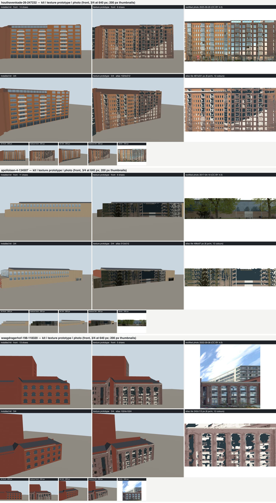

# Texture prototype: panorama-derived walls on the three complaint houses (2026-10-14)

The user's decision (2026-10-14): "keep making the kit better, try both". A stylised photo-derived texture is
acceptable where the kit cannot express a front, judged side by side with the measured kit. This page is the
texture half of that comparison for the three complaint houses: Houthavenkade 26 (`houthavenkade-26-247232`),
Apollohal (`apollolaan-4-134507`) and Waagdragerhof (`waagdragerhof-198-118320`). Nothing was installed.

Per house: [Houthavenkade 26](images/texture-prototype/houthavenkade-26-247232.jpg),
[Apollohal](images/texture-prototype/apollolaan-4-134507.jpg),
[Waagdragerhof](images/texture-prototype/waagdragerhof-198-118320.jpg). Each sheet is the installed kit GLB
(`public/canal-drive/models/ordinary-buildings/recipe-large-<id>.glb`), the textured prototype and the rectified
photo, front-on and 3/4 at gallery-card size (640 x 448) and as 200 px thumbnails, rendered by
`scripts/building-recipes/render.ts renderModels` (headless Chromium, the recipe look). The third column of the
second row is the posterised atlas tile for the framed panel.

## Method

`scripts/building-recipes/export-textured.ts --house=<id>[,...]` writes `artifacts/texture-prototype/<id>/`
(`model.glb`, `atlas.png`, `measure.json`, `compare.png`) and `artifacts/texture-prototype/index.png`.

1. **Crops.** `scripts/pand-reference/all-walls.ts --archive --min-len=6 --max=24` with `MAP_RECALL_SOURCE_DATA`
   pointing at `artifacts/texture-prototype/source` (so nothing lands in the source-data archive) and
   `PAND_REFERENCE_CACHE` at the main checkout's cache: 5 / 7 / 9 crops with masks for Apollohal / Houthavenkade /
   Waagdragerhof. Three Apollohal walls (w02, w03, w08, the east side) have no panorama within 35 m.
2. **Shell.** `fitLarge` then `buildHost` with the same options as the kit's `compose` (deferred, dissolved walls,
   `mergeKey = wallGroup`, sealed slivers), so panel indices are the kit's. No openings are cut: the textured walls
   are the flat 3DBAG LoD2.2 panels.
3. **Crop to panel.** `cropToPanel.bestCropForPanel` per panel (party walls and panels under 2 m skipped). u maps
   onto the crop's along-metres through the match's `alongAtUMin/UMax`; v (metres above `set.groundNap`) onto crop
   rows through NAP: row 0 is `baseZ + wallHeightM`.
4. **Sample** at 8 px/m with a box filter over the source footprint and the validity mask.
5. **Exposure** per crop (measureFacade.ts's rule): p95 luma to 215/255 (gain 0.75..1.6), white balance from the
   brightest 10 % clamped to +-8 %.
6. **Mask and inpaint.** Missing pixels, leaves (hue 55-165 deg with saturation) and the ground band below 2.5 m
   (vehicles, bikes, people, hedges; there is no vehicle detector) are filled from the nearest usable row a whole
   storey period away (vertical autocorrelation of the tile, 2.6-4.5 m), then the nearest usable row in the column,
   then the tile median.
7. **Posterise.** Sky-reflecting glazing (blue/cyan over red) takes the kit's glass colour directly; the rest is
   k-means (k = 11, deterministic) over all of the house's tiles, each centre pushed through the city look's tints
   (`cityWallTint` for brick hues, even hazy ones with s >= 0.06; `cityFrameTint` for light neutrals; dark
   neutrals kept); then a 3 x 3 majority filter, twice, against speckle. 12 colours per house, no dither.
8. **Atlas** per house: shelf-packed, 2 px extruded gutters, power-of-two, the narrowest that is no taller than wide;
   PNG with a 12-colour palette. `toktx`/`basisu` are not installed and the brief says not to install anything, so
   KTX2 sizes below are estimates (the transcoded block size), not measured files.
9. **Export.** Roofs, slivers, party walls and unphotographed panels go through the unchanged
   `canalhouseGroupToGlb` (texture-free; the kit's per-group plain wall colour and roof slots, so the city look
   dresses them). The script then opens that GLB with gltf-transform and appends one primitive with the atlas as
   `baseColorTexture` and no `materialSlot`, so the city look leaves it alone. The material's extras carry
   `attribution: "panorama-derived; panoramas Gemeente Amsterdam, CC BY 4.0"` and the panorama ids and dates.
   `export-glb.ts`'s contract is unchanged.

## Measurements

GPU bytes are uncompressed: vertex + index buffers as stored in the GLB, plus RGBA8 with a full mip chain (x 4/3).
"Draw calls" is primitives per model (one per material) before any batching. Build time is the whole per-house
export (fit, shell, crop decoding, sampling, inpaint, k-means, atlas, GLB) on this machine, crops already on disk.

| House | Textured panels / plain | Atlas | Atlas PNG | GPU texture RGBA8+mips | KTX2 est. UASTC→BC7/ASTC / ETC1S→BC1 | GPU vertex (textured / kit) | Draw calls (textured / kit) | GLB (textured / kit) | Build |
| --- | --- | --- | --- | --- | --- | --- | --- | --- | --- |
| Houthavenkade 26 | 16 / 394 | 1024 x 512 | 34 KB | 2.80 MB | 0.70 / 0.35 MB | 178 KB / 887 KB | 6 / 14 | 216 KB / 900 KB | 0.54 s |
| Apollohal | 7 / 65 | 512 x 512 | 12 KB | 1.40 MB | 0.35 / 0.17 MB | 31 KB / 373 KB | 6 / 11 | 50 KB / 383 KB | 0.16 s |
| Waagdragerhof | 16 / 80 | 1024 x 1024 | 57 KB | 5.59 MB | 1.40 / 0.70 MB | 40 KB / 893 KB | 5 / 13 | 105 KB / 905 KB | 0.63 s |

Totals in GPU memory, uncompressed: textured 2.97 / 1.43 / 5.63 MB against the kit's 0.89 / 0.37 / 0.89 MB. The
texture route is 3-6x the kit's GPU memory per house before KTX2 and roughly at par after it (UASTC); a hundred
such houses at ~3 MB each is the "~80 MB without an atlas" estimate in the plan, give or take. Download is the
other way round: the posterised PNG compresses to 12-57 KB and the flat shell has a fifth of the kit's
triangles, so the textured GLBs are 4-9x smaller on the wire. Masked share (inpainted pixels, width-weighted):
Houthavenkade 0.19, Waagdragerhof 0.22, Apollohal 0.62.

## What reads right and wrong

**Houthavenkade 26: texture wins on the one thing the kit cannot say, loses on everything else.** The front is two
buildings in one pand: an orange-brick left half with bay-window columns and a plum-brown right half on a different
grid. The kit has one wall colour per group and paints it all orange; the texture shows the split at a glance at
both 640 and 200 px, which is the identity of this block from the Houthavenkade. But at 640 px the windows are
blotches, not openings: reflections and curtains posterise into white and slate patches of random shape, the
bay-window columns read as pale smears, and the inpainted ground band repeats the first floor instead of the
shopfront glazing the kit draws. At 200 px it reads as a dirty, mottled building beside the kit's clean one. The
flat shell makes it a billboard at 3/4: no reveals, no balcony slabs, no depth, and the light on it is the scene's
own, not the city look's baked shade, so it sits darker and greyer than the kit's lit brick next to it.

**Apollohal: no usable evidence.** The only panorama of the 74 m south-west front (2017-04-19, the newest within
35 m) is behind a row of trees in fresh leaf; 62 % of the textured area is inpainted, and on the main wall the
storey-period copy has nothing clean to copy from, so it fills with glass-tone and stray trunk pixels. The texture
is worse than the kit at both sizes. The kit's beige brick plinth and glass hall clerestory are the right idea;
what the user's complaint asks for there is a kit fix (the plinth colour, the clerestory proportions), not a photo.
A winter panorama would change this verdict; the archive picks one panorama per wall and there is no other here.

**Waagdragerhof: kit wins.** The arched warehouse windows are the signature of the front; the kit draws them as
clean round-headed openings. The texture turns the 2022 glazing (sky reflection plus white frames) into ragged
white-and-slate blobs with no arch, and the brick comes out pink-grey: the panorama is hazy and low-contrast, and
even after `cityWallTint` lifts the hue the palette keeps the haze's greys. The cornice line and the pilaster rhythm
do read, but not better than the kit's. The tall block behind has no matching crop (`cropToPanel` matches no crop to its panels) and stays plain, which makes the textured warehouse look
pasted onto a plain box.

**Across all three:**

- *Billboard effect.* Exactly as `facade/photoSilhouette.ts` warns: a photo rectangle on a flat 3DBAG box. Every
  window, balcony and cornice is painted, not built, so the 3/4 view and any oblique game camera flatten it. The
  roofline is right (3DBAG walls stop at the roof, so no sky is drawn), which removes the worst of the billboard
  look but not the flatness.
- *Blur.* At 8 px/m a window is ~10 x 12 px; posterising keeps edges sharp but the 3 x 3 majority filter and the
  box downsample round every corner. 16 px/m would double the edge quality and quadruple the bytes.
- *Seams at panel edges.* Where two panels meet at a corner they sample different panoramas on different dates
  (Houthavenkade 2016-2025), so the palette index jumps at the corner; along one wall, coplanar panels split by
  3DBAG steps sample the same crop and do not seam. The 2 px gutter keeps mip bleed out at 640 px; at 200 px the
  mips are fine.
- *The one-shader mismatch.* The textured primitive is not dressed by the city look (`cityLook.slotIneligible`:
  own texture), so it skips the baked sun shade, the lit gain and the city brick cell; beside the kit's dressed
  walls on the same model it reads visibly darker and colder (judged by eye on the sheets, not measured). The posterised palette is in the city's tones, but
  the shading is not.

**Verdict.** Kit for Apollohal and Waagdragerhof. For Houthavenkade the texture carries the two-building split that
the kit lacks, but the kit can learn that cheaply: two wall groups (or a per-panel colour split from
`measureFacade`) with the plum-brown measured on the right half. Recommendation: no texture route for these three;
put the "what the texture got right" items on the kit (Houthavenkade's colour split; Apollohal's plinth).

## What a shipping path would need

- **Atlas per tile, not per house.** Per-house atlases would be one texture binding per building and break the
  streamed city's batching; the textured walls belong in the tile's atlas (or a `DataArrayTexture` layer, like the
  bay cells), with UVs into it.
- **KTX2.** UASTC (BC7/ASTC 4x4, ~1 byte/px) is the floor for these sharp-edged posterised images; ETC1S halves that
  but smears the palette edges. That needs `toktx` in the toolchain and the KTX2 loader and transcoder in the
  runtime; neither is wired today.
- **The city look.** `cityLook.slotIneligible` returns "own texture" for any mapped material; a shipping path needs a
  slot (say `photoWall`) whose shader samples the atlas but keeps the baked shade, lit gain and outline, or the
  textured walls will always sit outside the one-shader world.
- **Exporter contract.** `export-glb.ts` throws on `material.map` ("Canalhouse originals must be texture-free");
  this prototype adds the texture after export instead of relaxing that. A shipping path would make the texture a
  separate, declared layer (atlas reference in extras) rather than an embedded image.
- **Attribution and registration.** The walls are panorama-derived: they need "panorama-derived" plus the
  Gemeente Amsterdam CC BY 4.0 credit wherever the gallery currently says "No reference-photo pixels", and an entry
  in the street-derived registration rule (`facade/fixtures/street-derived-invalidation.json`) so a newer panorama
  invalidates the texture.
- **Evidence gates.** A wall whose crop is more than ~25 % inpainted (Apollohal: 62 %) or whose newest panorama is in
  leaf should fall back to the kit, as should walls with a ground floor that differs from the storeys above
  (the ground band is never photographed usably and is always inpainted here).

## Found on the way

- `all-walls.ts` records `ppm: 50` (the requested scale) in walls.json even when `rectifyFacade` lowers the scale to
  stay under `maxPixels` (Apollohal's 74 m wall: 41.6 px/m). `export-textured.ts` uses `widthPx / wallWidthM`; any
  consumer that trusts `ppm` (`cropToPanel.cropsOfWallsJson` copies it through) will mis-scale long walls.
- all-walls.ts's leaf test (`g > r + 8 && g > b + 15`) misses olive spring leaves (Apollohal reports foliage 0.12 on
  a crop that is mostly tree); the hue test in `export-textured.ts` (`isLeaf`) catches them.
